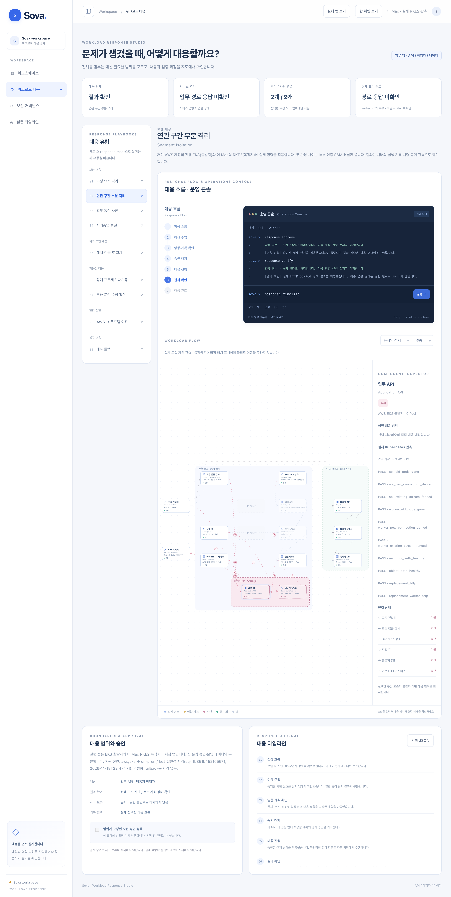

# Sova

[](docs/assets/workload-verification.md)

**실제 실행 화면:** 2026년 11월 13일, 실행 전용 EKS(출발지)와 이 Mac의 RKE2(목적지)에서 「연관 구간 부분 격리」를 운영 콘솔 명령으로 실제 실행하던 중 저장한 Sova 콘솔 전체 페이지입니다. 단계·지도·검사 결과는 서버가 관측한 실제 Kubernetes·HTTP·DB 값입니다. 당시 저장한 화면이며 현재 실시간 상태나 팀 운영 환경 이전·운영 T10 완료를 뜻하지 않습니다. [촬영 범위·출처](docs/assets/workload-verification.md)

운영 서비스의 환경 이전과 보안 대응을 **계획 → 승인 → 실행 → 실제 관측 → 검증**으로 연결하는 개발·통합 검증 저장소다. 제품 목표는 기능·데이터·보호 수준과 남은 의존성을 함께 확인하는 것이다. 범용 앱의 무중단 이전이나 기업 운영 자격을 이미 확보했다는 뜻은 아니다.

## 먼저 볼 문서

- [계약·방향별 자격 첫 구현](docs/contract-foundation.md): 새 CLI, 평가 API, 검증 범위와 다음 단계.
- [2026-11-14 개인 개발 기준](docs/adr/0001-contract-driven-foundation.md): 계약·능력 기반 통합 명세 1.1과 단계별 구현 순서. 기존 실검증 결과를 새 제품 전체 완료로 합산하지 않는다.

- [전체 문서 목차](docs/README.md): 목표 설계, 현재 실행 안내, 과거 검증을 구분한다.
- [워크로드 대응 실행기](docs/workload-response-runtime.md): 실제 RKE2와 실행 전용 EKS를 사용하는 9개 대응 유형, 명령·승인·서명 증거·보류·감사 보존.
- [명세 대비 추적표](docs/spec-traceability.md): 실환경·로컬·단위·미구현을 항목별로 구분한다.
- [제어면 구현 현황](docs/implementation-status.md): `src/sova`의 도메인·PostgreSQL·port/adapter 연결 상태.
- [프로덕션 목표 명세 v2](docs/sova-production-spec-v2.md): 목표 아키텍처. 구현·배포·검증 결과의 목록과는 다르다.

## 저장소와 책임

| 저장소·경로 | 역할 | 구분해야 할 점 |
|---|---|---|
| 이 저장소의 `src/sova` | 공통 그래프·계획·실행 원장·환경 어댑터·통합 코드 | 코드·구성 요소 시험과 운영 인수를 구분한다. |
| 이 저장소의 `demo` | 개인 시험 호스트·앱·클러스터 대응 실행기 | 개인 시험 승인은 팀 운영 승인이 아니다. |
| [sova-security](https://github.com/sangmu1126/security) | 공통 정책·보안 보류·서명 근거·읽기 전용 판정 서비스 | 승인 발급이나 클라우드 변경 권한을 제공하지 않는다. |
| [팀 platform](https://github.com/Softbank-Hackathon-Finals/platform) | 기존 팀 API·승인·실행·통합의 참조 구현 | 이 저장소의 시험 성공을 팀 제품 전체 완료로 옮기지 않는다. |

개인 계정의 포크와 팀 원본은 브랜치가 자동 동기화되지 않는다. 공개 `main`, 작업 브랜치, 검증한 코드 SHA와 실제 이미지 digest를 각각 확인한다. 이 문서의 대응 실행기는 `demo/local_response`가 있는 브랜치를 기준으로 한다. [문서 점검 기준](docs/documentation-review-2026-11-13.md)

초기 23개 커밋은 기존 로컬 작업물을 기능별로 나눠 재구성한 이력이다. 작성일은 기능별 파일의 최종 수정 시각을 사용했고 실제 Git 커밋 시각은 별도로 유지했다. 원래의 점진적 개발 이력을 복원한 것은 아니다.

## 실제 대응 경로와 한계

| 실행 경로 | 제공하는 것 | 검증·지원 경계 |
|---|---|---|
| `demo/local_response`, `local` | 이 Mac RKE2의 출발지·목적지·제어 영역에서 9개 유형 실행 | 같은 클러스터 안의 실제 시험이다. AWS 이전으로 표시하지 않는다. |
| 같은 실행기의 `hybrid-aws` | 실행 전용 개인 EKS → 이 Mac RKE2, 두 PostgreSQL·진입점 전환 | 등록한 경로의 제한된 stop-and-copy다. 2,000행 상한이며 CDC·무중단 자격이 아니다. |
| `demo/onprem_response` | 이전 무상태 시험앱의 격리·대체·재검증·복귀 | [2026-11-08 인수 범위](docs/workload-response-acceptance.md). 고객 앱 전체·일반 공격 탐지로 확대하지 않는다. |
| `demo/response_scenarios` 단독 서버 | 터미널 명령으로 진행하는 브라우저 시나리오 | 실제 실행 API가 없다. 실제 모드는 별도 `local_response.server`가 같은 UI 자산에 연결한다. |
| `console` | 초기 React·TypeScript·Vite 콘솔 | 최신 대응 Studio와 다른 진입점이다. [기존 콘솔 안내](console/README.md) |

9개 대응 유형은 구성 요소 격리, 연관 구간 부분 격리, 발신 차단, 자격 회전, 패치·검증 후 교체, 작업자 재기동, 수평 확장, 환경 이전, 이미지 롤백이다. 현재 명령은 제한된 전용 앱과 자원을 대상으로 한다. 공격 신호는 통제된 시험 입력이며 일반 사이버공격 자동 탐지나 모의해킹 결과가 아니다. 지도 이동은 관측을 표시하는 애니메이션이며 실제 패킷이나 VM의 물리적 이동을 뜻하지 않는다.

패치 경로의 통제된 앱 결함 수정, 이미지 digest 교체, 레지스트리 재스캔을 구분한다. ECR 시험에서 발견한 잔여 취약점은 해소됐다고 표시하지 않는다. 로컬의 미실행 스캔도 PASS로 바꾸지 않는다. AI·Harbor 전체 패칭 흐름과 운영 인수는 별도다.

과거 통과 횟수·지원 선언은 해당 코드·프로필·방향·기한에만 유효하다. 현재 서버 가동·자격·이미지 안전성은 과거 기록에서 추정하지 않는다.

## 안전한 로컬 시작

아래 배치는 두 저장소가 같은 상위 폴더에 있는 경우다.

```text
workspace/
├── security/
└── sova-test/       # 여기서 실행
```

Python 3.11 이상을 사용한다. 다음 명령은 패키지 설치와 오프라인 예제이며 클라우드 자원을 만들지 않는다.

```sh
python3 -m venv .local-notes/venv
.local-notes/venv/bin/python -m pip install -e ../security
.local-notes/venv/bin/python -m pip install -e '.[dev]'
.local-notes/venv/bin/sova example > .local-notes/example.json
.local-notes/venv/bin/sova inspect .local-notes/example.json
.local-notes/venv/bin/sova assess .local-notes/example.json \
  --target-environment customer-k3s --target-backend kubernetes
```

설치 전에 `pyproject.toml`의 `sova-security==0.11.1`과 사용할 Security 코드·산출물의 출처를 확인한다. [패키지 소비 계약](https://github.com/sangmu1126/security/blob/main/docs/distribution.md). `.local-notes`와 비밀값은 커밋하지 않는다. 예제는 단기 가상 등록이며 운영 승인·실제 배포 결과가 아니다. [입력 예제](examples/README.md)

실제 대응 실행기는 기존 소유 VM·클러스터 UID·namespace UID·고정 이미지·보호된 상태 등록이 필요하다. 일반 설치 명령만으로 새 PC에 준비되는 서비스가 아니다. 고정 대상을 다른 클러스터로 임의 치환하지 않는다. AWS 자원 생성·앱 쓰기 제한·역방향 데이터 복사·자원 삭제가 포함된 명령은 [실행 안내](docs/workload-response-runtime.md)의 대상과 영향을 먼저 확인한다.

## 구성

```text
src/sova/                 공통 제어면, 호스트 실행 상태와 어댑터
src/sova/security/        추출한 보안 모듈의 호환 import와 호스트 전용 연결
console/                 초기 React 운영 콘솔
demo/response_scenarios/  대응 Studio 자산·정적 시나리오·실제 모드 클라이언트
demo/local_response/     로컬·하이브리드 실행기, 원장·관측·보류·서명 증거
demo/onprem_response/    이전 온프렘 무상태 시험과 플랫폼 콘솔 연결
demo/audit_shipper/      허용한 증거의 외부 보관·WORM 시험
infra/                   시험 환경 IaC
integration/security/    Security 생산자 고정값·소비 계약
docs/                    설계·실행 안내·검증 기록
```

`src/sova/security`의 추출된 모듈은 설치한 `sova-security`를 재사용한다. 실제 승인·실행 원장과 어댑터 책임은 호스트에 남는다. [패키지·플랫폼 인계](docs/platform-security-handoff.md), [Harbor 담당 경계](docs/team-boundaries.md)

## 검증

전용 가상환경을 준비한 뒤 필요한 범위의 검사를 실행한다.

```sh
.local-notes/venv/bin/ruff check src tests demo
.local-notes/venv/bin/python -m pytest -q
node --test demo/response_scenarios/*.test.mjs
```

실제 PostgreSQL 시험은 별도 격리 DB와 `SOVA_TEST_POSTGRES_DSN`이 필요하다. 운영 DB를 지정하지 않는다. 실제 클러스터 시험은 별도 등록·권한·자원과 효과를 요구하며 기본 단위 시험으로 대체하지 않는다. [PostgreSQL 시험 조건](docs/postgres-execution.md)

Sky에서 확인한 동작, 팀 platform의 검증, 개인 대응 실행기의 검증을 합산하지 않는다. 실제 접속 주소·토큰·개인키·kubeconfig·DB·실행 상태는 공개 문서나 저장소에 올리지 않는다.
