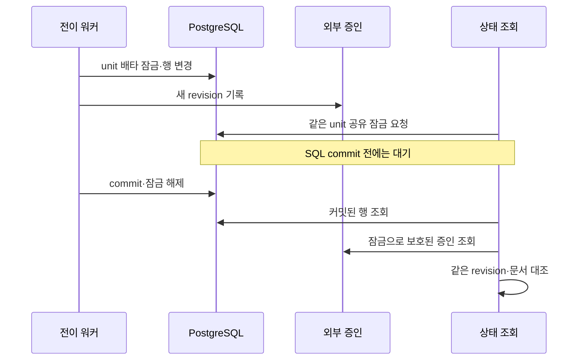

# 복구 상태 조회와 증인 기록의 동시성

2026-11-19 · 개인 개발 브랜치 `feature/migration-request-qualification`.

## 문제와 변경

직전 HTTPS 부하 시험은 복구 후 상태 조회의 HTTP 500·증인 불일치 거부·완료 시간 초과를 남겼다. 이번 변경은 이 오류를 재시도로 숨기는 대신, 아래 두 경합을 독립적으로 재현하고 수정한다. 과거 각 실행의 원인이 모두 같았다고 소급해서 단정하지 않는다.

| 경계 | 이전 동작 | 수정 |
|---|---|---|
| DB 전이와 외부 증인 | 증인이 먼저 갱신되고 SQL이 아직 커밋되지 않은 순간, 조회가 이전 행과 새 증인을 비교 | tenant·app·unit별 transaction advisory lock. 조회는 공유 잠금, 전이·복구는 배타 잠금 |
| 최초 생성 행 | 행 잠금만으로는 아직 보이지 않는 행을 보호할 수 없음 | 행 유무와 관계없이 동일 unit 잠금을 먼저 획득 |
| 로컬 파일 기록 | 객체별 thread lock만 있어 서로 다른 객체·프로세스가 같은 체인을 동시에 갱신 | 같은 파일 descriptor의 POSIX `flock`으로 기록은 배타, 조회는 공유 잠금 |
| 손상·부분 기록 | JSON 파싱이나 자료형 오류가 예외 메시지로 빠질 수 있음 | 완성된 줄·레코드 구조·체인 검사, 손상은 `ContractError`로 거부 |

잠금 키는 구조화한 범위를 canonical JSON으로 직렬화한다. 문자열 접합의 구분자 모호성을 피하며 PostgreSQL hash 충돌은 불필요한 대기로만 이어지고 권한을 넓히지 않는다. DB 잠금은 transaction 종료·연결 해제 시 풀린다. 외부 증인을 SQL DB 안으로 옮기지 않았다.

## 유지하는 안전 조건

- 실제 DB 복원 또는 증인 기록 후 SQL rollback이면 조회·전이를 계속 거부한다.
- 이 경우 명시적 복구를 거쳐 epoch와 revision을 높인다. 증인을 덮어쓰거나 거부를 무시하지 않는다.
- lease 만료만으로 살아 있는 워커를 대체하지 않는다. 권한 없는 Pod 조회도 정지 증거가 아니다.
- 판정·증거 만료·쓰기 fencing·원본 및 목적지 승인·도메인 상태 전이는 변경하지 않았다.

## 실제 실행 결과

최종 하네스 `04eeac02acdf66cdc97837b8b792be371d94741c`에서 아래 세 경우를 독립 실행했다. 제품 이미지와 계약·권한·기한은 고정했다.

| 경우 | 실제 결과 | 최초 HTTP·통신 실패 | 데이터·완료 |
|---|---|---:|---|
| 목적지 후속 기동 | 시험 DB 연결 2초 시간 초과, 업무 부하 시작 전 중단 | 미측정 | 전체 비교 인수 실패 |
| 목적지 사전 준비·부하 후 복구 | HANDOFF_COMPLETE·새 경로 확인 | 23/100 | 독립 SQL 103/103 확인, 최대 부하 주문 완료 20.383초 |
| 목적지 사전 준비·제한 재시도 | HANDOFF_COMPLETE·새 경로 확인 | 2/100 | 호출 내 확인 98·횟수 소진 2, 후속 복구 후 독립 SQL 103/103, 최대 완료 28.426초 |

두 완료 실행 모두 살아 있는 소유자의 lease 만료만으로 복구하지 않았고, 실제 SA의 Secret 조회·권한 없는 Pod 조회는 403으로 거부했다. 실제 Pod 종료 후 후속 워커가 효과를 조회해 이어갔으며 경로 PATCH는 한 번이었다. 기존 주문 50건과 새 주문·확인 요청을 보존했다. 잘못된 CA·호스트명도 거부됐다.

**위 실행에서 전체 3종 비교와 모든 요청의 기한 내 완료는 미통과였다.** 제한 재시도에서 2건은 8회 한도에 도달했다. 최종 데이터가 맞아도 이 두 호출을 기한 내 성공으로 바꾸지 않는다. 단일 closed-loop 실행이므로 23건과 2건을 일반적인 개선율로 제시하지 않는다. 후속 기동 경로의 시작 실패 원인은 더 조사해야 하며, 과거 500 오류의 전체 원인이 해결됐다고 단정하지 않는다.

## 검증과 제한

실제 PostgreSQL의 미커밋 구간에 워커를 멈추고, 독립 조회의 backend가 `Lock`을 기다리는지 검사한다. 기존 행과 최초 생성 행을 각각 확인한다. 별도 프로세스의 파일 append 경합과 부분 기록 중 조회도 검증한다. 기존 실패 결과는 보존한다.

파일 backend는 **POSIX 로컬 파일 잠금을 제공하는 환경**으로 제한한다. 미지원 플랫폼에서 thread lock만으로 조용히 대체하지 않는다. 이 잠금은 WORM·파일 교체 방지·서명·tail 삭제 탐지·여러 호스트의 합의 알고리즘을 제공하지 않는다. 실제 배치의 공유 파일시스템에서도 같은 보장이 생기는지는 해당 경로의 시험이 필요하다.

SQL과 외부 증인은 여전히 서로 다른 저장소다. 증인 append 뒤 DB commit이 실패하면 정상 진행으로 추정하지 않고 복구를 요구한다. 장기 transaction에 대한 배치별 query/lock timeout과 연결 풀 운영 기준도 별도로 필요하다. 이 변경만으로 운영 가용성 SLO나 무중단 자격을 발급하지 않는다.

[개발 기록](development/authority-read-concurrency-2026-11-19.md) · [검증 증거](evidence/authority-read-concurrency-20261119.json).

## 준비 순서 후속 검증

[시험 DB 준비와 클러스터 기동 순서](database-bootstrap-order.md)에서 실제 버전 관측을 앞당긴 뒤 세 경로를 다시 검증했다. 새 결과와 남은 최초 실패·한도 소진은 해당 문서에 별도로 기록한다. 위 실행의 실패·수치는 유지한다.
