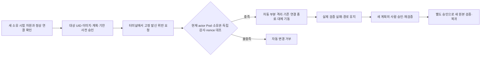

# 전용 시험의 사전 승인 자동 격리

범위: **2026-11-08 `demo/onprem_response`의 전용 무상태 시험**. 최신 9개 대응 실행기는 [별도 실행 안내](workload-response-runtime.md)를 따른다. 이 문서의 사전 승인 자동 격리를 최신 실행기의 모든 대응 유형에 적용한 것으로 해석하지 않는다.

## 승인과 실행 시점

기존 수동 대응은 위반을 관측한 뒤 격리 계획을 승인한다. 새 opt-in 경로는 시험 자원을 준비한 다음 **위반 주입 전에** 정확한 자동 대응 정책을 승인한다. 고정된 발신 위반을 확인하면 다시 승인을 기다리지 않고 기존 효과 원장으로 격리·fencing·대체 기동을 실행한다. 수동 경로는 유지한다.

## 자동 실행이 가능한 조건

- 생성한 시험의 namespace UID, 선택 집합(API 또는 API+작업자), 원본 Pod UID, 앱·이미지·불변 설정·응답 계획을 먼저 고정한다.
- 정책은 해당 시험의 남은 수명 안에서 사건 한 번에만 유효하다. 승인 메시지의 짧은 전달 유효시간과 소비한 정책의 유효기간을 구분한다.
- 터미널 요청은 실행 중인 원본 API가 고정 이웃 서비스의 보호 경로로 보내는 요청이다. 이웃의 실제 403, 독립 감사의 actor IP, Kubernetes의 현재 Pod UID와 ReplicaSet·Deployment 소유권, 요청 nonce를 기존 시험기가 대조한다.
- 정책 활성화 이후 발생한 30초 이내의 관측만 받는다. 일반 외부 요청의 403, 앱이 반환한 임의 문자열, 일반 탐지 webhook은 이 정책의 입력이 아니다.
- 격리 직전에 실제 자원·이미지·설정을 다시 검사한다. 계획을 다시 컴파일해 승인 범위를 넓히지 않는다.
- 명령마다 정책 기한과 철회를 재검사한다. 기존 `EffectExecutor`와 효과 원장을 사용하고, 불명확한 효과는 자동 재실행하지 않는다. 단일 dispatch intent도 배타적으로 생성한다.

## 사람 승인을 유지하는 동작

정책은 첫 격리·fencing·대체 기동과 고정된 실패 검증 시험만 승인한다. 실패 원인 해소·재검증·대체 경로 전환과 원본 복귀는 각각 새 계획의 명시적 승인이 필요하다. 사건 보류 해제, DB·큐·파일·공유 자원 변경, 일반 고객 앱 대응은 포함하지 않는다.

`자동 대응 철회·시험 종료·자원 정리`는 이 시험의 자동 실행을 중지한다. 실행기가 이미 전송한 외부 요청을 되돌리거나 취소했다고 주장하지 않는다. 다음 명령 직전에 철회를 검사하고 소유 시험 namespace의 UID를 확인해 정리한다. 현재 시험 정리는 고객 서비스의 격리 해제 계약이 아니다.

## 화면과 실행 경로

1. 기존 `IncidentSupervisor`를 상속한 `AutoIncidentSupervisor`를 opt-in 주입한다. 기존 인증·Origin·CSRF·본문 크기 제한을 그대로 사용하며 새 운영 권한을 만들지 않는다.
2. 시험 준비 후 정책의 대상·동작·이미지·기한을 확인하고 `자동 격리 정책 사전 승인·활성화`를 누른다.
3. 표시된 고정 터미널 명령으로 요청한다. 추가 격리 승인 없이 실제 차단·연결 종료·대체 기동 결과가 지도에 반영된다.
4. `시험 만료까지`는 실행 대기시간이 아니다. 만료를 기다려 자동 승인되는 일은 없다.
5. 재검증·복귀는 화면의 별도 승인을 사용한다.

## 검증과 한계

로컬 회귀 시험은 프로토콜·권한·실패 경계를 확인하며 클러스터 격리 증거를 대신하지 않는다. 실제 자원 시험의 생산자 SHA와 완료 여부는 개발 기록에 별도로 남긴다.

이 경로는 새로 만든 무상태 전용 fixture의 **통제된 발신 위반에 대한 자동 대응**이다. 일반 사이버공격·침해 탐지, 실제 채팅 앱의 자동 격리, AWS→온프렘 앱·DB 이전 완료, 기업 인증·금융 규제 준수를 주장하지 않는다. 실제 제품은 기존 T33 탐지·T10 승인·T19 판정·T31/T12 실행 경로의 별도 인수가 필요하다.
