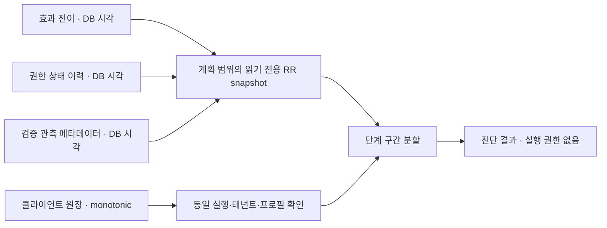

# 전환 구간의 실제 원장 시각과 클라이언트 완료 측정

2026-11-19 · 로컬 offline-copy qualification의 읽기 전용 진단.

## 측정하는 문제

직전 조회 backpressure 비교에서, 같은 수정 이미지의 두 경로 모두 100건 중 99건만 호출 안에 완료되고 1건은 한도를 소진했다. 조회 안내를 추가한 것만으로 5초 목표는 달성되지 않았다. 다음 변경을 고르기 전에 제어면의 어떤 구간이 시간을 쓰는지 실제 기록으로 분리한다.

제품·승인·fencing·검증 순서·DB 연결 및 재시도 제한·이미지는 변경하지 않는다. 실제 effect_events와 authority history, 현재 계획에 묶인 검증 관측의 저장 시각을 읽고 클라이언트 원장의 실행 범위를 확인한다.

## 기록과 범위 연결

- tenant·application·unit·plan·operation이 실제 admission 응답과 같은 행만 선택한다. tenant RLS와 명시적인 앱·작업 필터를 함께 적용한다.
- 동결 계획의 canonical SHA-256과 내부 tenant·service·unit을 대조한다. 현재 지원하는 9단계 offline-copy 형태를 벗어나면 거부한다.
- DB 트랜잭션은 실제 `REPEATABLE READ`와 `READ ONLY`를 사용한다. 서로 다른 읽기 시점의 상태·효과·증거가 섞이지 않도록 한다.
- 효과 7개의 prepared→in_flight→confirmed_applied 총 21건과 authority 이력 10건을 요구한다. 누락·중복·unknown·뒤집힌 시각은 완료된 측정으로 처리하지 않는다.
- 검증 관측은 현재 계획의 revisions·obligation scope가 같고 현재 authority 시작 이후 저장된 서명 envelope의 참조만 읽는다. 동일 body digest를 여러 obligation이 참조해도 각 서명 시각은 유지한다. 관측 본문·명령 인자·승인 문서·token·DSN·개인 키는 내보내지 않는다.
- SQLite 원장은 읽기 전용으로 열고 정확한 run·tenant·profile을 대조한다. 최종 reconciliation의 scope와 모드도 확인한다. 다른 실행의 같은 request ID를 가져오지 않는다.

서명 envelope를 조회하는 것과 서명을 인증하는 것은 다르다. 이 exporter는 현재 issuer 권한·서명을 다시 인증하거나 승인·게이트 통과를 발급하지 않는다. 진단 호출자는 테스트 하네스의 신뢰된 내부 코드이며 운영자용 인증 API가 아니다.

검증 참조의 범위·시각 일치는 실행 단계별 signature가 오직 그 워커에서 생성됐다는 인증을 뜻하지 않는다. 해당 metadata는 구간의 문맥이며, 21개 효과 전이와 10개 authority 이력의 실제 작업 결속과 구분한다.

## 구간의 의미

| 측정 구간 | 포함하는 시간 | 해당하지 않는 의미 |
|---|---|---|
| reserve→dispatch | 준비 전이 저장 이후 dispatch 전이까지 | 순수 DB 쿼리 시간 |
| dispatch→confirmation | dispatch 기록 이후 효과 확인 저장까지 | 순수 클라우드 API 또는 SQL 실행 시간 |
| 이전 confirmation→다음 prepare | 검증·서명/저장·authority 갱신·lease·다음 준비 등 | 한 검증 함수의 실행 시간 |
| pause prepare→route confirmation | 위 세 구간으로 분할하는 제어면 전환 envelope | 최종 사용자의 정확한 중단 시간 |
| 클라이언트 elapsed | 동일 클라이언트 monotonic 도메인의 호출 완료 시간 | 다른 프로세스의 DB 시각을 뺀 값 |

DB의 `recorded_at`은 행 기록 시각이며 commit timestamp가 아니다. source 쓰기 차단이나 라우팅의 실제 효력이 생긴 순간과 완전히 같다고 가정하지 않는다. pause 이전 stage_target은 전환 envelope의 합계에서 제외한다. 플랫폼 단계처럼 별도 adapter 효과가 없는 작업은 앞뒤 효과 사이 구간에 포함된다.

단계 합계는 전체 DB envelope와 일치해야 한다. 서로 다른 clock을 직접 빼서 소요 시간을 만들지 않는다. 클라이언트의 CONFIRMED·EXHAUSTED·REJECTED와 최초 503·통신 오류는 별도로 유지한다. **측정 complete는 업무 완료 한도 충족이 아니다.**

## 검증과 다음 변경 조건

단위 시험은 시각 역전·시간대 누락·효과/이력 누락·중복 요청·미완료 부하·다른 실행 원장의 거부를 확인한다. 실제 TLS DB와 API 시험은 계획 범위 연결과 읽기 전용 관측, 다른 tenant·app·operation 거부, 참조되지 않은 민감 관측 본문 비노출을 확인한다. 실제 CLI Pod·HTTPS·SQL 전환에서 같은 수집을 수행한다.

진단은 실행이 끝난 뒤 수행하므로 관측하려는 source 봉쇄 구간에 새 SQL 조회를 추가하지 않는다. 수집 실패는 측정 불완전으로 기록하며 기존 실행 상태를 바꾸지 않는다. 정상 시험에서는 측정 완전성도 요구한다. 원문 파일을 덮어쓰거나 빠진 값을 0으로 채우지 않는다.

결과를 근거로 사전 준비 가능한 작업과 봉쇄 뒤 반드시 수행할 검증을 구분한다. 단일 구간을 오래 쓴다는 이유만으로 검사를 제거·병렬화·앞선 증거로 대체하지 않는다. 내구성 대기를 추가한다면 접수와 커밋 완료·취소·만료·멱등성 계약부터 구분한다. 현재 5초·8회 기준은 그대로 유지한다.

로컬 단일 kind 노드·전용 PG 서버의 별도 DB, 합성 계획·IdP·일부 신뢰 입력·로컬 witness의 한계가 남는다. AWS→독립 온프렘·운영 SLO·WORM·금융 보안 인증을 발급하지 않는다.

[개발 기록](development/cutover-critical-path-2026-11-19.md) · [실측 증거](evidence/cutover-critical-path-20261119.json) · [직전 backpressure 비교](lookup-backpressure.md).
