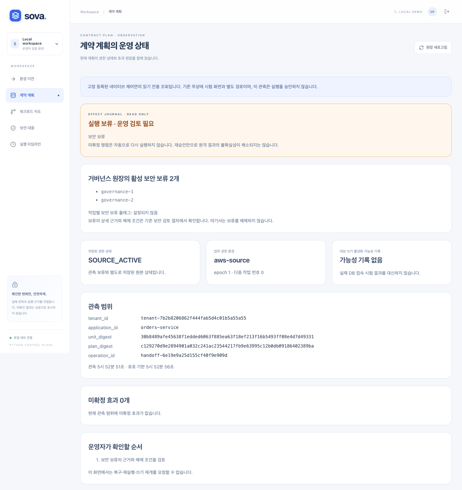
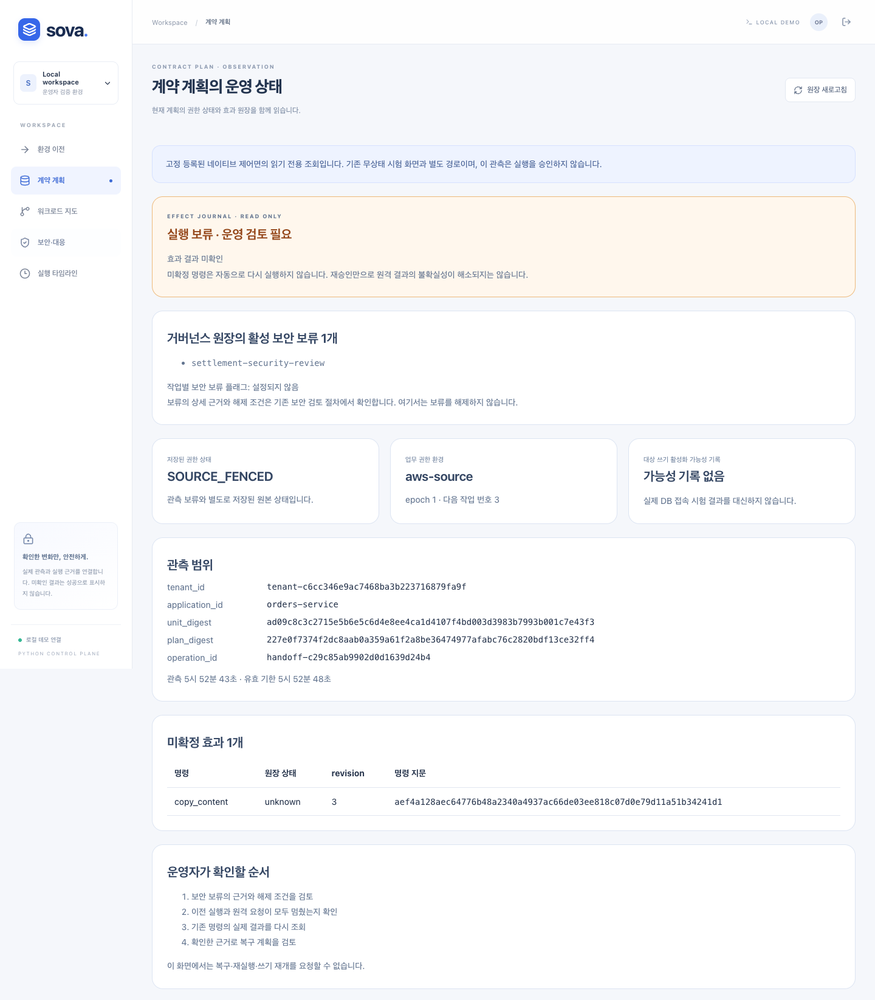

# 2026-11-19 · 거버넌스 보류와 복구 상태의 연결

## 결과와 범위

계약 계획 화면이 앱의 거버넌스 원장에 열린 보안 보류를 표시하도록 보완했다.
직전 v1은 operation의 `security_hold` 플래그만 읽었으므로, 별도 원장에 열린 보류가
있어도 그 보류는 화면의 관측 범위에 포함되지 않았다.
기존 실행기의 보안 차단 규칙은 유지했으며, 이번 변경은 읽기 전용 관측을 보완한다.

| 상황 | 현재 표시 |
| --- | --- |
| 효과 없음, operation 플래그 false, 거버넌스 보류 2개 | SECURITY_HOLD + 활성 보류 2개 + 보안 검토 안내 |
| 2개 중 1개 해제 | 남은 보류 1개, required 유지 |
| 마지막 보류 해제 | 활성 보류 0개. 다른 보류 사유가 없으면 clear |
| UNKNOWN 효과 + 활성 보안 보류 | UNKNOWN 주 사유와 활성 보안 보류를 함께 표시 |
| 작업이 없거나 모호함 | unavailable, operation 플래그 null·화면 미확인 |
| 다른 tenant·app의 보류 | 현재 앱의 보류 개수·ID에 포함하지 않음 |
| 손상된 문서·범위 불일치·활성 보류 257개 | 조회 거부. 정상 빈 목록으로 표시하지 않음 |

생성·해제는 기존 `PostgresSecurityHolds`와 도메인 규칙으로 수행한 **격리 로컬
fixture**다. 해제 승인과 증거도 fixture이며 기업의 실제 승인 인수를 완료한 것은 아니다.
UI에는 보류 해제·재실행·승인 버튼을 추가하지 않았다.

## 구현

- 권한 원장은 기존 공유 lock과 외부 witness로 확인한다.
- 현재 계획의 operation·효과·실행권과 앱의 최신 활성 보류를 한 SQL 스냅샷으로 읽는다.
- 기존 보류 문서 검증기로 해시·tenant·app·ID·revision을 확인한다. 별도 보류 도구를 만들지 않았다.
- 응답에는 활성 보류 개수·ID·operation 플래그만 포함한다. reason·actor·release 문서는 전달하지 않는다.
- 보안 보류만 있으면 `REVIEW_SECURITY_HOLD`를 안내한다. UNKNOWN 등이 함께 있으면 기존 복구 확인 순서를 이어서 안내한다.
- 관측 형식은 `handoff-recovery-status-v2`다. v1 또는 보류 정보 누락을 거부한다.
- API·브리지·콘솔을 함께 갱신한다. 형식이 맞지 않으면 조회 미확인으로 남긴다.
- 워커·효과 변경·권한·DB 스키마·보안 패키지는 변경하지 않았다.

## 기준 SHA와 변경 단위

기준은 개인 브랜치의 `e7edac218b8c4e9a51cd6a2a3810cf79f3ede409`다.

| 커밋 | 내용 |
| --- | --- |
| `6019c33` | 거버넌스 보류 SQL·기존 검증기 연결, v2 관측 |
| `3ebadc1` | 브리지·콘솔의 활성 보류 표시와 검토 순서 |
| `5420d90` | 보류 생성·해제, UNKNOWN 동시 표시의 실제 인수 시험 |
| `7b68887` | 모호한 작업의 플래그를 false 대신 null로 보존 |
| `a4970a8` | 누락·중복·개수·nullable 플래그의 거부 시험 |
| `e91816f` | 시험의 문서 해시 import를 실제 보안 패키지 경로로 수정 |

실제 DB·브라우저 최종 시험은 `e91816f4abd29290f80dcb561fa9db1e6244998e`에서 수행했다.
서비스 회귀는 `a4970a870955cdad4fa63fc9ef8ee37cdc187509`에서 수행했다.
두 커밋 사이에는 시험 import만 바뀌었다. 최종 native 측정 소스 325개와 서비스
측정 소스 39개의 해시를 현재 파일과 대조했다.

security 생산자는 `27e6e85514a7cbb3e43d216464b72d9bd78f3fcf`이며,
PostgreSQL은 기존 고정 arm64 17.12 이미지를 사용했다.
제품 이미지를 새로 빌드하거나 운영에 배포하지 않았다.

## 검증

| 묶음 | 결과 | 확인 내용 |
| --- | --- | --- |
| 실제 PostgreSQL·프로세스·브라우저 | 11 PASS | 보류 생성·단일/전체 해제, UNKNOWN 동시 표시, 손상·다른 범위·상한 초과 거부, 기존 워커 종료 |
| 기존 서비스 회귀 | 78 PASS | 인증·등록·계획·승인·이전·별도 승인 복귀 |
| 로컬 경계 | 62 PASS | v1/누락/중복/잘못된 개수/거짓 clear 거부, 자격 파일·운영자 인증 |
| 콘솔 | 53 PASS | 보류와 확인 순서, UNKNOWN, 미확인 플래그, 기존 화면 |
| 타입·빌드·형식·Ruff | PASS | TypeScript·Vite·Prettier 및 변경 Python 정적 검사 |

실제 Chromium에서 보류 2개·해제 후 0개·UNKNOWN과 보류 1개·정상 완료를 각각 확인했다.
각 화면에서 상태 변경 요청 0건, 페이지 오류 0건이었다. 1440px·390px에서 문서
가로 넘침도 없었다. 원본 JSON에는 생성 전 0개·열린 2개·모두 해제한 0개를 보존한다.
단일 해제 후 1개가 남는지는 같은 실행의 실제 API 응답 assertion으로 검증했다.

최초 native 실행은 시험 모듈 import 오류로 수집 단계에서 중단됐다. 호환 별칭에
없는 모듈을 참조한 문제로, 실제 `sova_security` 경로로 수정했다. 제품 코드·DB grant는
이 수정에서 바꾸지 않았다. 실패 로그·JUnit·실행 메타데이터를 보존했다.

DB/호스트 시각 감시는 실패 실행 4개, 최종 native 156개, 서비스 282개 표본에서
통과했다. 정확히 이번 실행이 만든 컨테이너·네트워크 6개는 정리 후 별도 inspect로
존재하지 않음을 확인했다. 실제 시험 동안만 `caffeinate -di`를 사용했다.

원본은 `local-dev-records/governance-recovery-20261119/`에 있으며
[증거 JSON](../evidence/governance-recovery-status-20261119.json)에 실행·소스·화면의
해시와 공개 가능한 결과를 모았다. JWT·개인 키·보류 상세 원문은 포함하지 않는다.

## 실제 화면

로컬 실제 PostgreSQL·native API를 읽은 과거 캡처다. `aws-source`는 합성 등록의
환경 ID이며 실제 AWS 이전을 뜻하지 않는다. 운영자·IdP·등록·신뢰도 fixture다.

[보류 2개 모바일](../assets/governance-recovery-status-20261119/held-mobile.png) ·
[모두 해제한 화면](../assets/governance-recovery-status-20261119/released-desktop.png) ·
[해제 후 모바일](../assets/governance-recovery-status-20261119/released-mobile.png)

[UNKNOWN·보류 모바일](../assets/governance-recovery-status-20261119/unknown-mobile.png)

## 운영 인수와 병행 작업

다른 세션의 `feature/contract-driven-foundation`은 `e3df972b38f14a446699621c0702b277519c1e07`로
작업 트리가 깨끗했으며 변경 파일 중복이 없었다. 해당 세션의 코드나 작업 트리는 수정하지 않았다.

이 결과는 관측 경로의 로컬 인수다. 기존 인증·승인·실행 차단을 대체하지 않는다.
실제 기업 신원과 해제 승인, 원격 TLS·운영 배포, 감사 보존·알림, 인증된 원격
정지 증명과 복구 runbook은 별도 운영 인수가 필요하다. 무중단·금융 보안 자격은 발급하지 않았다.
