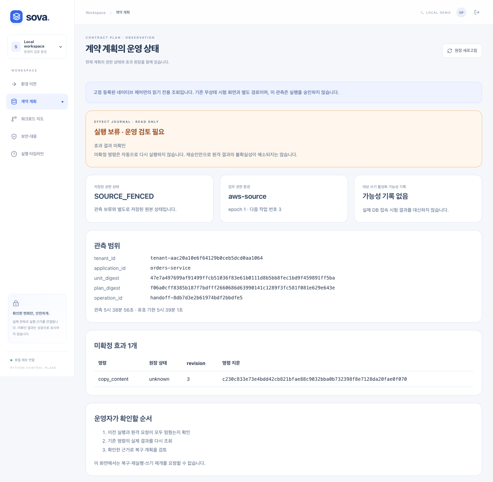

# 2026-11-19 · UNKNOWN 효과와 운영 보류의 읽기 전용 연결

## 결과

실제 격리 PostgreSQL에서 워커 종료 이후의 효과 원장을 기존 native API와
로컬 React 콘솔까지 연결했다. 권한 상태와 효과 보류는 별도로 표시한다.
개인 qualification worktree에서 개발했고 팀 저장소·공유 클러스터는 변경하지 않았다.

| 경우 | 실제 확인한 결과 | API·화면 |
| --- | --- | --- |
| copy 커밋 후 응답이 남은 상태에서 SIGKILL | 원격 요청 잔존 중 복구 거부. 요청 정지 후 기존 명령 readback 1회, copy 재발행 0회. 원본 각 51행·대상 각 53행 | 최종 HANDOFF_COMPLETE, 관측 보류 없음 |
| copy 미커밋 중 SIGKILL | 원격 요청 잔존 중 복구 거부. 정지 후 readback 결과 unknown 유지. 원본 각 51행·대상 각 0행, 기존 50개 관계 보존 | 저장 상태 SOURCE_FENCED 유지 + EFFECT_RESULT_UNKNOWN 보류 |

두 경우 모두 계획과 다른 tenant의 JWT를 거부했다. 브리지 자격 파일을 다른
tenant의 자격으로 교체한 뒤에도 이전 성공 결과를 반환하지 않았다.
운영자·IdP·등록·신뢰 부트스트랩과 원격 정지 증명 생산자는 **로컬 시험용**이다.
실제 Kubernetes/provider의 인증된 정지 증명을 발급한 것은 아니다.

## 변경과 기준

기준: `95239fe029c436b16b81e45d29fd904f01623d0e`.
기능 커밋은 다음과 같이 분리했다.

| 커밋 | 내용 |
| --- | --- |
| `f92cce2` | 현재 계획의 권한·효과·실행권을 읽는 상태 projection |
| `2d187f7` | 고정 scope GET 브리지, 서버 측 자격 보관, 경계 시험 |
| `2dd429f` | 기존 UI를 유지한 별도 계약 계획 화면 |
| `7906717` | 기존 시험의 시각 비교 및 보호된 fixture 컬럼 준비 수정 |
| `1634748` | 실제 API·콘솔·Chromium 데스크톱/모바일 검증 |
| `796ae0c` | 모바일 표 가독성 수정과 실제 행 높이 검사 |

최종 브라우저 검증 코드: `796ae0c75cb9d610528733b8b1af15dd88a9d195`.
기존 서비스 회귀 78개는 `1634748cfab8488cdc67ed8764b0ae7bc16fa2ef`에서 확인했다.
그 이후 제품 Python 코드는 바뀌지 않았으며, 최종 native 실행의 측정 소스
325개 해시를 작업 트리와 다시 대조했다.

- security 생산자: `27e6e85514a7cbb3e43d216464b72d9bd78f3fcf`
- PostgreSQL 17.12 arm64: `sha256:0d938e975177bef9f1f61f3f9dbcf2e0aa0a139568f66d3415ed8892eb97f6ac`
- 실제 브라우저: Chromium `156.0.8078.4`, 시험 드라이버 playwright-core `1.56.1`
- 제품 의존성 추가 없음. 시험 드라이버는 별도 개인 `.local-deps`에 고정했다.
- API 프로세스는 소스에서 실행했다. 제품 이미지를 새로 빌드·배포한 것이 아니다.

## 검증 결과

| 검증 묶음 | 결과 | 범위 |
| --- | --- | --- |
| 로컬 Python 경계 | 51 PASS | 보류 분류·scope/기한·파일 권한·비밀 비노출·인증·POST 차단 |
| 기존 실제 서비스 회귀 | 78 PASS | 인증·등록·계획·승인·이전·별도 승인 복귀 |
| 최종 실제 DB/프로세스/브라우저 | 7 PASS | 원격 요청 잔존, 두 종료 결과, 기존 워커 회귀 2개, 상태 조회 3개 |
| React/Vitest | 50 PASS | 기존 콘솔 포함, 새 보류 표시·만료·중복·실행 플래그·XSS 거부 |
| TypeScript·Vite·Prettier·Ruff | PASS | 빌드·타입·형식·정적 검사 |

실제 브라우저는 각 종료 결과마다 native API에 GET을 보냈다. 상태를 바꾸는 요청과
페이지 오류는 모두 0건이다. 1440px 및 390px 화면에서 문서 가로 넘침이 없었다.
미확정 효과가 있는 모바일 표의 최종 행 높이는 46px이다.
화면을 직접 확인해 긴 지문이 한 글자씩 줄 바뀌면서 행이 늘어나는 문제를 고쳤다.

DB/호스트 시각 감시는 최초 native 85개, 첫 브라우저 112개, 최종 브라우저 93개,
최종 서비스 252개 표본에서 통과했다. 첫 서비스 실패 실행도 시각 감시는 통과했다.
각 실행은 고유 DB 컨테이너와 네트워크만 사용했다. 5회 실행에서 생긴 정확한
10개 자원은 종료 후 별도 inspect로 존재하지 않음을 확인했다. 브라우저·콘솔·API
프로세스도 시험 종료 경로에서 닫았다. 실제 시험 동안만 `caffeinate -di`를 사용했다.

## 보존한 실패와 수정 이유

실패를 삭제하거나 재시도만으로 통과시키지 않았다.

1. 첫 native 실행은 **6 PASS / 1 FAIL**이었다. 보안 보류 플래그를 준비하는
   시험 코드가 런타임에 허용되지 않은 직접 UPDATE를 시도했다. 소유한 시험
   DB의 migration owner로 fixture를 준비하도록 바꿨고 런타임 grant는 넓히지 않았다.
2. 첫 서비스 실행은 **77 PASS / 1 FAIL**이었다. 이미 완료된 복귀를 다시 조회할 때
   새 관측 시각까지 같아야 한다는 기존 전체 dict 비교가 실패했다. 관측 시각만
   비교에서 제외하고 권한·history·scope·복구 내용은 계속 같아야 한다고 검사한다.
3. 첫 브라우저 실행 7개는 통과했지만, 스크린샷의 모바일 표 행이 지나치게 높았다.
   표 내부 가로 스크롤로 바꾸고 행 높이 검사를 추가한 뒤 최종 7개를 다시 통과했다.

원본은 `local-dev-records/recovery-status-20261119/`와
`local-dev-records/recovery-status-service-20261119/`에 남겼다.
[증거 JSON](../evidence/recovery-status-20261119.json)에 실행·기준 SHA·원본 해시와
공개해도 되는 결과만 모았다. JWT·개인 키·원본 명령 파라미터는 공개 문서에 넣지 않는다.

## 실제 화면

아래는 **로컬 실제 PostgreSQL·프로세스 시험의 브라우저 관측**이다.
`aws-source`는 합성 등록의 환경 ID이며, 이 캡처가 실제 AWS 배포·이전을 뜻하지 않는다.
표시된 시각은 해당 실행의 과거 관측이고 현재 운영 상태가 아니다.

[모바일 캡처](../assets/recovery-status-20261119/uncommitted-mobile.png) ·
[커밋 확인 후 완료 화면](../assets/recovery-status-20261119/committed-desktop.png) ·
[커밋 확인 후 모바일 화면](../assets/recovery-status-20261119/committed-mobile.png)

## 충돌 점검과 남은 운영 작업

다른 세션의 `feature/contract-driven-foundation`에서 워커·볼륨 종료 처리가
`e3df972b38f14a446699621c0702b277519c1e07`까지 진행된 것을 읽기 전용으로 확인했다.
해당 세션의 작업 트리는 수정하지 않았고 이번 변경 경로와 중복이 없었다.
그 변경을 소비하거나 통합 검증한 것으로 기록하지 않는다.

이 관측은 실행 허가, 전체 거버넌스 PASS, 무중단 또는 금융 보안 인증이 아니다.
운영 전에는 인증된 원격 정지 증명, 실제 사용자 위임·전송·배포 경로, 감사·보존·
알림과 복구 runbook을 별도 인수해야 한다. 원격 요청이 끝났는지 모르면 계속 보류한다.
조회가 장애를 복구하거나 원본 쓰기를 자동으로 다시 열지는 않는다.
