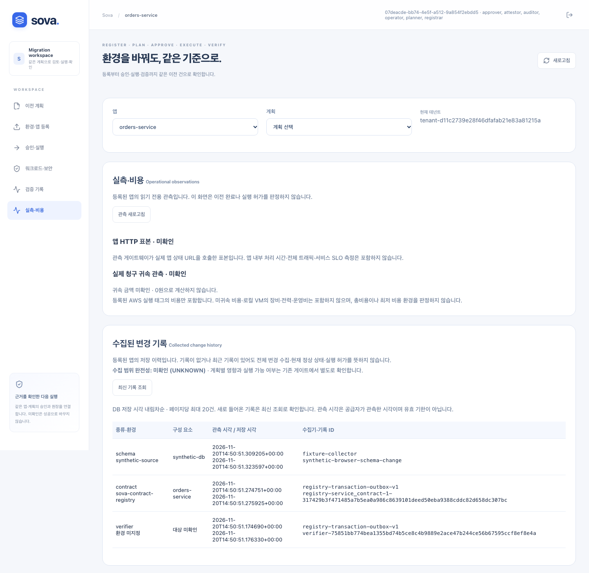

# 앱별 변경 수집 이력 → API → 콘솔

2026-11-20 개인 개발 기록. 실제 서비스 이전 완료 보고가 아니다.

**11/21 후속:** 남아 있던 이전 회귀의 원인과 수정은 [신뢰 grant 순환 차단 복구](verifier-grant-recovery-2026-11-21.md)에 기록했다. 아래의 실패 수치·최초 진단은 당시 기록이며, 단순 준비 순서만의 문제라는 해석은 후속 조사로 보완됐다.

## 변경 이유와 범위

개인 AWS·VM에서 수집한 변경은 이미 native PostgreSQL 원장에 저장할 수 있다. 그러나 기존 사용자 화면에는 HTTP 표본·비용만 연결돼 있었고, 앱에 귀속된 변경 이력을 조회하는 경로가 없었다. 저장 이력과 변경 수집의 완전성을 구분하는 조회 API와 콘솔을 추가했다.

- 기준: `c9f3d08dc2fe0325e5c523d73edb38ebbcc48c39`.
- 서버: `7683f17` — 등록된 앱, 인증된 tenant, auditor 역할을 확인한 뒤 해당 앱 기록만 조회한다.
- 콘솔: `44bd351` — 실측·비용 메뉴에 수집된 변경 기록을 표시한다.
- 실제 브라우저 시험: `278f531` — 임시 Keycloak·PKCE 로그인, native API, 실제 PostgreSQL, 콘솔 표시와 로그아웃을 연결한다.
- 다른 개인 작업 트리의 기준은 `93704d8`이며, 확인 당시 변경 중인 파일은 없었다. 별도 브랜치와 경로에서 작업했다. 이 확인은 다른 세션의 잠금이나 동의로 간주하지 않는다.

## 읽기 계약

`GET /v1/tenants/{tenant}/applications/{application}/change-history?after=...`

| 항목 | 동작 |
| --- | --- |
| 범위 | 정확한 tenant·앱에 직접 귀속된 기록만 반환. 공유 환경에 있다는 이유로 다른 앱 기록을 반환하지 않음 |
| 권한 | auditor 필수. 다른 tenant·권한 없는 사용자·미인증 요청은 거부 |
| 등록 | 해당 앱의 service contract가 없으면 조회 거부 |
| 페이지 | 저장 시각·기록 ID 내림차순, 20건 + 다음 페이지 여부 확인. 커서는 앱·tenant 결속과 시간 형식 검사 |
| DB | 기존 비소유·NOBYPASSRLS 경계와 강제 RLS를 재사용. 읽기 전용 트랜잭션, SQL 2초 제한 |
| 반환 정보 | 종류·환경·구성 요소·공급자 관측 시각·DB 저장 시각·수집기·기록 ID. 원문 명령·DSN·자격은 없음 |
| 판정 | `coverage=UNKNOWN`, `observational_only=true`, `authorizes_execution=false` |

이 API는 앱에 직접 귀속된 이력을 읽는다. 공유 자원의 변경까지 포함한 **계획별 영향·보안 보류·실행 허가**는 기존 게이트와 변경 영향 평가의 책임이다. 새 조회를 실행기나 승인 우회 경로로 사용하지 않는다.

기록이 0건이어도 변경 없음으로 판정하지 않는다. 최근 기록이 있어도 수집기가 지금 살아 있다거나 변경을 빠짐없이 수집했다는 뜻이 아니다. 저장 기록에는 임의의 유효 기한을 붙이지 않는다. 공급자 관측 시각·DB 저장 시각을 구분하며 기존 HTTP·비용 표본의 유효 기한과 섞지 않는다.

페이지 이동은 고정된 전체 DB 스냅샷이 아니다. 중간에 추가된 기록은 최신 조회로 확인한다. 페이지 한 개나 마지막 페이지가 전체 변경 채널의 완전성을 증명하지 않는다. timeout·형식 손상·권한 거부는 정상 빈 결과로 바꾸지 않는다.

## 검증 결과

[기계 판독 증거](../evidence/workspace-change-history-20261120.json)

| 범위 | 결과 | 한계 |
| --- | --- | --- |
| 전체 Python 단위 | 1,402 통과, 제외 0, 기존 Starlette 경고 1 | 실제 AWS·VM 이전 자격이 아님 |
| 콘솔 | 86 통과, 타입 검사·빌드 통과 | 브라우저 결과는 아래와 별도 |
| 실제 native DB·API·커서·브라우저 | 11 통과, 제외 0 | 이벤트·인벤토리는 명시적 시험 입력 |
| DB 접속 | PG 17.12, verify-full TLS, 클라이언트 인증서 없는 접속 거부, DB clock 관측 통과 | 별도 일회용 컨테이너 |
| 브라우저 | 실제 Keycloak, Authorization Code + S256 PKCE 1회, 토큰 교환 1회, API 200, 페이지 오류 0 | 로그인·브라우저 HTTP는 loopback 시험 구성. 기업 SSO·MFA 인수 아님 |
| 경계 | 다른 앱 미노출, UNKNOWN 유지, 권한 거부, 잘못된 커서 거부, 로그아웃 시 기록 제거, 영속 토큰 미저장 | 운영 역할 철회 전체 인수와 구분 |
| 정리 | 시험 DB·IdP의 컨테이너와 각 네트워크 제거 확인 | 실제 개인 VM·AWS·다른 세션 자원은 변경하지 않음 |

**실제 브라우저 화면.** 합성 이벤트를 실제 native DB에 저장하고, 실제 로그인한 브라우저가 API를 조회한 화면이다. 실제 AWS 사건이나 운영 인수 완료 화면으로 제시하지 않는다.

첫 단위 실행은 제한된 실행 환경에서 로컬 소켓 PermissionError 8건이 발생했다. 코드를 바꾸거나 제외하지 않고 필요한 실행 권한으로 같은 전체 시험을 실행해 통과했다.

첫 브라우저 실행은 임시 IdP의 명시적 180초 시작 제한을 넘겨 실패했다. DB/API·커서 10개만 통과했으며 브라우저 성공으로 세지 않았다. 임시 디렉터리가 후속 pytest에서 정리돼도 시작 실패 진단이 남도록 private artifact 보존을 추가했다. 후속 실행은 다른 본 세션 시험이 끝난 뒤 단독으로 수행했고, 로컬 시작 제한 300초 안에서 127.234초에 준비됐다. 운영 시간 기준이나 보안 검증을 완화한 것이 아니다. 실패와 후속 결과를 증거 파일에 모두 남겼다.

브라우저 실행 시작 커밋은 `44bd351`이고 시험 도구는 당시 작업 트리에 있었다. 보고서의 파일별 SHA-256과 `278f531`의 해당 파일들이 일치함을 별도로 확인했다. 시작 커밋이 시험 도구까지 모두 포함했던 것으로 기록하지 않는다.

## 함께 발견한 기존 회귀 실패

새 기능을 포함한 기존 service 묶음은 126개 중 111개 통과·15개 실패였다. 변경 전 `c9f3d08`의 독립 소스 복사본에 같은 고정 DB 이미지·security 생산자를 사용하면 124개 중 109개 통과·동일한 이름의 15개가 실패했다. 새 조회 2개는 통과했다.

- 14건: fixture snapshot 이후 검증자 신뢰를 발행한 기록 때문에 `PLAN_VERIFIER_CHANGED:any`로 차단된다. 현재 게이트가 오래된 계획을 막는 동작이다. fixture의 조사·신뢰 설정·승인 순서를 새 계약에 맞춰 재구성해야 한다.
- 1건: 기존 손상 주입 시험이 tenant publication barrier를 설정하지 않은 채 head를 직접 바꾸려 해 DB에서 거부된다. 현재 보호를 무효화하지 않고 최신 불변조건에 맞는 시험으로 보완해야 한다.

두 결과를 전체 통합 시험 PASS로 보고하지 않는다. 변경 이력을 지우거나 watermark를 임의로 발행하거나 보안 판정을 완화하지 않았다. 실제 이전 사용자 흐름의 회귀를 복구하는 후속 작업으로 남긴다.

## 현재 운영 경계와 다음 작업

개인 AWS 시험 창은 22:20 KST에 끝났고 source EC2가 stopped인 마지막 관측·만료된 VPN 규칙 정리는 [이전 기록](personal-change-feed-integration-2026-11-20.md)에 있다. 이번 기능은 AWS를 다시 시작하거나 기존 credential·시험 창을 연장하지 않았다.

현재 native/security 전체 구현 지문은 `8f5fb08f63009ccb5f6ecbc23a8ff2e2b3092b90db9f0cc96f5b4ea58cfe7caf`다. 과거 코드의 C3 자격을 새 코드에 재사용하지 않는다. 현재 실제 AWS·VM 방향별 자격은 미발행 상태다.

1. 기존 service 회귀의 신뢰 발행·snapshot 순서와 보호 불변조건 시험을 복구한다.
2. 새로 정한 유효 기한·자격으로 native 관리 API에 연결하고 실제 AWS/VM 저장 이력을 같은 앱의 화면에서 조회한다. 만료된 TLS·관측 역할을 우회하지 않는다.
3. 실제 분리된 방향별 검증을 다시 완료한 뒤 원래 앱·계획·승인·실행·복귀를 연결한다.

실제 모델 호출과 VM 우선순위 변경은 계속 보류한다. 원래 1–6 전체 완료나 무중단 이전 완료를 주장하지 않는다.
