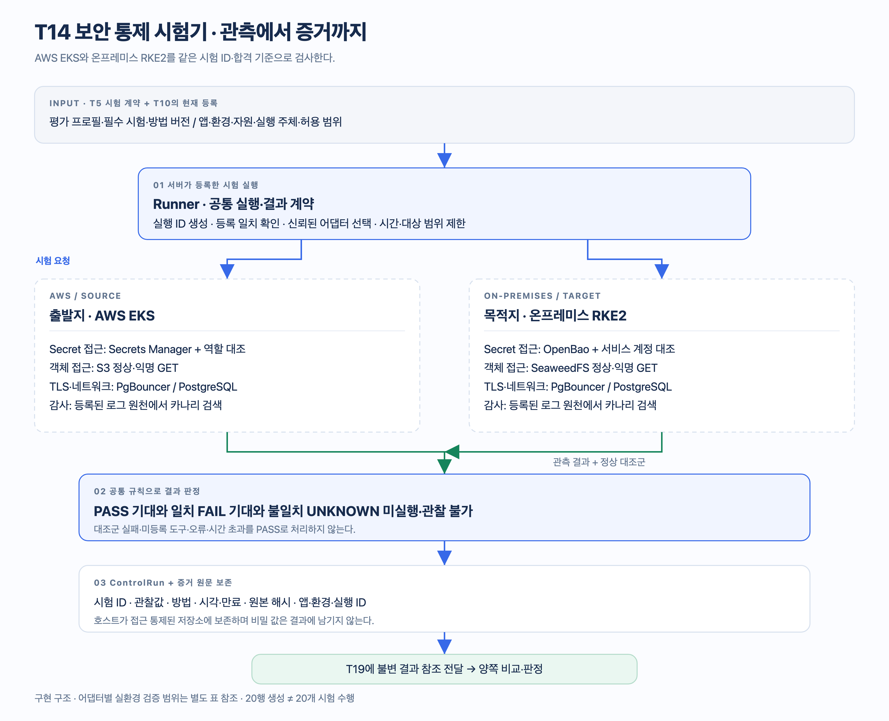
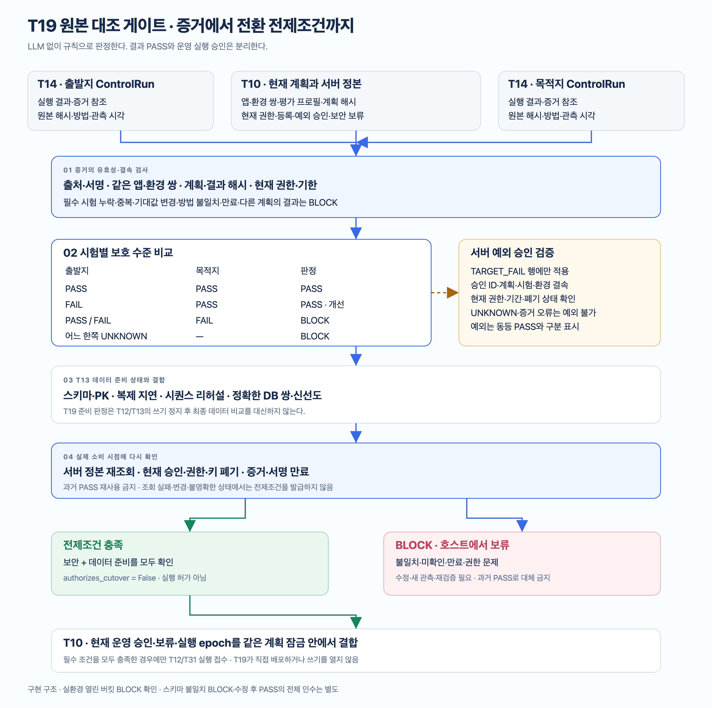

# T14 · T19 구현 구조와 설명표

2026-11-09 작성. 아래 PNG는 노션 업로드용 2배 해상도이며, SVG는 편집·확대용 원본이다.
실제 화면 캡처가 아닌 **구현 구조 설명 그림**이다. 도구 설치·코드 존재를 전체 실환경 PASS로 표시하지 않는다.

## T14 — 보안 통제 시험기

| 단계 | 역할 | 보안 조건 |
|---|---|---|
| 기준·대상 등록 | T5 프로필과 T10 앱·환경·자원·실행 주체를 받음 | 요청자가 시험 범위·기대값을 임의 축소하지 않음 |
| 환경별 수집 | EKS·RKE2의 등록된 어댑터를 실행 | 같은 의미·시험 ID·방법 버전으로 비교 |
| 정상 대조군 | 정상 앱의 같은 자원 접근과 시험 전후 정상 상태 확인 | 대조군 실패를 접근 거부 PASS로 오인하지 않음 |
| 결과 판정 | 관찰을 PASS·FAIL·UNKNOWN으로 기록 | 미실행·관찰 불가·오류를 UNKNOWN으로 유지 |
| 증거 보존 | 원문·시각·해시·앱·환경·실행 ID를 묶음 | 비밀 값 제외, 과거 결과의 시각·대상 변경 금지 |
| T19 인계 | 불변 결과 참조를 전달 | 20개 행 생성과 20개 실제 시험 수행 구분 |

실제 양쪽 TLS 시험 3개는 PASS였고 해당 실행의 다른 17개는 UNKNOWN이었다.
별도 demo-gate 실행에서는 출발지 3개 PASS, 목적지 익명 객체 접근 FAIL·나머지 2개 PASS였다.
이 두 실행을 합쳐 full PASS로 만들지 않는다.

- [양쪽 TLS 실제 검증](https://github.com/Softbank-Hackathon-Finals/platform/blob/379f2ddc81f27452a62c48a790d3b24ce18a5ca7/docs/evidence/t14-app-pooler-pair-2026-11-06/README.md)
- [실제 demo-gate 실행](https://github.com/Softbank-Hackathon-Finals/platform/blob/379f2ddc81f27452a62c48a790d3b24ce18a5ca7/docs/evidence/t14-gate-record-2026-11-08/README.md)

## T19 — 원본 대조 게이트

| 단계 | 역할 | 차단 조건 |
|---|---|---|
| 증거 검증 | 현재 계획·앱·환경·서명·프로필·관측 기한 대조 | 누락·중복·변조·다른 계획·만료·현재 권한 부재 |
| 보안 비교 | 시험 ID별 출발지·목적지 결과 비교 | 목적지 FAIL, 어느 한쪽 UNKNOWN |
| 예외 검증 | 인증된 서버 승인 기록의 범위·기한·폐기 확인 | UNKNOWN·증거 오류는 예외로 덮을 수 없음 |
| 데이터 준비 | T13 스키마·PK·복제 지연·시퀀스 리허설 확인 | DB 쌍·현재 관측·데이터 준비 조건 불충족 |
| 소비 직전 재검사 | 서버 정본·권한·키 폐기·기한 재확인 | 과거 PASS만 존재하거나 현재 상태 불명확 |
| T10 인계 | 전제조건을 현재 운영 승인·보류·실행 epoch와 결합 | T19 결과 자체는 실행 권한이 아님 |

실환경에서 열린 버킷으로 인한 BLOCK을 확인했다. 스키마 불일치 BLOCK과 수정 후 PASS의 전체 인수는 별도다.

- [실제 capture·BLOCK 기록](https://github.com/Softbank-Hackathon-Finals/platform/pull/891)
- [T19 남은 완료 조건](https://github.com/Softbank-Hackathon-Finals/platform/issues/29#issuecomment-6712930348)

## 출처·렌더링

고정 검토 소스와 해석 범위는 [source.json](source.json)에, PNG 규격·해시·텍스트 경계 검사는
[render-results.json](render-results.json)에 기록했다. SVG 문법과 한국어 렌더링·내용 배치를 확인했다.
이 그림을 생성하며 클러스터·권한·운영 설정은 변경하지 않았다.
