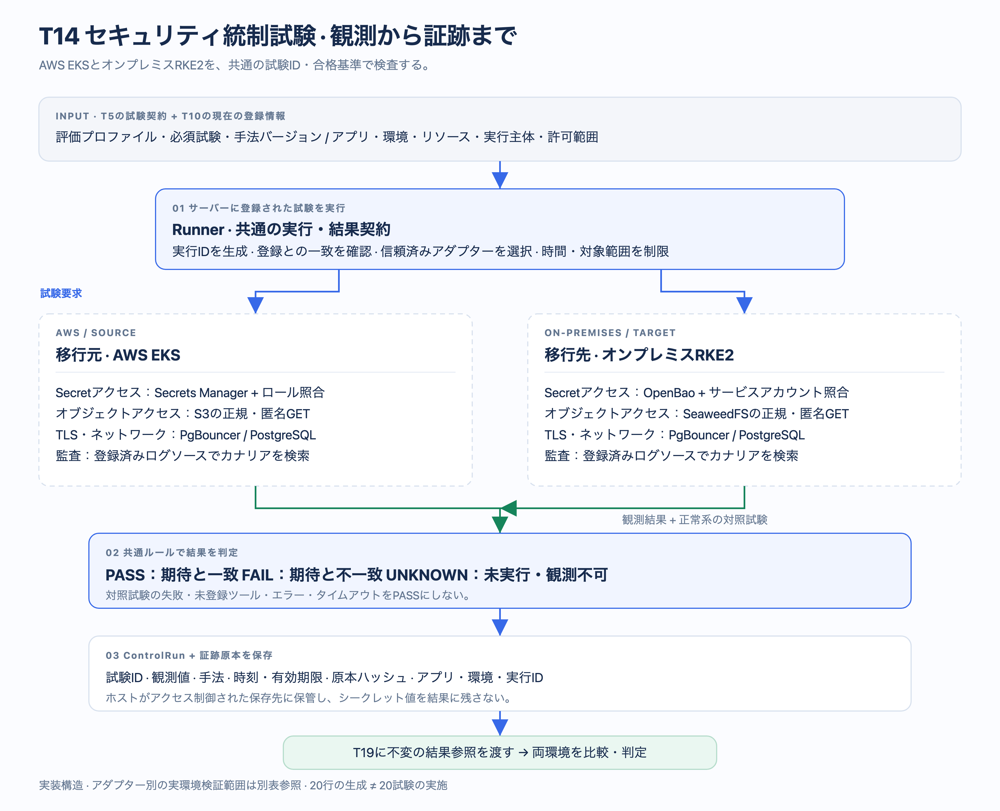
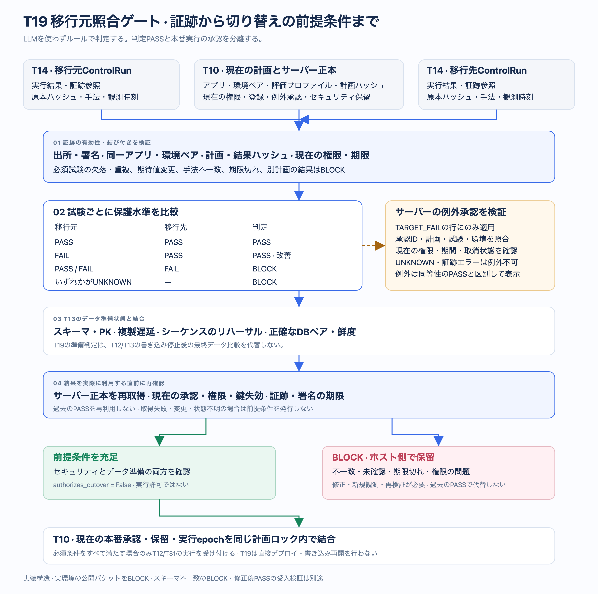

# T5・T14・T19・T23 セキュリティ設計・実装および検証記録

**整理基準日：2026年11月9日**

クラウドとオンプレミスで異なるセキュリティ機能を使用する場合でも、**同じ保護目的を試験し、その結果を根拠として移行可否を判断する仕組み**を設計・実装した。

本書は、リポジトリのコードと公開された検証記録を整理したものである。コード実装、ローカル統合試験、実際のEKS・RKE2環境での検証を区別する。今回の整理・翻訳に際して実環境試験を再実行したものではない。

## 1. 各タスクの役割と接続構造

| タスク  | 役割                                                           | 主な成果物                                           | GitHub上のタスク状態 |
| ------- | -------------------------------------------------------------- | ---------------------------------------------------- | -------------------- |
| **T5**  | 何を試験し、どの条件で合格とするかを定義                       | 統制試験一覧、評価プロファイル、結果・証跡契約       | 完了                 |
| **T14** | 登録済み環境で実際に試験を実行し、結果を収集                   | 統制試験ランナー、環境別アダプター、ControlRunと証跡 | 完了                 |
| **T19** | 両環境の結果とデータ準備状態を検証し、切り替えの前提条件を判定 | 決定的ゲート、署名・例外・現在の権限の検証           | 進行中               |
| **T23** | 試験基準と金融セキュリティの原文との関係・限界を整理           | 日本・韓国の規制原文対応表                           | 完了                 |

タスク状態はGitHub Issueに基づく。**T14の完了扱いは、すべての環境・すべての試験がPASSであることを意味しない。** 実環境で確認した範囲は、以下の検証記録に従う。

```text
T23：規制原文・適用範囲の確認
                 ↓
T5：試験一覧・手法・合格基準・証跡契約
                 ↓
T14：移行元・移行先での実試験と結果収集
                 ↓
T19：出所・期限・必須試験・保護水準・データ準備の検証
                 ↓
T10：現在の本番承認・保留・実行権限との結合
                 ↓
T12/T31：実際の切り替え・デプロイ実行
```

タスクIssue：[T5 #9](https://github.com/Softbank-Hackathon-Finals/platform/issues/9) · [T14 #21](https://github.com/Softbank-Hackathon-Finals/platform/issues/21) · [T19 #29](https://github.com/Softbank-Hackathon-Finals/platform/issues/29) · [T23 #16](https://github.com/Softbank-Hackathon-Finals/platform/issues/16)

## 2. T5 — セキュリティ統制の試験・証跡・判定契約

### 目的

AWS EKSとオンプレミスRKE2で製品名や設定値を単純比較するのではなく、**同じセキュリティ上の質問に対する実際の動作を比較できるよう、試験基準を固定**した。

例えばSecrets ManagerとOpenBaoは異なる製品だが、「正規のアプリはSecretを読み取れ、別の主体は拒否されるか」という共通の質問で試験する。

### 設計した統制範囲

| 統制カテゴリ           | 主な試験内容                                                                           |
| ---------------------- | -------------------------------------------------------------------------------------- |
| **シークレット保管**   | 別主体のSecretアクセス拒否、ソース・設定・ログへの漏えい、ローテーション、保存時暗号化 |
| **通信暗号化**         | アプリ→PgBouncer、PgBouncer→DB、複製経路のTLSと、不正なCA・ホスト名・平文接続の拒否    |
| **監査ログ**           | 管理者接続、DDL、Kubernetes権限変更イベントの実検索                                    |
| **ネットワーク露出**   | 公開ポート、外部→DB、別namespace→DBのアクセス                                          |
| **最小権限**           | 匿名オブジェクトアクセス、基準線を超える権限、アプリ間のオブジェクト・DBアクセス       |
| **バックアップ・復旧** | 別クラスタへの復元と、登録済み検証データの確認                                         |

全体評価用の`full`プロファイルは、**6カテゴリ・20の下位試験**を要求する。デモ用`demo-gate`と変更後の再検査用`apply-recheck`は別プロファイルとして管理する。小さいプロファイルの合格を20試験全体の合格として表示しない。

### 実装した契約

- `ControlRun`、`TestResult`、`GateComparison`のJSON Schema
- 試験ID・統制ID・期待値・手法バージョン・正常系対照試験の必須条件
- 観測時刻・有効期限・原本出力のハッシュ
- バージョン付き評価プロファイルの`required_test_ids`
- 計画・アプリ・環境ペア・両環境の結果ハッシュを結び付ける`context_digest`
- サーバー側の例外承認ID・範囲・有効期間・取消状態を確認する契約

### 主な安全条件

| 条件                                   | 処理           |
| -------------------------------------- | -------------- |
| 必須試験の欠落・重複                   | BLOCK          |
| 正常系対照試験の失敗                   | UNKNOWN        |
| 手法バージョンの不一致                 | BLOCK          |
| 証跡の期限切れ・未来の時刻             | BLOCK          |
| 移行先がFAIL、またはいずれかがUNKNOWN  | BLOCK          |
| 移行元FAIL → 移行先PASS                | 改善として表示 |
| 別計画・別環境のPASSや例外承認の再利用 | 拒否           |

ネットワークのタイムアウトも、それだけで遮断成功とは認めない。同じ試験時間枠で対象と試験主体の正常系対照を確認するよう定義した。これはタイムアウトを解釈するための根拠であり、ポリシードロップのイベントを直接観測したことを意味しない。

### 実装・検証の証跡

| 証跡                                                                                                                                                                  | 確認できる内容                                             |
| --------------------------------------------------------------------------------------------------------------------------------------------------------------------- | ---------------------------------------------------------- |
| [T5 PR #51](https://github.com/Softbank-Hackathon-Finals/platform/pull/51)                                                                                            | 試験・証跡・例外承認契約、レビュー反映、検証結果           |
| [統制試験設計](https://github.com/Softbank-Hackathon-Finals/platform/blob/379f2ddc81f27452a62c48a790d3b24ce18a5ca7/docs/controls/README.md)                           | 下位試験、対照試験、UNKNOWN・ゲートルール                  |
| [結果・証跡JSON Schema](https://github.com/Softbank-Hackathon-Finals/platform/blob/379f2ddc81f27452a62c48a790d3b24ce18a5ca7/docs/controls/control-result.schema.json) | データ形式と構造上の制約                                   |
| [評価プロファイル](https://github.com/Softbank-Hackathon-Finals/platform/blob/379f2ddc81f27452a62c48a790d3b24ce18a5ca7/docs/controls/profiles.json)                   | プロファイル別の必須試験と不変条件                         |
| [契約試験ケース](https://github.com/Softbank-Hackathon-Finals/platform/blob/379f2ddc81f27452a62c48a790d3b24ce18a5ca7/docs/controls/contract-cases.json)               | 欠落・改ざん・例外の誤用・サーバー正本不在などの拒否ケース |

PR #51には、5つのサンプルと計40の契約ケースの検証範囲を記録している。**T5の検証は契約の検証であり、実際のAWS・RKE2試験はT14が担当する。**

## 3. T14 — 統制試験ランナーと実環境での収集

### 目的

T5で定めた試験を実行し、観測結果を**PASS・FAIL・UNKNOWNに分け、証跡とともに残す試験ランナー**を実装した。

### 実装構造



この図は実装構造の説明図であり、実行時の画面キャプチャではない。アダプターごとの実環境検証範囲は、以下の記録と区別する。

### 実装内容

| 構成                         | 実装内容                                                                                       |
| ---------------------------- | ---------------------------------------------------------------------------------------------- |
| **共通試験ランナー**         | 登録済みアプリ・環境・実行ID・手法バージョン・観測時刻を検査し、ControlRunを生成               |
| **既存ツールとの接続**       | gitleaks・Prowler・kube-benchの結果を共通の統制形式に接続                                      |
| **Secretアクセス試験**       | AWSロールまたはOpenBaoのIDに基づき、正規アクセスと非認可アクセスを比較                         |
| **オブジェクトアクセス試験** | 正規アプリの読み取り成功と、同じオブジェクトへの匿名読み取りを比較                             |
| **TLS試験**                  | 正常な証明書検証、不正なCA・ホスト名の拒否、平文接続開始の拒否                                 |
| **ネットワーク試験**         | 登録済みDB・プーラー経路と、試験前後の正常系対照を確認                                         |
| **追加検査**                 | ソース・ログへのシークレット漏えい、保存時暗号化、アプリ間隔離、ローテーション・復元の検証経路 |

実行できなかった必須試験を結果から削除せず、`UNKNOWN / NOT_RUN`として残す。ツール実行エラー、権限不足、対照試験の失敗を正常や検出0件に置き換えない。

実装コードと各項目の運用接続状態は、[T14試験ランナーの説明](https://github.com/Softbank-Hackathon-Finals/platform/blob/379f2ddc81f27452a62c48a790d3b24ce18a5ca7/services/control-runner/README.md)と[下位試験別の受入状況](https://github.com/Softbank-Hackathon-Finals/platform/blob/379f2ddc81f27452a62c48a790d3b24ce18a5ca7/services/control-runner/docs/implementation-readiness.md)に記録した。

### 実検証① 両環境のアプリ→PgBouncer TLS

2026年11月6日、実際のAWS EKSとオンプレミスRKE2で、それぞれ新しい観測を収集した。

| 試験                                   | AWS EKS | オンプレミスRKE2 |
| -------------------------------------- | ------- | ---------------- |
| 正常な証明書検証付きTLS・SELECT 1      | PASS    | PASS             |
| 不正なCA・ホスト名の拒否               | PASS    | PASS             |
| パスワードを送らない平文接続開始の拒否 | PASS    | PASS             |

各実行は`full`プロファイルの**3件PASS・17件UNKNOWN**だった。これはアプリ→PgBouncer区間の証跡であり、PgBouncer→DB、複製TLS、データ移行完了を証明するものではない。

**証跡：**[両環境のTLS実環境検証記録](https://github.com/Softbank-Hackathon-Finals/platform/blob/379f2ddc81f27452a62c48a790d3b24ce18a5ca7/docs/evidence/t14-app-pooler-pair-2026-11-06/README.md)

### 実検証② 匿名オブジェクトアクセス・Secretアクセス・接続監査

2026年11月8日、実際の両環境で`demo-gate:1`の3試験を実行した。

| 試験                                    | AWS EKS                 | オンプレミスRKE2                                          |
| --------------------------------------- | ----------------------- | --------------------------------------------------------- |
| **IAM-01.1 匿名オブジェクト読み取り**   | PASS — 匿名アクセス拒否 | **FAIL — 意図的に公開したバケットへの匿名アクセスを許可** |
| **SEC-01.1 別のIDによるSecret読み取り** | PASS                    | PASS                                                      |
| **AUD-01.1 管理者接続記録の検索**       | PASS                    | PASS                                                      |

移行先のFAILを隠さず、原本の結果として保存した。AUD-01.1はCNPG primary自身のログを利用した試験であり、中央監査保存先への収集・保管全体の完了とは区別する。

**証跡：**[両環境のdemo-gate実行記録](https://github.com/Softbank-Hackathon-Finals/platform/blob/379f2ddc81f27452a62c48a790d3b24ce18a5ca7/docs/evidence/t14-gate-record-2026-11-08/README.md)

この記録の実行結果は、当時まだGATEに登録していなかった。後述のT19運用判定記録と、同一の実行であるかのように統合しない。

### 実検証③ 誤ったPASS判定の採用撤回と再検証

AWS Secret保存時暗号化検査の初期バージョンで、設定上のキーと実際の現在バージョンの暗号化キーが異なる可能性を発見した。

既存PASSをゲートの根拠として採用する判断を撤回し、実バージョンの`KmsKeyIds`を前後確認する新しい実行で再検証した。初期記録を削除したり、新しい結果で上書きしたりしていない。

**証跡：**[暗号化検査の採用撤回・バージョン2再検証](https://github.com/Softbank-Hackathon-Finals/platform/blob/379f2ddc81f27452a62c48a790d3b24ce18a5ca7/docs/evidence/t14-secret-encryption-2026-11-05/README.md)

### コード実装の証跡

- [共通試験ランナー・AWSプローブ PR #90](https://github.com/Softbank-Hackathon-Finals/platform/pull/90)
- [実際のプーラーTLS試験 PR #112](https://github.com/Softbank-Hackathon-Finals/platform/pull/112)
- [DB・プーラーのネットワーク対照試験 PR #122](https://github.com/Softbank-Hackathon-Finals/platform/pull/122)

各PRと証跡文書では、単体・モック試験、ローカルでの実ツール試験、チームの実環境結果を区別した。異なる実行のPASSを集め、新たな全体PASSを作らない。

## 4. T19 — 移行元照合ゲート

### 目的

移行元と移行先の結果が存在するかだけでなく、**その結果が現在の計画に属し、信頼でき、実際の切り替えの前提条件を満たすかを判定する決定的ゲート**を実装した。

判定にLLMは使用しない。

### 実装構造



この図は実装構造の説明図である。ゲートの判定と本番実行権限を分離し、未確認の受入範囲は実環境検証済みとして表示しない。

### 実装した検証

| 検証領域         | 主な条件                                                         |
| ---------------- | ---------------------------------------------------------------- |
| **必須試験**     | プロファイルが要求する結果が両環境に正確に1件ずつ存在            |
| **結果の整合性** | 試験ID・統制ID・期待値・観測値・判定が一致                       |
| **出所・環境**   | 同じアプリ、登録済み移行元・移行先、正確な結果参照               |
| **鮮度**         | 証跡・署名・現在の権限の有効期限と失効・取消状態を確認           |
| **例外承認**     | 現在のサーバー承認記録・計画・試験・環境・期間に結び付く         |
| **利用時の検証** | 提出されたPASSをそのまま信頼せず、サーバー正本と再計算結果を照合 |
| **データ準備**   | T13のスキーマ・PK・複製遅延・シーケンスのリハーサル観測と結合    |
| **記録の保護**   | 計画別の公開鍵・署名台帳の保存・再取得・現在の失効状態の反映     |

セキュリティ前提条件を満たしても、その結果自体が本番実行権限を与えることはない。T10の現在の承認・保留・実行権限と、T12/T13の最終データ比較が別途必要である。

**実装証跡：**[T19モジュール・統合契約](https://github.com/Softbank-Hackathon-Finals/platform/blob/379f2ddc81f27452a62c48a790d3b24ce18a5ca7/services/control-gate/README.md)

### 実環境・統合検証の証跡

| 検証                       | 確認した内容                                                                               | 根拠                                                                                                                                                                                        |
| -------------------------- | ------------------------------------------------------------------------------------------ | ------------------------------------------------------------------------------------------------------------------------------------------------------------------------------------------- |
| **公開鍵・署名台帳**       | 実際のSQLite・PostgreSQLで、保存・再取得・同時競合・期限切れ・失効・プロセス終了処理を確認 | [署名台帳の検証記録](https://github.com/Softbank-Hackathon-Finals/platform/blob/379f2ddc81f27452a62c48a790d3b24ce18a5ca7/docs/evidence/t19-signature-records-2026-11-06/README.md)          |
| **両環境のDBへの直接収集** | 異なるCNPGの実体を確認し、2テーブルのスキーマハッシュ・PKの一致を確認                      | [両環境への直接収集記録](https://github.com/Softbank-Hackathon-Finals/platform/blob/379f2ddc81f27452a62c48a790d3b24ce18a5ca7/docs/evidence/t19-direct-database-2026-11-06/paired/README.md) |
| **運用S1のBLOCK**          | 実際の公開バケットでIAM-01.1 TARGET_FAILが発生。データ準備PASSとは分けて全体BLOCKを記録    | [運用統合の実測 PR #891](https://github.com/Softbank-Hackathon-Finals/platform/pull/891)                                                                                                    |
| **DB参照不一致の遮断**     | 観測したDB・複製参照が登録ペアと異なる場合、記録・署名前にHOLD                             | [補強 PR #902](https://github.com/Softbank-Hackathon-Finals/platform/pull/902)                                                                                                              |

署名台帳の検証時には、**ゲート全体661試験**と、実際にプロセスを終了させる試験を実施した。DBとプロセスは実物だが、ID・鍵・観測は合成試験データであり、運用受入完了とは区別する。

運用統合PR #891には、30秒の観測有効期間内で、**観測から評価まで約12秒、全体14秒**の実測が記録されている。これは当該capture・評価経路の時間であり、サービス移行全体の時間ではない。

### 不具合の発見と証跡説明の訂正

初期は両環境のアプリのDB経路を照会したが、両経路とも移行元DBに到達し得る問題が確認された。

そのため、独立した2つのDBの一致証跡として使うという説明を撤回し、各CNPGへ直接接続して実体・CA・Service・primary Podを確認する新しい観測を実施した。

**証跡：**[DB実体の結び付けに関する訂正記録](https://github.com/Softbank-Hackathon-Finals/platform/blob/379f2ddc81f27452a62c48a790d3b24ce18a5ca7/docs/evidence/t19-direct-database-2026-11-06/README.md)

### 残る完了条件

確認した最新Issue記録では、次が残っている。

- スキーマ不一致シナリオでの**実環境BLOCK**
- 修正反映後、同じ運用フローでの**PASS**
- 補強コードの実際のデプロイ・新しいcaptureでの確認

したがって、**T19全体を完了として表示しない。** 現在確認した運用検証の範囲は、公開バケットのBLOCKなどの個別項目である。

**状態の根拠：**[T19の最新フォローアップ記録](https://github.com/Softbank-Hackathon-Finals/platform/issues/29#issuecomment-6712930348)

## 5. T23 — 金融セキュリティの規制原文と試験基準の接続

### 目的

技術試験がどの金融セキュリティ要件と結び付くかを説明し、**試験で確認した範囲と規定全体で要求される範囲を区別**した。

### 実施内容

- 日本の金融庁サイバーセキュリティガイドラインの原文・改訂履歴を確認
- 韓国の電子金融監督規定・施行細則と関連別表を確認
- T5の6統制カテゴリを原文の条項・ページ・公式リンクに接続
- 直接対応しない項目と、別途運用検証が必要な範囲を明示
- 原文変更を再確認できるよう、受信したPDFのSHA-256を記録

原文確認記録の基準日は**2026年11月3日**である。

### 適用した区別

| 区分                     | 文書に反映した原則                                                     |
| ------------------------ | ---------------------------------------------------------------------- |
| **原文確認と遵守判定**   | 原文を確認した事実だけで規制遵守を宣言しない                           |
| **技術試験と運用統制**   | サービスアカウントのアクセス拒否は、人のMFA・職務分離全体を代替しない  |
| **ログ検索と監査体制**   | イベント検索の成功は、保存期間・不変性・継続的レビュー全体を証明しない |
| **復元試験と業務継続性** | 一部の検証用データの復元は、データ全体のRPO・業務RTOを保証しない       |
| **推奨事項と義務**       | 文書上の推奨事項と法的義務を同一に表現しない                           |

### 成果物・レビューの証跡

| 証跡                                                                                                                                                              | 確認できる内容                                  |
| ----------------------------------------------------------------------------------------------------------------------------------------------------------------- | ----------------------------------------------- |
| [T23 PR #107](https://github.com/Softbank-Hackathon-Finals/platform/pull/107)                                                                                     | 原文レビュー範囲、公式出典との接続、変更内容    |
| [日本・韓国の規制対応表](https://github.com/Softbank-Hackathon-Finals/platform/blob/379f2ddc81f27452a62c48a790d3b24ce18a5ca7/docs/controls/regulatory-mapping.md) | 条項・ページ・適用範囲・試験の限界・PDFハッシュ |
| [T23完了Issue #16](https://github.com/Softbank-Hackathon-Finals/platform/issues/16)                                                                               | 原文確認作業の完了基準と状態                    |

T23は規制根拠と技術試験を結び付ける文書である。ランタイムの判定コードを追加したり、金融機関の規制遵守認証を行ったりした作業ではない。

## 6. 証跡の解釈範囲

| 証跡の種類                       | 示す内容                                                   |
| -------------------------------- | ---------------------------------------------------------- |
| **コード・マージ済みPR**         | 当該機能と検証ロジックがリポジトリに反映されたこと         |
| **単体・契約試験**               | 定義した入力に対して判定・拒否条件が動作すること           |
| **実DB・実ツールの統合試験**     | 指定したローカル環境で実際の構成要素を接続して動作したこと |
| **EKS・RKE2の実環境記録**        | 指定した時刻・リソース・試験範囲で観測した結果             |
| **原本ハッシュ・ソースmanifest** | レビュー対象コードと保存した証跡を識別・照合できること     |

公開要約とハッシュは、非公開原本と照合するための手段である。公開資料だけで原本や運用リソースの実体をすべて独立検証できるという意味ではない。

**本作業の成果は、セキュリティ試験基準の設計、実際の統制試験ランナーの実装、証跡に基づく切り替えゲート、金融セキュリティ原文対応表である。正式なペネトレーションテスト、金融規制全体の遵守、すべての統制における両環境のPASSは、別途の検証範囲として扱う。**
