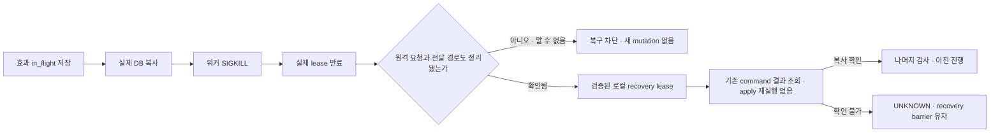

# 실제 효과 중단과 원격 정리 후 조회 복구

실제 PostgreSQL offline-copy와 기존 HandoffWorker·effect 원장을 사용해, 워커가 죽은 뒤 무엇을 확인해야 복구할 수 있는지 검증하는 로컬 qualification이다. 제품 워커·실행기·Kubernetes proof 구현은 변경하지 않는다.

## 구분하는 사건

프로세스 종료와 lease 만료만으로 원격 DB 요청이 정리되지는 않는다. 네트워크가 중계한 요청이 아직 DB에서 실행 중일 수 있다. 이 시험은 실제 요청을 보낸 뒤 종료를 지연하는 relay를 사용해 해당 경계를 재현한다. TCP payload는 해독하거나 기록하지 않는다.

## 시험 경로

- 커밋 후: 실제 copy가 commit된 뒤 효과 확인 전 원격 SELECT 대기를 추가한다. 워커를 죽이고도 원격 backend가 남는지 관측한다.
- 커밋 전: 같은 정의의 trigger를 양쪽 업무 DB에 설치하고, 태그된 시험 copy의 target INSERT만 서버에서 지연시킨다. 실제 COPY 트랜잭션 도중 워커를 죽인다.
- 원격 요청이 남아 있는 동안 후속 워커는 proof를 받지 못하고 아무 효과도 실행하지 않는다.
- 시험 워커의 고유 태그와 DB 범위로만 backend를 종료하고 relay도 닫는다. 실제 backend 부재·프로세스 종료·lease 만료·pending effect digest를 묶어 qualification 전용 proof를 발급한다.
- 기존 recovery 경로가 원래 command를 readback하고, copy apply는 다시 호출하지 않는지 확인한다. 실제 TRUNCATE audit trigger의 commit 수를 별도 SQL로 대조한다.

관측자는 전용 DB 신원과 full session visibility를 확인해야 한다. 세션 정보를 충분히 볼 수 없는 실제 runtime role은 부재를 증명할 수 없는 것으로 처리한다. 오류·권한 부족을 빈 목록으로 바꾸지 않는다. PostgreSQL은 다른 세션의 상세 정보에 [관측 권한을 적용](https://www.postgresql.org/docs/17/monitoring-stats.html)하며, 이 하네스는 멤버십 대신 [즉시 사용 가능한 역할 권한인 USAGE](https://www.postgresql.org/docs/17/functions-info.html)를 확인한다. 운영 runtime에 전역 관측 권한을 부여하라는 의미는 아니다.

## proof의 신뢰 범위

`NativeSettlement`는 테스트 안에서 관리하는 issuer다. 정확한 Popen 객체·소유한 relay·run-owned DB와 session 태그를 알고 있는 신뢰된 fixture에서만 사용한다. 발급한 proof를 메모리에서 대조하고, scope·epoch·pending·유효기간은 기존 실행 원장이 다시 검사한다. 임의 artifact digest는 거부한다.

application_name은 위조 가능한 client 설정이므로 운영 workload 신원이 아니다. 이 proof를 배포하거나 실제 Pod/계정의 원격 정리 증거로 사용하지 않는다. Kubernetes UID·클라우드 workload identity·운영 issuer 인증을 가짜 값으로 대신하지 않는다. 이 테스트가 발급하는 로컬 recovery 권한과 운영 이전 자격은 구분한다.

## 유지되는 실패 조건

커밋되지 않은 copy의 결과가 target에서 확인되지 않으면 기존 adapter는 UNKNOWN을 반환한다. 현재 worker는 미해결 recovery lease의 release를 거부해 RecoveryRequired를 반환하며, 라우팅·source 쓰기를 열지 않는다. 이를 이전 완료나 자동 재실행 허용으로 표시하지 않는다. 명시적 운영 보류 표시와 후속 승인·복구 절차는 별도 통합 대상이다.

단일 로컬 PG 서버의 별도 DB·합성 계획/신뢰 입력·파일 route·로컬 witness·fixture IdP라는 한계가 있다. 운영 이미지·실제 Pod·AWS→독립 온프렘·클라이언트 5초 완료·금융 보안 인수는 이번 시험의 범위가 아니다.

[개발 기록](development/effect-settlement-2026-11-19.md) · [실측 증거](evidence/effect-settlement-20261119.json) · [선행 네트워크·세션 시험](pool-lifecycle-faults.md).
