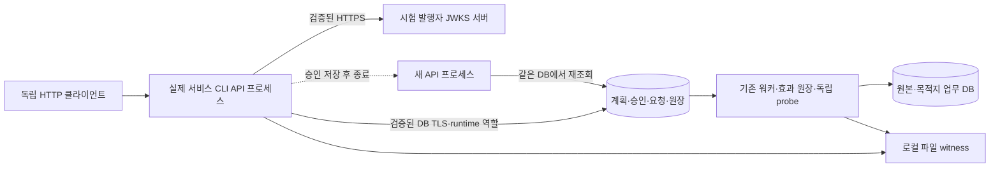

# 서비스 진입점·HTTPS JWKS·API 재시작 검증

2026-11-18 · 개인 `feature/migration-request-qualification`. MQ-03 로컬 runtime 연결이며 운영 배포 인수는 아니다.

후속 [워커 프로세스 종료·인계·복구 차단 시험](migration-worker-qualification.md)은 별도 실행과 증거로 관리한다. 이 문서의 81개 결과는 `081cda5` 스냅샷 기준이다.

## 이전 검증에서 확장한 것

[기존 서비스 구성 요소 시험](migration-service-qualification.md)은 같은 pytest 프로세스 안에서 `create_app`과 생성한 JWKS 함수를 연결했다. 이번에는 운영 서비스와 같은 **`python -m sova.service.main serve-api` 명령**으로 API를 별도 프로세스에서 실행한다.

| 항목 | 이번 시험 |
|---|---|
| API 시작 | 실제 CLI → `ServiceConfig` → 파일의 runtime DSN → 기존 `ControlPlane` |
| API 접속 | `--host 127.0.0.1`로 이번 실행의 loopback 포트만 바인딩. 기존 기본값 `0.0.0.0`은 유지 |
| 발행자 키 | 실제 HTTPS JWKS 서버에 접속. 생성한 CA를 API 자식 프로세스의 `SSL_CERT_FILE`로 신뢰 |
| 인증 | 생성한 RS256 시험 토큰. 기존 issuer·audience·tenant·역할 검사는 유지 |
| DB | run 전용 PostgreSQL, 검증된 서버 TLS와 fixture 클라이언트 인증서. API는 RLS를 우회하지 않는 runtime 역할 |
| witness | API와 기존 워커가 같은 로컬 파일을 사용. 독립 WORM·다중 호스트 witness는 아님 |
| 재시작 | 정방향 승인 후와 복귀 승인 후 API를 종료·재기동. 새 프로세스가 저장된 요청·계획·승인을 읽어 실행 접수 |
| 워커 | 기존 `HandoffWorker.drive`를 pytest 프로세스에서 사용. 워커 daemon·Pod 배포 검증은 아님 |



API 재시작은 **응답을 받은 승인 요청 이후**, 워커를 실행하기 전에 수행한다. 승인 저장 도중 응답 유실·동시 API replica·트래픽 무중단 교체를 검증한 것으로 합치지 않는다.

## 새로 확인하는 장면

1. 등록·attest·정방향 계획·독립 승인 → API 재시작 → 새 프로세스에서 실행 접수.
2. 실제 원본 차단·복사·목적지 활성화·HTTP 주문 저장. 안정화 직전의 명시적인 시험 예외로 정지.
3. 복귀 요청·별도 계획·독립 승인 → API 재시작 → 새 프로세스에서 복귀 요청 재컴파일·실행 접수.
4. 목적지에서 생성한 주문을 원본으로 복귀시키고, 독립 요청 원장과 주문·완료 작업·멱등 결과를 대조.
5. JWKS에 잘못된 CA를 지정하면 인증을 시작하지 못해 503. 정상 CA 참조로 바꾸고 API를 재시작한 뒤 같은 시험 토큰의 인증을 확인.
6. DB에 잘못된 CA를 지정하면 liveness는 200, readiness는 503. 정상 CA 참조로 바꾸고 재시작한 뒤 readiness 200을 확인.

인증서 검증 해제·평문 fallback·시계 변경·승인 자동 통과를 사용하지 않는다. 잘못된 CA 시험에서는 등록 문서가 생성되지 않았는지도 별도로 조회한다.

## 코드 변경

- `main.py`: API CLI의 `--host`를 추가했다. JWKS 전송·HTTP·JSON 해석 실패를 짧은 `AuthenticationUnavailable`로 분류한다.
- `auth.py`·`api.py`: 해당 실패는 **503 `identity provider unavailable`**로 응답한다. 새 principal을 만들거나 TLS 검증 실패를 무시하지 않는다. 기존 잘못된 토큰의 401과 구분한다.
- `qualification_service.py`: 합성 프로필의 PostgreSQL 버전을 실제 DB `SHOW server_version` 조회값에 맞추고, 방향별 qualification fingerprint도 다시 결속한다.
- `qualification_runtime.py`: CLI 프로세스·실제 HTTPS JWKS·비밀 파일·정상 종료·재시작·비공개 로그 수집을 담당하는 시험 helper다. 고객용 실행 도구가 아니다.

원래 MQ-03 기록의 합성 프로필은 PostgreSQL 18.4였고 실제 DB는 17.12였다. 그 과거 실행 기록은 그대로 보존한다. 후속 시험은 실제 engine 버전에 맞춘다. **provider·자원 UID·인벤토리·adapter digest·발행 자격은 여전히 fixture**이므로 운영 자격으로 발급하지 않는다.

## 공통 fixture 재사용과 종료 판정

공통 수집 완료 시각을 host 시각보다 5ms 전으로 두면, DB 시계가 몇 ms만 뒤여도 제품의 미래 시각 거부 규칙에 걸린다. 다른 세션이 먼저 만든 `b24cd7c`의 수정(1초 전의 시험 watermark)을 이 브랜치에 의존성으로 가져왔다. 별도 구현을 중복 작성하거나 다른 작업 트리를 수정하지 않았다. 이번 시험의 attestation 유효 기간은 기존 기본 4분을 유지한다.

현재 Uvicorn은 정상 종료 처리를 마친 뒤 SIGTERM을 다시 발생시킬 수 있다. 시험에서는 코드 0만 요구하지 않고 다음 조건을 함께 확인한다.

- 종료 코드가 0 또는 SIGTERM이다.
- 구조화된 로그에 `Application shutdown complete.`와 `Finished server process`가 모두 있다.
- 제한 시간 안에 종료했고 SIGKILL을 사용하지 않았다.

이 조건은 테스트한 API의 종료 판정이다. 모든 Uvicorn 버전이나 모든 진행 중 요청의 무손실 종료를 증명하지 않는다. API 로그는 비공개 실행 디렉터리에 보존하고 공개 요약에는 해시만 둔다.

## 재현과 증거

```sh
caffeinate -di python tests/qualification_postgres.py \
  --suite runtime \
  --image sha256:0d938e975177bef9f1f61f3f9dbcf2e0aa0a139568f66d3415ed8892eb97f6ac \
  --security-source /path/to/pinned-security/src \
  --artifacts /path/to/new-private-run-directory
```

`caffeinate`는 macOS에서 시험 프로세스가 살아 있는 동안만 적용한다. 실행기는 고정 Security 생산자와 캐시 이미지, 소유권 라벨을 확인하고 생성한 자원만 정리한다. 자식 프로세스에는 AWS 자격·프록시 설정 등을 전달하지 않는다. 호스트·DB 시각의 샘플링 검사를 유지한다.

[실행 요약·소스 지문](evidence/runtime-service-qualification-20261118.json), [개발·실패 기록](development/migration-runtime-qualification-2026-11-18.md).

최종 `run-02`: **81 PASS, 0 FAIL, 0 ERROR, 0 SKIP**. 기존 78개 회귀와 새 runtime 3개를 같은 실행에서 확인했다. 주 흐름에서는 API 프로세스 3회·HTTPS JWKS 조회 3회를 거쳤고, 4개 논리 주문·POST 5회·503 1회를 보존한 채 모두 결과를 확인했다. 부정 대조까지 포함한 API 프로세스 총 7개에서 정상 종료 로그를 확인했다.

시각 감시는 211개 샘플에서 통과했고 생성한 컨테이너·네트워크를 정리했다. 측정 소스 38개가 `081cda5`의 커밋 파일과 일치한다. 전체 시험 시간은 서비스 지연·중단 시간의 SLO 측정값이 아니다.

## 남은 범위

실제 기업 IdP 로그인·MFA·키 회전/폐기, API 진입점의 HTTPS, 배포 이미지·Pod·daemon 워커, 독립 두 서버·AWS→VM·외부 Edge, NetworkPolicy를 켠 운영 경로, 독립 witness·감사 보존·부하/SLO는 별도 인수다. JWKS 장애 시험은 처음 키를 받아야 하는 새 API 프로세스를 대상으로 하며 이미 캐시된 키의 철회 동작을 증명하지 않는다.

모든 업무 대조 보고서는 `service_continuity=NOT_QUALIFIED`, `qualification_issued=false`, `authorizes_execution=false`를 유지한다.
