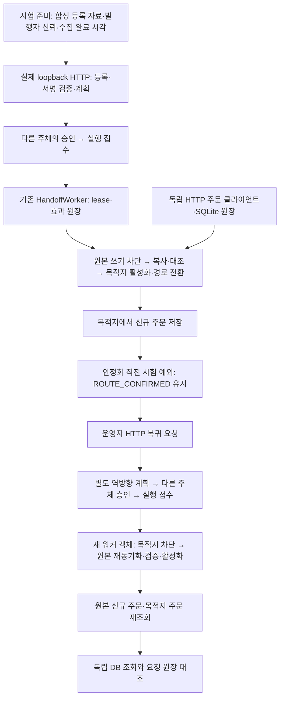

# 서비스 HTTP·워커를 통한 로컬 이전과 복귀 검증

2026-11-18 · 개인 `feature/migration-request-qualification` 브랜치. MQ-03의 구성 요소 연결이며, 배포된 운영 경로 전체의 인수 완료는 아니다.

이 문서의 78개 실행은 `13f7324` 기준 기록이다. 후속 [서비스 CLI·HTTPS JWKS·재시작 검증](migration-runtime-qualification.md)은 별도 실행·소스 지문으로 관리한다.

## 연결한 범위

[MQ-02](migration-http-qualification.md)의 HTTP 주문·독립 요청 원장을 기존 서비스 API와 `HandoffWorker`에 연결한다. 새 복제 엔진이나 승인 체계를 만들지 않는다. 계획 컴파일러, 원장, 실행 소유권, 증거 검증기, PostgreSQL 어댑터와 독립 probe를 재사용한다.



점선의 준비 과정은 fixture다. 실제 클라우드 조사, 자격 발급, 고객 IdP 또는 운영 수집기의 통과 결과로 해석하지 않는다.

## 추가 API와 권한

공통 경로는 `/v1/tenants/{tenant}/applications/{application}/plans/{plan}`이다. 기존 Bearer 검증, 경로 tenant 결속, 역할 검사를 그대로 적용한다.

| 경로 | 역할 | 실제 변경과 제한 |
|---|---|---|
| `POST …/failback-requests` | operator | 허용된 사유 코드로 기존 coordinator의 `FAILBACK_REQUIRED` 전이를 요청한다. 쓰기 개방·승인을 수행하지 않는다. 반복 요청은 authority revision을 다시 올리지 않는다. |
| `POST …/failback-plans` | planner | 원래 계획·현재 authority와 현재 등록 자료로 기존 `compile_failback`을 호출한다. 새 계획을 저장하며 승인·실행은 별도다. |
| 기존 `POST …/approvals` | approver | 계획 작성자 본인의 승인을 금지한다. 복귀 계획에도 별도 승인이 필요하다. |
| 기존 `POST …/admissions` | operator | 저장한 복귀 요청을 읽어 현재 등록 자료로 다시 컴파일한다. 승인 후 입력이 바뀌면 실행 접수를 거부한다. |

복귀 요청의 body는 `{"reason":"service_regression"}`처럼 제한된 코드 하나다. 허용 코드는 `operator_requested`, `service_regression`, `destination_incident`다. 임의 명령·쓰기 허용 플래그·검증 통과 여부를 body로 받지 않는다.

복귀 계획의 body는 기존 `PlanRequest`와 같은 형식이다. 서비스는 내부 저장 요청에 `request_kind=failback.v1`과 원래 계획 ID를 함께 보존한다. 기존 정방향 요청 형식은 유지한다. DB 스키마나 기존 domain 프로토콜은 변경하지 않는다.

없는 승인·범위 밖 레코드는 HTTP 404, 저장 revision 경합은 409로 짧게 응답한다. SQL·토큰·내부 예외를 응답에 싣지 않는다. 계약상 거부는 422, 인증·역할 거부는 401·403이다.

## 복귀 가능 시점

이번 시험은 **목적지가 쓰기를 받은 뒤, 정방향 안정화 완료 전**의 복귀다. 안정화 측정 콜백에서 의도적인 Python 예외를 발생시킨다. OS 프로세스 종료, 네트워크 장애, 관측기 고장 시험으로 표시하지 않는다.

정방향 authority는 `ROUTE_CONFIRMED → FAILBACK_REQUIRED`로 남는다. 복귀 계획은 원래 compiled digest와 epoch를 참조하며, 기존 프로토콜의 새 epoch로 원본 권한을 되찾는다. 복귀 계획의 완료가 정방향 계획의 `HANDOFF_COMPLETE`를 뜻하지 않는다.

이미 `HANDOFF_COMPLETE`인 전환을 이 API로 다시 열 수 없다. 그 이후의 재이전은 별도의 정방향 이전으로 설계해야 한다. 복귀 계획의 복귀도 요청하지 못하도록 제한한다.

## 시험 구성과 판정

| 구분 | 이번 구성 |
|---|---|
| 제어 API·주문 API | 실제 TCP loopback HTTP 서버. 평문이며 외부에 공개하지 않음 |
| API 신원 | 시험마다 생성한 RSA 서명 토큰, fixture JWKS 함수. 실제 기업 로그인·MFA·IdP 가용성 시험이 아님 |
| 워커 | 변경하지 않은 `HandoffWorker.drive`. 새 객체로 원장에서 복귀를 실행하며 배포된 daemon·Pod 인수는 아님 |
| 제어·업무 DB | run 전용 PostgreSQL 17.12 arm64 컨테이너 한 대의 여러 논리 DB |
| DB 전송 | 서버 인증서·호스트명 검증, run 전용 클라이언트 인증서. 합성 역할들이 인증서를 공유 |
| 경로·witness | 시험용 메모리 Route, 로컬 파일 witness. 외부 Edge·독립 WORM 저장소가 아님 |
| 등록 자료 | 합성 방향별 프로필·자격·의존성, 기존 fixture 서명. 실제 AWS·온프렘 인벤토리나 운영 지원 자격이 아님 |
| 예산 | 시험용 쓰기 정지 60초·클라이언트 완료 120초. 고객 SLO로 제시하지 않음 |

기존 fixture의 프로필에는 PostgreSQL 18.4와 합성 adapter digest가 들어 있다. 실제 실행한 서버는 17.12다. 이번 결과는 서비스 구성 요소의 연결 시험이며, 이 프로필을 실제 배포의 자격 증거로 발급하지 않는다. 운영 인수에서는 실제 조사 버전·이미지·등록 발행자의 자격부터 다시 결속해야 한다.

주 시험은 전환 전 주문, 실제 차단 중 503, 목적지 신규 주문, 복귀 후 재시도·신규 주문·목적지 주문 조회를 기록한다. 최종 원본의 주문·완료 작업·멱등 결과와 대조하며, 최초 503은 재시도 성공 뒤에도 남긴다.

부정 시험은 잘못된 인증·다른 tenant·역할, 잘못된 사유·앱·방향, 자기 승인, 승인 누락, 승인 후 등록 변경, 활성화 전·완료 후 복귀 요청을 거부하는지 확인한다. 완료된 복귀를 다시 조회·실행해도 효과를 재생하지 않는지 확인한다.

결과와 고정 소스 지문은 [실행 요약](evidence/service-request-qualification-20261118.json), 실패·수정 근거는 [개발 기록](development/migration-service-qualification-2026-11-18.md)에 남긴다. 실제 원문은 비공개 로컬 실행 디렉터리에 보관한다.

최종 실행 `run-05`: **78 PASS, 0 FAIL, 0 ERROR, 0 SKIP**. 요청 원장 단위 56개, MQ-02 통합 3개, 기존 서비스 API·계획 9개, 새 서비스 경로 4개, 기존 워커 통합 6개다. 측정 소스 34개의 SHA-256이 시험·구현 커밋 `13f7324`와 일치한다. 시각 감시 197개 샘플에서 허용 구간 밖 오차는 없었고 시험 자원을 정리했다. 전체 시험 시간은 서비스 SLO 측정값으로 사용하지 않는다.

## 재현

MQ-02와 같은 고정 Security 생산자 `27e6e85514a7cbb3e43d216464b72d9bd78f3fcf`와 캐시 DB 이미지를 사용한다. 실행기는 다른 버전으로 자동 대체하지 않는다.

```sh
caffeinate -di python tests/qualification_postgres.py \
  --suite service \
  --image sha256:0d938e975177bef9f1f61f3f9dbcf2e0aa0a139568f66d3415ed8892eb97f6ac \
  --security-source /path/to/pinned-security/src \
  --artifacts /path/to/new-private-run-directory
```

`caffeinate`는 macOS의 시험 프로세스 동안만 적용한다. 다른 OS에서는 해당 명령을 제외한다. 실행기는 소유권 라벨이 일치하는 자원만 정리한다. 공유 kind DB·클러스터·고객 환경을 초기화하지 않는다.

호스트와 DB 시각을 실행 전·중·후에 읽어 실제 왕복 구간 밖의 오차를 기록한다. 관측한 오차가 1초를 넘거나 수집이 실패하면 실행을 정상 완료로 처리하지 않는다. 시계·인증서·증거 유효 기간을 늘리거나 만료 검사를 꺼서 통과시키지 않는다. 이 샘플링은 모든 순간의 시각 동기화를 증명하지 않는다.

## 남은 운영 인수

MQ-03의 전체 조건은 실제 배포 API·워커·설정과 같은 경로에서 충족해야 한다. 실제 IdP·최소 권한·호스트 TLS·영구 경로·독립 witness, 두 서버·AWS→VM, 수집기·실제 자격·만료/회수, 프로세스 장애·외부 효과·부하/SLO는 이번 로컬 연결과 별도다.

모든 업무 대조 결과의 `service_continuity=NOT_QUALIFIED`, `qualification_issued=false`, `authorizes_execution=false`를 유지한다. 로컬 통과를 운영 배포나 금융 보안 인증으로 바꾸지 않는다.
