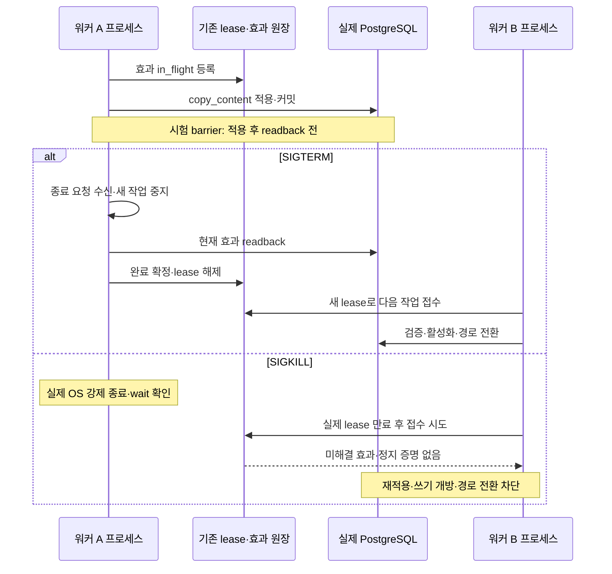

# 별도 워커 프로세스의 종료·인계·복구 차단 검증

2026-11-18 · 개인 `feature/migration-request-qualification`. MQ-03 프로세스 연결과 MQ-04 장애 경계의 일부를 확인하는 로컬 시험이다.

## 연결한 범위

[API runtime 시험](migration-runtime-qualification.md)의 실제 서비스 CLI·HTTPS JWKS·승인·DB 접수에 **별도 OS 프로세스의 `HandoffWorker.run` 폴링 루프**를 연결한다. 시험 코드가 `drive`를 호출해 단계를 진행시키지 않는다. 워커가 DB의 접수된 단위를 찾아 lease·효과 원장·실제 PostgreSQL adapter·독립 probe로 진행한다.

배포용 `run-worker` CLI·Kubernetes catalog·Pod 정지 증명은 이번 시험에서 사용하지 않는다. 제품 코드를 바꾸지 않고 시험 helper의 구성으로 연결했다.

반환값 관측용 subclass는 `super().drive`의 결과를 trace에 남긴 뒤 그대로 반환한다. `run`·lease·효과·복구 판단을 바꾸지 않는다.

| 구성 | 실제 사용한 것 | 이번 한계 |
|---|---|---|
| API | 실제 서비스 CLI 프로세스, 파일 설정, HTTPS JWKS | 생성한 시험 IdP, loopback API HTTP |
| 워커 | 별도 Python 프로세스, 기존 `HandoffWorker.run` | 전용 시험 진입점. 배포 Pod·daemon CLI 아님 |
| 데이터 | TLS PostgreSQL의 실제 역할 차단·복사·검증·활성화 | 한 컨테이너의 여러 논리 DB |
| 경로 | HTTP 앱이 매 요청의 DB 연결을 고를 때 읽는 공유 파일 | 시험 구현. 외부 Edge·Kubernetes Service 아님 |
| 복구 | 기존 lease·pending effect 검사 | quiescence provider를 연결하지 않아 강제 종료 후 자동 복구를 허용하지 않음 |
| 시간 | 실제 DB 시각으로 lease 만료 관측 | 시험 lease 2초. 배포 `WorkerConfig`나 제품 기본값은 변경하지 않음 |

경로 파일은 tenant·application·run·허용 DB를 확인하며 원자적으로 교체한다. 이 파일을 권한 원장이나 프로덕션 CAS 저장소로 표현하지 않는다. 쓰기 권한은 기존 승인·lease·효과 원장이 결정한다.

## 중단 지점

기존 PostgreSQL adapter가 `copy_content`를 적용하고 커밋한 뒤, readback·완료 원장 기록 직전에 시험 barrier를 둔다. trace와 실제 목적지 행으로 적용을 관측한다. adapter의 승인 검사·SQL·검증 결과를 바꾸거나 통과 여부를 주입하지 않는다.



## 장면 1 · SIGTERM 후 다음 워커가 계속 진행

1. 실제 HTTP 주문을 원본에 저장한다.
2. 워커 A가 DB 폴링으로 계획을 접수하고 복사 후 barrier에서 대기한다.
3. 원본의 실제 쓰기 차단 때문에 새 HTTP 주문은 503을 받는다.
4. 워커 B도 시작하지만 A가 lease를 보유하므로 진행하지 못한다.
5. A에 SIGTERM을 보낸다. 종료 요청 수신 trace를 확인한 뒤 현재 효과의 barrier를 해제한다.
6. A는 readback과 완료 기록을 마치고 종료한다. B는 새 lease로 다음 단계부터 진행한다.
7. 목적지에서 재시도·신규 주문을 받아 독립 원장과 대조한다. 최초 503도 보존한다.

논리 복사 효과의 시작·커밋 trace가 각각 한 번이고, 완료 원장에 미해결 효과가 남지 않는지 확인한다. 전체 DB 명령이나 모든 외부 효과의 exactly-once 보장을 뜻하지 않는다.

## 장면 2 · SIGKILL 이후 정지 증명 없이 재개하지 않음

1. 같은 커밋 후·readback 전 지점에서 워커 A를 실제 SIGKILL로 종료하고 OS의 종료 결과를 기다린다.
2. 목적지의 복사된 주문을 별도 조회한다. 원장에서는 해당 효과가 여전히 `in_flight`다.
3. DB의 실제 시각으로 lease 만료를 기다린다. `valid_until`을 과거로 수정하지 않는다.
4. B가 폴링·접수를 시도하되 정지 증명 provider가 없으므로 진행하지 못한다.
5. 원장·epoch·원본 authority·경로가 바뀌지 않고, 복사 재적용과 추가 쓰기 개방이 없는지 확인한다.

이 결과는 **복구 사전조건이 충족되지 않아 멈춘 것**이다. authority 상태를 임의의 `RECOVERY_REQUIRED`나 `SAFE_HOLD`로 덮어쓰지 않는다. 해당 분류와 실제 authority 상태·pending effect를 구분해 보고한다.

parent가 로컬 PID의 종료를 안다는 이유로 Kubernetes 정지 증명을 만들어 주지 않는다. 실제 Pod·원격 실행 효과가 더 이상 도착하지 않는다는 증명과 그 인증은 배포 인수에서 별도로 확인해야 한다.

SIGKILL 장면은 이전 완료·가용성 통과가 아니다. 성공 응답한 기존 주문은 보존되지만 차단된 새 요청은 미처리로 남는다. 시험 종료 후에는 모든 프로세스를 기다린 뒤 이번 실행의 휘발성 DB만 정리한다. 운영 자원을 자동 복구·초기화하는 로직을 추가하지 않았다.

## 재현과 결과

```sh
caffeinate -di python tests/qualification_postgres.py \
  --suite worker \
  --image sha256:0d938e975177bef9f1f61f3f9dbcf2e0aa0a139568f66d3415ed8892eb97f6ac \
  --security-source /path/to/pinned-security/src \
  --artifacts /path/to/new-private-run-directory
```

고정 Security 생산자 `27e6e85514a7cbb3e43d216464b72d9bd78f3fcf`, run 소유 DB·TLS·API·JWKS를 사용한다. 공유 클러스터·팀 저장소·다른 작업 트리는 변경하지 않는다. 프로세스 설정 파일에는 키·DSN의 파일 경로만 넣고 명령행에 값은 넣지 않는다. worker/API 로그와 trace는 비공개 증거로 보존한다.

[실행 요약](evidence/worker-process-qualification-20261118.json), [개발 기록](development/migration-worker-qualification-2026-11-18.md).

최종 `run-03`: **83 PASS, 0 FAIL, 0 ERROR, 0 SKIP**. 기존 회귀 81개와 새 워커 프로세스 2개를 같은 실행에서 확인했다. 소스 40개가 커밋 `ae509a1`과 일치하며, 시각 감시 234개 샘플을 통과했다. 생성한 컨테이너·네트워크를 정리했다.

| 장면 | 실제 최종 상태 | 업무 결과 |
|---|---|---|
| SIGTERM 인계 | `HANDOFF_COMPLETE`, 남은 미해결 효과 없음 | 논리 주문 3개 확인, POST 4회·503 1회 보존 |
| SIGKILL 후 증명 부재 | `SOURCE_FENCED`, 복사 효과 `in_flight` 유지 | 기존 주문 1개 확인, 차단된 새 요청 1개는 미처리. 이전 완료 아님 |

## 다음 운영 인수

실제 배포 이미지·실행 catalog·Pod 신원, Kubernetes 경로 저장소, 정지 증명·readback 복구, 독립 DB 서버·AWS→VM, NetworkPolicy·독립 witness·관측·SLO를 같은 배포에서 확인해야 한다. 이번 시험을 그 완료로 합산하지 않는다.

모든 업무 보고서의 `service_continuity=NOT_QUALIFIED`, `qualification_issued=false`, `authorizes_execution=false`를 유지한다.
