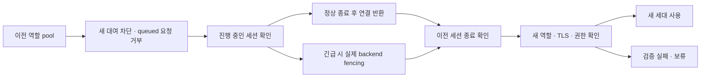

# 연결 pool의 네트워크 지연과 세대 교체 시험

[제어면 pool 실험](control-pool-qualification.md)의 남은 경계를 실제 TLS PostgreSQL에서 확인하는 qualification 하네스다. 운영 pool·자격증명 자동 교체 기능을 배포하는 변경은 아니다.

## 네트워크 지연

전용 loopback TCP 중계기는 DB와 client 사이의 암호화된 바이트를 그대로 전달한다. TLS 종료·SQL 해석·인증서 검증 생략을 하지 않는다. DB endpoint는 원래 certificate-verified loopback DSN만 허용한다. 서버→client 방향을 일시 정지하고 회복시켜 실제 checkout과 reset 대기를 관측한다. 저장하는 값은 이벤트·시각·backend 상태·바이트 수뿐이며 payload는 기록하지 않는다.

- 정상 중계 대조군에서 실제 연결·SELECT 1·정상 종료를 확인한다.
- 기존 backend를 pool이 대여하기 전 수행하는 check 중 응답을 지연시킨다. 자원 대기 1초가 동기 check의 네트워크 대기까지 제한하는지 직접 확인한다.
- 새 연결 방식의 실제 SELECT 응답도 같은 중계기로 지연시킨다. 동기 I/O 대기가 pool만의 문제인지 구분한다.
- reset의 실제 DISCARD 응답을 지연시킨다. 초기화가 끝나기 전에 다음 호출에 backend가 대여되는지 확인한다.
- 네트워크를 회복시킨 뒤 자연스러운 결과와 pool 종료를 확인한다. 별도 child process에 시험을 격리하며 실패 시 부모가 종료 기한을 적용한다.
- 별도 guard 시험에서는 회복시키지 않고 부모가 의도적으로 자식 프로세스를 종료한다. 중계기 종료 뒤 실제 pg_stat_activity에서 해당 backend가 사라졌는지 확인한다. 지연을 관측한 뒤 1초 대기·종료·원격 확인 구간을 5초 안에서 검증하며 시작부터의 client 5초 완료 기준과는 구분한다. 이 guard는 테스트 전용이고 제품에 배포하지 않았다.

서버 응답을 지연시킨 상황은 데이터 훼손·패킷 재전송·전체 TCP blackhole·여러 사이트 장애와 같지 않다. 결과를 일반 네트워크 내결함성 자격으로 확대하지 않는다.

## 이전 역할과 새 역할의 세대 분리

실험은 별도로 만든 두 NOBYPASSRLS runtime role을 사용한다. 테스트가 순서를 조정하며 제품에 rotation manager를 추가하지 않는다.

`pool.close()`는 신규·대기 중인 요청을 거부하지만 이미 빌려준 연결은 반납할 때까지 남을 수 있다. 이는 [공식 pool 종료 계약](https://www.psycopg.org/psycopg3/docs/api/pool.html)에 명시돼 있다. NOLOGIN도 새 로그인에 관한 속성이므로 기존 세션 종료와 구분한다.

정상 교체는 이전 세션의 종료를 관측한 뒤 새 역할 pool을 연다. 새 역할의 실제 schema 접근이 거부되면 이전 pool로 fallback하지 않는다. 긴급 시험에서는 UUID 시험 role의 LOGIN을 막고, 해당 세션에서 직접 읽은 backend PID만 종료한다. 종료된 연결에서 쿼리가 거부되고 새 역할로 연결되는지 확인한다.

업무 mutation은 실행하지 않으므로 미확정 commit 복구·운영 중인 작업 drain·lease 인계·전체 cutover 자격을 증명하지 않는다. 실제 운영 중 효과를 중단할 때는 기존 승인·소유권·effect 원장·조회 전용 복구 계약을 재사용해야 한다. 단순한 pool.close를 즉시 권한 회수로 해석하지 않는다.

## 지원 범위

이번 역할 교체는 password·인증서·Secret 갱신 시험이 아니다. fixture 역할들은 기존 전용 client 인증서를 사용한다. 실제 키/인증서 교체, trust store 갱신, TLS 세션 재개·회수, 네트워크가 끊긴 reset 종료와 shutdown 중 미확정 쓰기는 별도다.

제품 기본 연결은 그대로 유지한다. 기존 pool 실험의 18건 회귀를 함께 실행하고 새 시험이 통과해도 운영 승격·클라이언트 5초 완료·AWS→독립 온프렘 무중단을 발급하지 않는다.

[개발 기록](development/pool-lifecycle-2026-11-19.md) · [실측 증거](evidence/pool-lifecycle-20261119.json).
