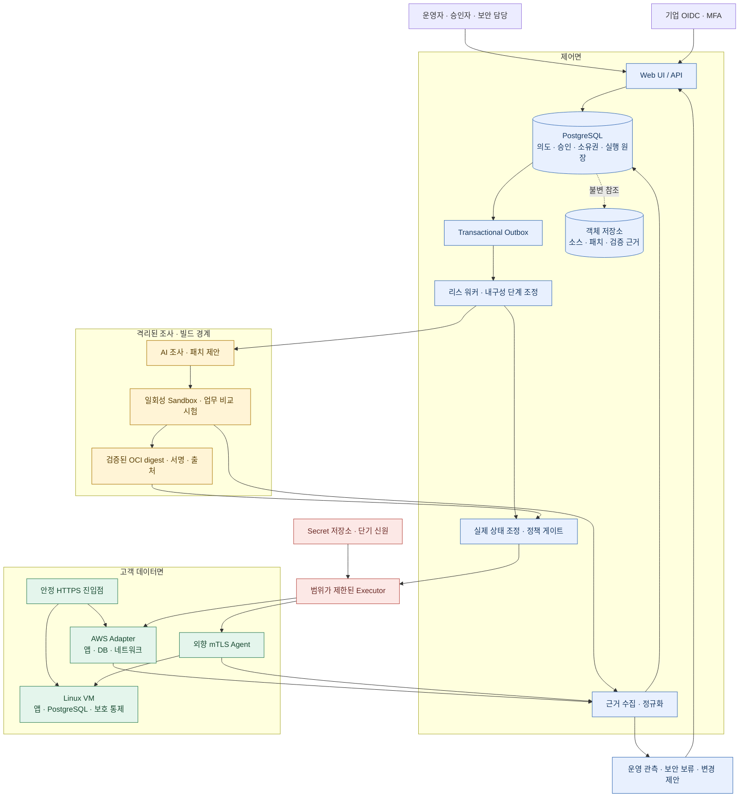
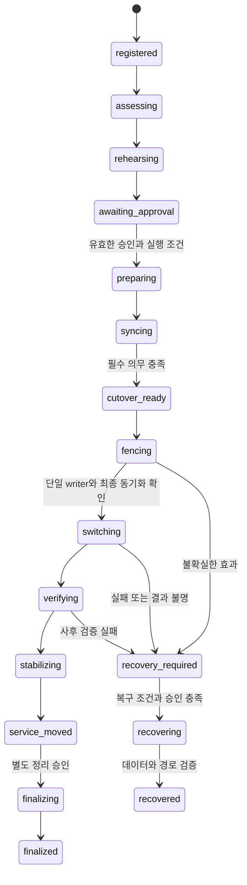

> 역사적 명세 v1.1. 최신 기술 선택은 [명세 v2](sova-production-spec-v2.md)를 따른다. 이 문서의 안전 불변식·검증 의무·시험 기준은 명시적으로 변경한 경우 외에는 유지한다. 기존 PDF는 이 스냅샷이며 최신 명세가 아니다.

# Sova 프로덕션 설계 명세 v1.1

작성일: 2026-10-31 · 상태: 구현 목표 명세 · 대상: 개발·보안·운영 담당자

개정일: 2026-10-31 · 기준 문서: 독립 제품 Sova · 개정 범위: 제품 경계·실행 책임·이전 자격·운영 연결

Sova는 운영 중인 웹 서비스의 요구사항과 환경 차이를 조사하고, 필요한 변경을 격리 환경에서 검증한 뒤, 승인된 범위에서 실행 환경과 데이터를 이전·복구하는 플랫폼이다. 운영 중 관측한 보안·성능·비용 변화는 새로운 변경 계획의 입력이 된다.

이 명세는 독립 제품 Sova의 목표다. 현재 구현한 AWS·Linux VM 시각화 프리뷰의 완료 범위는 2절에 한정된다. 운영 자격은 19절의 시험을 통과한 **경로·버전·부하·보호 수준**에 부여한다. 제품 전체에 한 번 부여하는 “프로덕션 인증”으로 취급하지 않는다.

## 1. 제품 범위와 핵심 계약

주 사용자는 서비스 운영 책임이 있는 개발·플랫폼·보안 팀이다. 단일 운영자의 로컬 실행도 지원하지만, 호스팅형 다중 테넌트 서비스와 인증·권한 구성을 분리한다. 일반 사용자의 자연어 요청은 의도 입력이며 운영 권한이나 위험 수용을 대신하지 않는다.

주요 흐름은 `운영 시스템 등록 → 환경 비교 → 변경 계획 → 격리 검증 → 승인 → 이전 → 사후 검증 → 관측`이다. 신규 ZIP·GitHub 앱 배포는 등록 방식 중 하나이며, 이미 실행 중인 서비스를 조사해 관리 대상으로 편입하는 흐름도 제공한다.

| ID | 반드시 보존할 계약 |
| --- | --- |
| INV-01 | 사용자 앱의 일반 쓰기 권위는 한 시점에 한 환경에만 있다. 제어면 리스만으로 이를 보장했다고 판단하지 않는다. |
| INV-02 | 승인한 source·patch·image·환경·정책 revision과 실제 실행이 일치해야 한다. 승인 후 변경은 영향 범위를 재검증한다. |
| INV-03 | 외부 변경의 결과가 불명확하면 재실행 전에 실제 상태를 조회한다. 확인할 수 없으면 보류한다. |
| INV-04 | 테넌트·앱·작업 경계를 넘는 데이터·Secret·실행 권한 접근을 거부한다. |
| INV-05 | 만료·누락·수집 실패한 근거는 통과가 아니다. AI의 설명으로 필수 시험을 대체하지 않는다. |
| INV-06 | 제어면 장애만으로 정상 데이터면을 종료하거나 기존 writer를 바꾸지 않는다. |
| INV-07 | 목적지에서도 요구된 보호 수준을 충족해야 한다. 변경된 보호 수준은 명시적 위험 수용과 새 계약이 필요하다. |
| INV-08 | 신규 쓰기 이후의 복귀는 새 데이터를 보존하는 복구 절차다. 옛 앱이나 URL로 돌아가는 것만으로 완료하지 않는다. |
| INV-09 | 보안 보류는 일반 배포 승인이나 AI 판단으로 해제되지 않는다. |
| INV-10 | 모든 변경은 자원 소유권·임시 권한·비용·정리 책임을 추적할 수 있어야 한다. |

제품 전체 목표에는 데이터 이전, 원격 온프렘, 운영 폐쇄 루프, 보안 통제 보존이 포함된다. 첫 경로의 자격 획득 순서가 이 기능들을 최종 범위에서 제외한다는 의미는 아니다.

## 2. 현재 구현과 첫 운영 경로

### 2.1 현재 Sova

| 구현 | 확인 범위 | 확장해야 할 부분 |
| --- | --- | --- |
| AWS Fargate·Lima VM의 별도 HTTPS 앱 | 미리 실행한 무상태 앱 간 실제 요청 경로 변경·응답 신원·TLS 확인 | 독립 설치·일반 앱·데이터 이전 |
| 워크로드 지도·단계·요청 기록 | 실제 응답과 실행 기록 기반 표시 | 다중 워커 이벤트·분산 추적·전역 지표 |
| 시험용 AWS 유입 격리·해제 | 전용 SG 규칙 제거·조회·새 연결 거부·원래 규칙 복원 | 실제 사고 탐지·기존 연결 차단·전체 격리 정책 |
| 프리뷰의 SQLite 실행 기록·오류 보존 | 재시작 시 불명확한 변경 보류, 읽기 전용 준비 확인의 제한 재시도 | 새 PostgreSQL 제어면과 프리뷰 연결·이력 전환 정책 |
| 독립 P0 계약·효과 원장 | 앱/환경 모델·검증 의무·불변 명령·SQLite CAS·프리뷰 어댑터 연결, 로컬 장애/HTTP 시험 | 실시간 인가·분산 fencing·전체 운영 조정·실환경 어댑터 자격 |
| Lifecycle PostgreSQL 저장 | 계획·승인·snapshot 불변 저장·강제 RLS·취소 CAS·실행 직전 재조회, 실제 임시 PostgreSQL 시험 | 웹·기업 인가·운영 TLS/복구 |
| 작업·outbox PostgreSQL 저장 | 원자적 접수·상태 이력·멱등 키·리스 claim/ack·relay, 실제 PG와 프로세스 종료 시험 | 실제 publisher/소비자·내구성 실행 조정·웹 연결 |
| 실행 PostgreSQL 원장·소유권 | 앱별 epoch/token·효과 CAS·미해결 인계 barrier·인증 callback 기반 조회 전용 복구, 실제 PG·워커 종료 시험 | 실제 외부 요청 종결 proof·원격 fencing·최소 권한 broker·큐/웹 연결 |
| 로컬 세션·소유권 검사 | localhost 운영자와 등록된 시험 자원 | 기업 SSO·테넌트·고객 계정 위임 |

초기 프리뷰 22개 시험은 현재 전체 시험 수와 구분한다. 2026-10-31 저장된 검증 기록에서는 전체 226개가 통과했고 실패·오류·skip은 0이다. 그중 64개는 임시 PostgreSQL 17.11을 사용하는 실제 DB 시험이다. 외부 provider는 시험 대체물을 사용했으며 실제 AWS·VM 프리뷰의 검증과 별개다. 이 숫자는 해당 실행의 기록이며 이후 코드 전체의 상태나 운영 자격을 자동으로 나타내지 않는다. 상세 범위는 [PostgreSQL 실행 검증](postgres-execution.md)과 [현재 README](../README.md)에 둔다.

시험용 404 신호를 실제 공격 탐지로 표현하지 않는다. 프리뷰는 기존 Sky 이미지·네트워크 준비에 의존하므로 독립 제품 설치가 완료된 상태도 아니다.

구현, 시험, 서비스 연결, 운영 자격은 독립 상태로 기록한다. PostgreSQL 구성 요소의 시험 통과는 웹 프리뷰가 PostgreSQL을 사용한다는 뜻이 아니다. 현재 프리뷰는 SQLite 경로이고 새 제어면은 별도로 시험했다. 실제 환경의 가동 여부는 시간에 따라 달라지므로 문서의 과거 검증을 현재 서버 실행 상태로 표시하지 않는다.

Sky의 기존 게임·DB 이전 결과는 이식할 구현과 회귀 시나리오의 출처다. 이를 Sova에서 이미 구현한 기능으로 합산하지 않는다. Sova로 옮긴 코드는 새 인증·작업·근거 계약 아래 다시 시험한다.

### 2.2 첫 운영 자격 경로

첫 경로는 **AWS에서 운영 중인 컨테이너 HTTP 서비스와 PostgreSQL을 독립 Linux VM 환경으로 이전**하는 것이다. 목적지는 고객이 관리하는 서버·가상머신으로 등록하며 개발 PC의 Lima만으로 원격 온프렘 지원을 판정하지 않는다.

첫 데이터 어댑터는 PostgreSQL 17 같은 major의 검증된 버전 조합을 대상으로 한다. 정확한 서버 patch·클라이언트·확장·collation·런타임 이미지 digest는 자격 레지스트리에 고정한다. 역방향 이전은 별도 시험을 통과해야 한다.

첫 자격은 `bounded_write_pause`다. CDC 기반 `continuous_service`, WebSocket 세션 보존, 파일 저장소·worker 이전은 같은 계약을 확장하는 후속 자격이다. 목적지가 단일 VM이면 그 실패 영역을 허용하는 서비스만 배치한다. Multi-AZ 수준의 요구가 있으면 다중 노드·복제·장애 조치가 실제 검증된 목적지가 필요하다.

### 2.3 완료 주장의 범위

| 주장 | 필요한 근거 | 현재 상태 |
| --- | --- | --- |
| `route_switch_verified` | 준비된 두 앱의 실제 신원·TLS·경로 변경·변경 후 응답 | AWS·Lima 프리뷰에서 확인. 일반 원격 VM 자격과 구분 |
| `migration_verified` | 앱·데이터·권한·진입점 이전, 신규 쓰기 보존, 복구 시험 | Sova 통합 경로 미완료 |
| `continuous_service_qualified` | 승인한 부하·관측 창에서 오류·지연·연결·데이터 기준 충족 | 미자격. 경로 변경 속도나 CDC 유무로 대체하지 않음 |
| `provider_exit_ready` | 출발 provider의 DNS·registry·Secret·백업 등 잔존 의존성 검토 | 미자격. 트래픽 이동과 별도 |

기능별 상태는 `implemented`, `verification_scope`, `service_integrated`, `qualification_profile`로 보존한다. 미검증·만료·비활성 상태를 별도 표시한다. 이는 목표 상태 계약이며 현재 모든 필드의 API 구현을 의미하지 않는다.

## 3. 구조와 기술 결정

제어면은 의도·승인·진행을 관리한다. 데이터면은 앱·DB·진입점으로 구성되며 제어면이 없어도 현재의 정상 서비스를 유지한다. 빌드·AI·고객 환경 실행은 각각 다른 신뢰 경계다.

| 영역 | 결정 | 운영 조건 |
| --- | --- | --- |
| API·도메인 | Python·FastAPI, 버전 있는 JSON 계약 | 요청 안에서 장시간 이전·빌드·AI 호출을 실행하지 않음 |
| UI | TypeScript, API와 독립 배포 가능 | 신뢰할 상태·근거와 표시 revision을 함께 제공 |
| 도메인 상태 | PostgreSQL | 백업·PITR·복원 시험, 테넌트 인가·RLS |
| 장기 실행 | 첫 경로는 PostgreSQL 상태 머신·outbox·리스 워커 | 큐는 통지 수단. 내구성 타이머·재개·복구·업그레이드 자격은 별도 확보 |
| 파일·산출물 | 객체 저장소·OCI 레지스트리 | 불변 digest·분류·보존·별도 삭제 권한 |
| VM 실행 | 외향 mTLS Agent, OCI 컨테이너 | 호스트 등록·업데이트·명령별 최소 권한 |
| 기반 인프라 | Terraform | 제품 기반과 앱별 자원의 state·소유권 분리 |
| 추가 환경 | 버전 있는 어댑터 | Kubernetes는 선택 대상이며 모든 앱의 필수 기반이 아님 |

첫 경로의 실행 진행·재시도 시점·취소 요청은 PostgreSQL을 정본으로 삼는다. outbox는 통지 유실을 복구하며 큐 메시지는 실행 권한이 아니다. 현재 저장소·relay 계약의 구현을 실제 큐·소비자·내구성 타이머 연결 완료로 간주하지 않는다. SDK·큐의 재시도는 외부 변경의 정확히 한 번 실행을 보장하지 않으므로 7절의 효과 계약을 적용한다.

Temporal은 별도 도입 평가로 남긴다. 채택 시 실행 순서·타이머·재시도 책임을 명시적으로 이관하고 PostgreSQL의 도메인 의도·승인·효과 원장은 유지한다. 같은 작업을 자체 워커와 Temporal이 동시에 조정하지 않는다. 전환에는 진행 작업 배출 또는 버전별 이관, 중복 시작 방지, 복구·비용·레지던시 시험과 ADR이 필요하다.

초기 저장소는 하나로 운영한다. `src/sova/{domain,application,workflows,ports,adapters,interfaces}`와 `web/`, `agent/`, `infra/`, `tests/`, `docs/`로 책임을 나눈다. `.local-notes/`는 개발기록·비공개 검증 자료에 사용한다. 최종 실행 패키지는 형제 Sky·OneDeploy 디렉터리를 import하거나 그 비공개 설정에 의존하지 않는다. 코드 이식 시 원본·라이선스·변경 내역을 추적한다.

## 4. 운영 시스템 모델과 후보 판단

`provider`와 `backend`를 분리한다. AWS라는 선택이 ECS Express라는 결정을 의미하지 않는다. 앱 요구사항은 특정 백엔드의 한계를 맞추기 위해 삭제하지 않는다.

등록 그래프는 서비스, DB, 파일·객체 저장소, queue, worker, scheduler, Secret 참조, 네트워크, 진입점, DNS·인증서, registry, 외부 API, 관측·감사·백업을 포함한다. 각 노드는 소유자·테넌트·실제 ID·현재 revision·데이터 등급·위치·관측 유효기간을 갖는다. 간선은 호출·인증·읽기·쓰기·복제 관계와 허용 경로를 나타낸다.

| 모델 | 필수 내용 |
| --- | --- |
| `ApplicationRequirements` | 프로토콜·상주 실행·프로세스 상태·모든 writer·데이터·호스트 제어·가용성·위치·보호 요구 |
| `EnvironmentSnapshot` | 실제 계정·노드·자원·설정·의존성·관측 시각·출처·수집 실패 |
| `BackendCapability` | provider 기능, Sova 구현 여부, 자격 시험 범위, 현재 실행 가능 여부를 별도 필드로 보존 |
| `CandidateAssessment` | 적합·조건부·부적합·미지원, 충족/미충족 조건, 변환 후보, 근거·견적 |
| `MigrationPlan` | 전체 revision·작업 DAG·데이터 경로·권한·중단 예산·복구·정리·비용 |
| `VerificationObligation` | 조건 ID·단계·대상·시험기 버전·필수성·담당 실행기·기한·실패 처리 |

분석기는 설정·구조·AST·정규식·의존성·실제 환경 신호를 모은다. 정규식 하나를 최종 의미 판정기로 취급하지 않는다. AI는 신호와 운영 조건을 해석하고 후보·변환·시험을 제안한다. 정책 엔진은 하드 제약·구현 상태·승인 범위를 검증해 실행 후보를 제한한다.

Lambda는 이벤트 단위 실행과 호출 간 프로세스 상태 비의존, ECS 계열은 지속 컨테이너 실행, EC2·VM은 호스트 제어 요구를 주요 신호로 삼는다. 이는 배타적 정답표가 아니다. 실행 시간·지연·스케일·네트워크·운영 능력·데이터·실측 비용에 따라 여러 후보가 적합할 수 있다. 지원하지 않는 후보를 적합하다는 이유만으로 실행하지 않는다.

비용 비교는 사용량·지역·가격 출처·조회 시각·세금/할인 포함 여부·추정 범위를 표시한다. 변환·이전 통신료·복제/WAL·두 환경 동시 실행·백업·정리 전 잔존 비용도 계산한다. 근거가 없으면 견적 미확정으로 남긴다. “로컬이 항상 저렴하다” 같은 기본 순위는 두지 않는다.

## 5. 테넌트·신원·승인

테넌트는 조직이다. 사용자 소속과 역할은 서버가 신뢰하는 IdP·멤버십 저장소에서 확인한다. 요청·큐 payload가 보내는 조직 ID와 역할을 그대로 신뢰하지 않는다.

| 역할 | 권한 |
| --- | --- |
| `viewer` | 허용된 앱·작업·비밀값이 제거된 근거 조회 |
| `operator` | 환경 등록·조사·계획·리허설 요청 |
| `approver` | 자신이 작성하지 않은 운영 전환·복구·비용 승인 |
| `security_officer` | 보안 보류·제한된 예외·신뢰 회복 검토 |
| `org_admin` | 멤버십·조직 정책 관리. 보안 보류 해제 권한은 별도로 부여 |

호스팅 API는 OIDC 토큰의 서명·issuer·audience·만료·허용 알고리즘을 검증한다. ALB 인증을 사용하는 배치에서는 ALB가 서명한 주장과 허용 signer를 검증하고, API 직접 접근도 네트워크로 차단한다. 헤더만 있는 요청은 인증으로 인정하지 않는다. 브라우저 세션은 안전한 쿠키·CSRF 방어·Origin 검사·재인증·세션 폐기를 포함한다.

PostgreSQL의 테넌트 행에 `tenant_id`를 필수로 저장하고 애플리케이션 인가와 RLS를 함께 적용한다. API 역할은 테이블 소유자·superuser·`BYPASSRLS`가 아니다. 연결 풀 사용 시 테넌트 문맥을 트랜잭션 범위에 설정하고 반환 시 잔류하지 않도록 시험한다. 객체·로그·캐시·다운로드 URL·이벤트 스트림·workflow 조회·백업 복원에서도 같은 경계를 적용한다.

승인은 `plan_digest`, requirements/policy/environment revision, image digest, 시험 근거 집합, 대상 ID, 최대 비용·기간·영향, 승인자·만료를 결합한다. 실행 직전에 권한·보류·현재 상태를 다시 확인한다. 승인 철회는 아직 수행하지 않은 변경을 막으며, 이미 수행한 효과는 조회 후 안전한 중단 또는 복구로 처리한다.

사전 승인 자동화도 변경 종류·자원·최대 위험·비용·관측 조건·동시성·유효기간을 제한한다. 일반 운영자는 자기 승인으로 보안 정책을 완화하지 못한다. 긴급 접근은 별도 신원·짧은 만료·사후 검토·독립 감사가 필요하다.

## 6. 상태 정본과 영속 모델

| 데이터 | 정본 | 다른 저장소와의 관계 |
| --- | --- | --- |
| 의도·요구·계획·승인·보류·소유권 | PostgreSQL | UI·workflow payload는 revision을 참조 |
| 실행 순서·재시도 시점·취소·단계 진행 | PostgreSQL 작업/단계 상태와 내구성 타이머(목표) | 워커가 조정하고 큐는 통지. 도메인 성공은 실제 효과·근거로 확정 |
| 실제 서비스·DB·경로·권한 | 고객 환경 | 어댑터 readback으로 수집. DB 기록만으로 실제 변경 완료를 주장하지 않음 |
| 소스·패치·로그·시험 자료 | 객체 저장소 | DB에는 digest·분류·불변 참조·보존 정책 |
| 인증 정보 | Secret 저장소 | DB·queue·실행 이력·로그에는 참조만 |

주요 테이블은 `tenants`, `memberships`, `applications`, `environments`, `resource_inventory`, `requirement_revisions`, `plans`, `plan_steps`, `approvals`, `operations`, `effect_attempts`, `obligations`, `evidence`, `security_holds`, `outbox`, `audit_events`, `usage_reservations`다. 테넌트별 유일성·외래키·상태 전이 조건을 DB에서도 강제한다.

승인된 계획은 불변이다. 변경은 새 revision을 만든다. 감사·근거를 덮어쓰지 않고 정정 레코드가 이전 레코드를 참조한다. 비밀값이 포함될 수 있는 원문은 분리 저장·제한 열람·보존 삭제를 적용하며 공개 근거에는 요약·해시만 제공한다.

목표 API는 operation과 outbox를 한 트랜잭션으로 저장하고 `202 Accepted`를 반환한다. dispatcher는 고정 event ID와 operation 참조를 발행한다. 발행 후 ack 저장에 실패하면 같은 이벤트가 재전달될 수 있다. 소비자는 DB의 작업·승인·보류·현재 revision을 재조회하고 앱 실행권을 얻어야 한다. 같은 메시지의 재수신은 새 operation이나 새 외부 효과를 만들지 않는다. 오래된 미접수·정합성 불일치는 조정기가 찾아 보류하거나 같은 작업의 재조정을 요청한다.

API의 접수, workflow의 단계 완료, 고객 서비스의 정상 상태는 서로 다른 사실이다. 작업 실패가 현재 정상 서비스의 실패로 표시되거나, 과거 성공이 현재 상태를 계속 초록색으로 만드는 것을 금지한다.

## 7. 외부 변경·재시도·동시성 계약

모든 변경 어댑터는 `inspect`, `plan`, `apply`, `readback`, `verify`, `compensate`, `finalize` 계약을 구현한다. `apply`는 자유 형식 CLI 문자열이 아니라 검증된 typed command를 입력으로 받는다. CLI·SDK·agent RPC 사용 여부는 어댑터 내부 구현이다.

효과 원장은 `effect_id`, operation/step/attempt ID, resource ID, 예상 revision, 명령 digest, 멱등 키, fencing epoch, 인가·승인 참조, 시작·응답·조회 결과를 기록한다. 외부 요청 전 의도를 저장한다. 반환값은 `confirmed_applied`, `confirmed_not_applied`, `unknown`을 구분한다.

| 상황 | 처리 |
| --- | --- |
| 안전한 GET 준비 확인이 일시 실패 | 명시된 timeout·횟수·총 deadline 안에서 재시도하고 모든 결과 보존 |
| 인증서·실행 신원·소유권·권한 불일치 | 즉시 보류. 재시도로 우회하지 않음 |
| 변경 요청 timeout·워커 종료·응답 유실 | 실제 자원 readback. 성공/미적용을 확인하기 전 무조건 반복 금지 |
| provider 멱등 API | 같은 효과 키로만 재시도하고 키 수명·요청 fingerprint 확인 |
| 멱등성도 신뢰할 조회도 없는 변경 | 자동 실행 자격을 부여하지 않고 수동 조정 절차 요구 |
| 사용자 앱 POST 결과 유실 | 앱이 승인된 멱등 키·결과 조회를 제공할 때만 재시도 |

같은 앱의 이전·갱신·DB 승격·복귀·삭제는 상충 변경으로 직렬화한다. 승인 대기 중 장시간 DB 트랜잭션을 유지하지 않는다. 공유 DB 할당·비용 예약·공유 edge 변경에는 해당 자원 범위의 짧은 잠금을 추가한다.

리스 만료는 이전 실행자의 자격 증명과 이미 진행 중인 API를 즉시 취소하지 못한다. 따라서 epoch를 DB/agent/edge가 검사하거나, CAS·버전 조건·단일 명령 broker로 늦은 변경을 거부해야 한다. provider가 이를 지원하지 않으면 기존 실행자의 미확정 요청을 해소하기 전 새 상충 명령을 내리지 않는 어댑터 계약을 시험한다. 리스가 만료됐다는 이유만으로 새 writer를 열지 않는다.

취소는 외부 요청 중간을 강제로 원복하는 신호가 아니다. 안전한 경계에서 멈추고 진행 중 효과를 확인한다. 실행 코드는 계획·단계·명령·검증기 버전에 결합하며, 업그레이드 중 기존 작업은 호환 실행기를 유지하거나 안전한 정지 후 재계획한다. 과거 이벤트·상태에서 새 코드를 재개하는 호환 시험을 수행한다. Temporal 채택 시에는 별도의 history replay 시험을 추가한다.

### 7.1 워커와 복구의 책임

| 구성 요소 | 책임과 금지 사항 |
| --- | --- |
| outbox relay | 통지 claim/발행/ack. 앱 변경 실행권을 부여하지 않음 |
| 실행 워커 | 승인·보류 재확인, 앱 lease 갱신, typed command 조정. 임의 shell/SQL·계획 변경 금지 |
| 타이머 조정기 | DB에 `due_at`·시도 횟수·총 deadline·원인 저장. 프로세스 sleep을 유일한 재개 근거로 쓰지 않음 |
| 효과 실행기 | intent와 in-flight 커밋 후 외부 호출. 외부 호출 동안 DB 행 잠금을 유지하지 않음 |
| 복구 실행기 | 인증된 종결 근거로 제한된 readback 수행. 조회 전용 권한으로 새 apply 금지 |
| 운영자 | 해결되지 않은 실제 상태를 조사하고 승인된 복구 계획 요청. DB 값을 임의 수정해 unknown 해제 금지 |

outbox lease, 앱 실행 lease, 사용자 DB의 writer 권위는 서로 다르다. 앞의 두 리스가 유효해도 DB writer handoff가 완료된 것은 아니다. 현재 PostgreSQL barrier는 프로토콜을 따르는 제어 실행기 사이의 통제다. 외부 API의 epoch 강제나 침해된 실행자의 모든 행동을 차단하는 경계로 주장하지 않는다.

기존 실행자의 미확정 요청이 있으면 일반 인계를 막는다. 조회 전용 복구는 이전 실행자·외부 요청의 늦은 변경 가능성이 해소됐다는 신뢰할 근거를 요구한다. 근거는 tenant/app/operation/이전 epoch/현재 미해결 효과 집합/관측 시각/만료/발급자에 결합한다. 로컬 프로세스 종료·현재 정상 응답·시간 경과만으로 원격 API의 종결을 증명하지 않는다. 실제 provider 종결 근거 수집기는 미구현이며, 확보할 수 없는 요청은 보류·수동 조사한다.

계획·승인 저장, 실행권, 효과 원장의 계약은 [Lifecycle 저장](postgres-lifecycle.md), [outbox](postgres-outbox.md), [실행 원장](postgres-execution.md)을 따른다. 계약 구현과 운영 인증·역할 분리 완료 여부는 별도로 검증한다.

## 8. 상태 전이와 검증 의무

`blocked`, `cancelled`, `failed`는 변경 전 안전한 단계에서 사용할 수 있다. writer 제어 이후에는 일반 실패 종료로 잠금·복제·정지 상태를 버리지 않고 `recovery_required`로 보낸다. `security_hold`는 모든 단계에 걸치는 별도 보류 상태다. 이전 상태도 보존하며 보류 해제만으로 다음 변경이 자동 재개되지 않는다.

| 게이트 | 의무 | 실패 처리 |
| --- | --- | --- |
| G0 등록 | 테넌트·권한·계정·자원·소유권·수집 범위 | 미등록/접근 거부 |
| G1 요구 | 전체 의존성·writer·SLO·데이터 등급·지원 범위 | 계획 보류 |
| G2 변경 | patch·설정·정책·공급망·Secret·금지 변경 검사 | 후보 제외/수정 |
| G3 실행 | 실제 빌드·기동·runtime identity·보안 sandbox | 승격 금지 |
| G4 동작 | 업무·권한 거부·데이터·오류 시나리오 비교 | 후보 사용 금지 |
| G5 데이터 | 일관 복사·동기화·fencing·신규 쓰기 후 복귀 리허설 | 운영 이전 금지 |
| G6 보호 | 통제·백업복원·관측·용량·복제 영향·비용 | 목적지 사용 보류 |
| G7 직전 | 승인·revision·현재 자원·유효 근거·보류·예산 | 재검토/재승인 |
| G8 사후 | 실제 경로·writer·새 쓰기·무결성·보호·SLO | 안전한 정지/검증된 복구 |

각 게이트 결과는 통과 여부뿐 아니라 **전체 의무 목록과 다음 단계로 이관할 의무 ID**를 가진다. `requires_target_verification`은 담당 단계·시험기·대상·deadline이 정해진 의무다. 미실행 상태로 G8을 통과할 수 없다. `not_applicable`은 이유·적용 범위·승인자를 요구한다.

Evidence는 tenant/app/operation/step, resource identity, 입력 revision, 검증기 버전, 관측·만료 시각, 값·단위·표본·결과, artifact digest, 수집 주체를 포함한다. 역사적 복사 완료 사실과 현재 접근 권한의 유효기간을 구분한다. 서명·인증 채널·저장 권한을 함께 검증하며 해시 하나를 위조 방지로 간주하지 않는다.

## 9. 데이터 이전과 단일 writer

### 9.1 서비스 수준

`bounded_write_pause`는 승인된 쓰기 정지 예산 안에서 최종 복사·동기화·전환을 수행한다. 읽기·WebSocket 영향은 별도로 측정한다. `continuous_service`는 지원 앱에 한해 요청 대기·재시도·멱등 처리·트랜잭션 의미를 포함해 승인 SLO를 충족해야 한다. CDC 사용만으로 무중단을 주장하지 않는다.

양쪽 DB에 일반 쓰기를 허용한 뒤 충돌을 나중에 해결하는 방식은 기본 이전 모드로 지원하지 않는다. dual write가 필요한 별도 제품은 충돌 해결·순서·재처리·복구까지 독립 자격이 필요하다.

### 9.1.1 첫 이전 경로의 실행 규약

첫 경로는 쓰기 정지 예산·데이터 크기·쓰기율에 맞춰 일관된 dump/restore 또는 검증된 초기 복사+변경분 동기화를 선택한다. CDC는 모든 앱의 필수 수단이 아니다. 전체 복사를 쓰기 정지 시간 안에 끝낼 수 없고 변경분 동기화도 자격이 없으면 해당 계획을 차단한다.

| 단계 | 다음 단계로 넘어가는 조건 | 시간 초과·불확실 시 처리 |
| --- | --- | --- |
| 준비 | 정확한 이미지·설정·권한·DB 버전·edge·복원본·비용 확인 | source 유지, 임시 자원만 승인 범위에서 정리 |
| 초기 동기화 | 일관 복사와 변경분 경계 확인, target 일반 쓰기 차단 | 복제/WAL/공간 위험 한도를 넘으면 중단·재계획 |
| 전환 직전 | 승인 유효, 전 writer 제어권, 역이전/복구 방식, 남은 중단 예산 확인 | 사용자 쓰기를 멈추기 전에 차단 |
| 쓰기 정지·최종 동기화 | source fence·기존 트랜잭션 처리·최종 barrier·데이터 확인 | 새 target writer를 열지 않음. source 상태를 확인한 뒤 재개 또는 복구 보류 |
| writer·경로 전환 | source 차단 확인, target 권위·DB binding·edge readback | 실제 상태를 조회하고 단일 writer를 유지. 추측 rollback 금지 |
| 사후 검증·안정화 | 운영 URL의 새 읽기·쓰기·지속 저장·권한·SLO 충족 | 신규 쓰기 유무에 맞는 복구 계획으로 전환 |

쓰기가 source에서 거부·대기되기 시작한 시각부터 target에서 정상 쓰기가 재개된 시각까지를 쓰기 정지 시간으로 측정한다. 사용자 경로에서 연속 probe와 업무 요청을 수행해 실패 수·최장 실패 구간·지연·재시도·중복을 따로 기록한다. 무요청 구간, 관측 누락, 낮은 표본 수는 무중단의 근거가 아니다.

`continuous_service`는 지원하는 프로토콜·부하·관측 창에서 합의된 서비스 기준을 만족한 경로에만 부여한다. “요청 실패 0”을 주장하려면 해당 시험에서 그 조건을 직접 확인해야 한다. 읽기 유지, 쓰기 대기, 클라이언트 재접속을 각각 공개하며 보편적인 무중단 보장으로 확대하지 않는다.

### 9.2 PostgreSQL 데이터 경로

1. schema·키·제약·sequence·확장·large object·타입·collation·replica identity와 모든 writer를 조사한다. 관리자·batch·scheduler·외부 연결도 포함한다.
2. dump/restore 경로 또는 일관된 초기 복사와 변경분을 연결하는 논리 복제 경로를 선택한다. 독립 시점 dump와 뒤늦은 CDC를 누락 없는 흐름으로 간주하지 않는다.
3. target의 일반 writer는 닫고 전용 복제 역할만 허용한다. 복제 설정 변경·재시작·slot·WAL·스토리지·출발지 부하 영향을 계획에 포함한다.
4. 초기 테이블 동기화·적용 실패·복제 지연·retained WAL·디스크 여유를 관측한다. 임계 초과 시 취소·slot 처리와 재시작 지점을 보존한다.
5. 이전 중 DDL은 동결하거나 검증한 호환 절차만 허용한다. sequence·역복제·대용량 데이터는 별도 의무다.

PostgreSQL 논리 복제는 DDL과 sequence 상태를 자동 복제하지 않으므로 별도 절차가 필요하다. 미지원 large object 등도 사전 검사한다. [PostgreSQL 17 논리 복제 제한](https://www.postgresql.org/docs/17/logical-replication-restrictions.html).

### 9.3 권위 전환

1. 실행권·G7·현재 자원·관측 상태를 확인한다.
2. 모든 writer의 새 작업 접수를 제어하고 진행 중 트랜잭션을 drain한다. 종료 deadline과 강제 종료 시 롤백 영향을 승인 범위에 포함한다.
3. source DB의 앱 쓰기 권한과 기존 세션을 실제로 fence한다. 앱 내부 플래그만으로 충분하다고 판단하지 않는다. 읽기도 막히는 수단이면 그 영향까지 표시한다.
4. source의 마지막 허용 commit에 대한 어댑터 barrier가 target에 durable apply됐음을 확인한다. 단순 지연 0·임의 WAL 위치 비교는 대체 근거가 아니다.
5. 같은 barrier에서 schema·PK 집합·행 수·정규화한 내용·제약·sequence를 검증한다. 표본 검사는 전체 비교로 표시하지 않는다.
6. 복제 중지·방향·재적용 방지 상태를 확인하고 target의 새 writer epoch를 활성화한다. source가 닫혔는지 확인할 수 없으면 target을 열지 않는다.
7. Green DB binding·edge를 전환하고 새 요청의 runtime·DB·epoch를 읽어 확인한다. 앱·DB·edge·작업 DB가 하나의 트랜잭션이라고 가정하지 않는다.
8. 새 읽기·쓰기·권한 거부와 내구성 검사를 수행하고 안정화한다.

DB 계정에 관리자 우회 경로가 남아 있다면 그 주체와 통제 절차를 명시해야 한다. Sova가 통제할 수 없는 writer를 숨긴 채 데이터 보존을 보장하지 않는다.

### 9.4 복귀와 정리

target 신규 commit 전에는 source 보존 상태를 검증해 제한된 빠른 복귀를 할 수 있다. 신규 commit 이후에는 target을 fence하고 역방향 복사/동기화·무결성·sequence를 검증해 source를 최신화한 뒤 복귀한다. 역복제를 검증하지 않은 경로는 신규 쓰기 이후 자동 복귀 자격을 얻지 못한다.

| 실패 지점 | 기본 대응 | 금지 동작 |
| --- | --- | --- |
| source fence 전 준비 실패 | target 임시 자원·권한 정리, source 유지 | 정상 source 변경 |
| source fence 후 target 미개방 | 실제 writer 상태 조회 후 source 재개 또는 안전 보류 | timeout만 보고 target 개방 |
| target 개방·edge 전환 불명 | 양쪽 DB·edge 조회, writer 하나를 유지해 조정 | 추측으로 양쪽 개방 |
| target 신규 쓰기 후 실패 | target 보존, 검증된 역이전 또는 수동 복구 | 과거 snapshot/URL만 복귀 |
| 침해 의심 동반 | 보안 사고 경로로 전환 | 오염 가능 source로 자동 복귀 |

source 삭제는 `service_moved`와 분리된 finalize다. 안정화 기간·유효한 복원본·잔존 의존성·복구 창 종료·별도 삭제 승인을 확인한다. 승인 전 source 비용은 계속 노출한다. slot·복제 계정·임시 방화벽·Secret·volume도 정확한 소유권을 확인해 회수한다.

## 10. 안정 주소·세션·환경 탈출

운영 주소는 소유권·TLS 갱신·용량·장애 조치·접근 제어·readback을 검증한 edge가 제공한다. source와 함께 사라지는 edge만 있으면 `service_moved`는 가능해도 `provider_exit_ready`는 아니다. 완전 탈출에는 DNS·registry·Secret·백업·감사·외부 API까지 검토해야 한다.

Blue는 source 앱/DB, Green은 target 앱/DB다. 서로 다른 writer DB로 일반 요청을 카나리 분산하지 않는다. 앱 버전 카나리는 동일한 권위 DB·호환 스키마·세션 처리·revision별 지표·승격/중단 기준을 갖춘 별도 전략이다.

HTTP 새 연결, keep-alive, 진행 중 요청, WebSocket, 쿠키·인증 세션, 프로세스 메모리는 별도 항목이다. WebSocket 재연결과 상태 복구를 구현한 경로는 그 범위로 표시한다. 기존 연결이 source에 남아 있는 것을 이동 성공으로 표시하지 않는다. DNS TTL을 즉시 전환 보장으로 사용하지 않는다.

edge 장애와 제어면 장애를 독립 시험한다. 목적지 준비 완료를 실제 사용자 경로의 완료로 올리지 않으며, 최종 검증은 운영 hostname·TLS·새 쓰기까지 포함한다.

### 10.1 트래픽 전환 계약

edge 설정은 예상 revision을 포함한 CAS로 전환하고 변경 후 실제 routing revision을 조회한다. source에서 처리 중인 요청 수·최장 처리 시간·drain deadline을 측정한다. deadline 초과 시 연결 종료·재시도·업무 영향의 처리 정책이 없으면 그 프로토콜의 무중단 자격을 주지 않는다.

DB handoff와 edge 전환 사이에는 새 요청을 승인된 방식으로 대기·거부하거나 검증된 DB binding을 사용한다. 오래된 source 앱이 새 요청을 받거나 keep-alive 연결을 유지하더라도 source DB에 쓰지 못해야 한다. edge 전환 성공만으로 writer 제어를 해제하지 않는다.

WebSocket은 기존 연결 drain, 재접속, 인증, 게임/업무 상태의 복구를 별도 시험한다. 연결을 닫고 재접속하는 경로는 해당 중단·복구 시간을 표시한다. 게임을 배포할 수 있다는 사실을 세션 이전 자격으로 사용하지 않는다.

보안 사고에서는 보호 요구 때문에 가용성을 희생하는 격리가 필요할 수 있다. 일반 이전의 준비 후 전환과 사고의 선격리 후 복구를 별도 정책으로 둔다. 격리 중 발생한 오류·중단도 사용자 영향 측정에 포함한다.

## 11. 보호 수준과 공유·전용 DB

Sova 제어 상태 DB와 사용자 앱 DB는 다른 데이터·권한·복구 책임을 갖는다. 공유 앱 DB는 앱별 database·role을 분리한 공동 인스턴스이고, 전용 DB는 특정 앱의 독립 인스턴스/클러스터다. 같은 서버 안의 다른 DB를 전용 인스턴스라고 표현하지 않는다.

공유 DB는 선택 후보이며 모든 앱의 필수 출발점이 아니다. 민감 데이터·물리적 격리·독립 복구·컴플라이언스·자원 경합 요구가 있으면 처음부터 전용 환경이 필요할 수 있다. 공유 환경은 논리 접근 분리와 함께 연결·statement·스토리지·용량·백업 복원 범위를 검증한다. 하나의 앱 복원이 다른 앱을 덮어쓰지 않아야 한다.

| 통제 | 목적지 의무 |
| --- | --- |
| 최소 권한·테넌트 격리 | 다른 앱 DB·Secret·파일·작업·agent 접근 거부 시험 |
| 네트워크 | 허용·거부 경로, 공개 우회 경로, 유출 통로·관리면 분리 확인 |
| 통신 | 올바른 hostname/CA·만료·회전 검증, DB `verify-full` |
| Secret | 앱별 참조·배포·회전·회수와 회전 후 재접속 |
| 감사 | 행위자·실제 자원·명령·결과 수집, 삭제 권한 분리·누락 경보 |
| 관측 | 범위·단위·최신성·장애 감지·담당자 연결 |
| 백업 | 암호화·별도 보관·보존·실제 복원·무결성·RPO/RTO |
| 가용성 | 실패 영역·장애 조치·운영 인력·복구 시간의 실제 시험 |
| 위치 | 앱 데이터·복제·백업·로그·AI·지원 접근 경로의 허용 위치 |

각 통제는 `pass`, `fail`, `unknown`, `not_applicable`로 판정한다. 출발지가 이미 취약하면 그대로 유지하는 것을 보존 성공으로 처리하지 않는다. 개선 계획을 만들거나 제한된 위험 수용을 요구한다. 예외는 사유·보완 통제·범위·승인자·만료를 갖고 기한 후 다시 게이트를 닫는다.

## 12. 자격 증명·빌드·에이전트 경계

API는 사용자 환경 배포 권한과 AI 비밀키를 갖지 않는다. 실행 워커도 정적 관리자 키 대신 작업별 단기 역할을 획득한다. 수집·배포·데이터 복제·Secret·서명 권한을 분리한다. AWS 고객 위임에는 테넌트별 ExternalId와 세션 신원·범위를 결합한다. 같은 계정 역할 분리 시험을 교차 계정 검증이라고 표현하지 않는다.

사용자 코드는 일회성 VM·동등 수준의 격리된 sandbox에서 빌드·시험한다. 제어면 Docker 소켓·호스트 홈·cloud metadata·운영 자격 증명·다른 작업 디스크를 제공하지 않는다. 외부 통신은 기본 차단하고 승인된 dependency mirror·artifact 경로만 연다. 패키지 설치 스크립트도 사용자 코드와 같은 위협으로 취급한다. 일반 컨테이너 경계만으로 악성 코드의 완전 격리를 주장하지 않는다. [Kubernetes 다중 테넌트와 sandbox](https://kubernetes.io/docs/concepts/security/multi-tenancy/#sandboxing-containers).

빌드 결과에는 digest·SBOM·취약점 결과·출처를 붙인다. 서명·출판 단계는 빌드와 다른 신원으로 수행한다. 출판자는 사용자 스크립트나 OCI 이미지를 실행하지 않고 승인된 artifact만 검증한다. 서명은 안전함의 충분조건이 아니므로 취약점·행위·정책·검증 결과도 확인한다. 모든 실행 어댑터가 동일한 검증 계약을 적용한다.

온프렘 agent는 외향 mTLS로 연결한다. 단일 사용·짧은 만료·환경 범위의 등록 토큰을 운영자가 승인해 노드 신원을 발급한다. node/app/operation/command/epoch/deadline에 결합된 명령만 수락한다. 인증서 회전·폐기·재등록·노드 폐기·서명된 업데이트와 이전 버전 호환을 시험한다.

agent는 자유 shell을 제공하지 않는다. `inspect_runtime`, `stage_artifact`, `verify_artifact`, `apply_runtime`, `read_route`, `set_route`, `fence_writer`, `read_writer_state` 등의 버전 있는 명령과 인자 schema를 제공한다. agent 서비스는 비루트로 실행하고 필요한 host 작업만 제한된 helper에 위임한다. Docker 제어 helper가 가진 실제 호스트 권한은 별도 신뢰 경계로 문서화하고 사용자 앱에 노출하지 않는다.

heartbeat 상실은 새 변경을 막지만 정상 앱을 자동 종료하지 않는다. 재연결 시 이전 명령의 효과부터 조정한다. agent 정상 응답만으로 호스트가 침해되지 않았다고 판단하지 않고 독립 관측·업데이트 출처·자원 식별을 결합한다.

agent는 마지막 허용 epoch·명령 ID·결과를 영속 보존해 재부팅 뒤에도 오래된 명령을 거부한다. 인증서·승인·관측 만료는 신뢰 가능한 시간에 의존하므로 시각 편차를 감시하고 허용 편차를 넘으면 새 변경을 막는다. 리스의 로컬 경과 시간은 단조 시계로 측정하며 시스템 시각 변경만으로 연장하지 않는다.

### 12.1 위협과 방어 경계

| 위협 주체·경로 | 필수 방어 | 남는 신뢰·시험 |
| --- | --- | --- |
| 악성 앱·빌드·압축 파일 | 일회성 sandbox·파일/자원 제한·운영 키 분리 | sandbox 탈출·잔존 디스크·외부 통신 시험 |
| 소스·로그의 prompt injection | 데이터/도구 권한 분리·정책 거부권·고정 시험 | 실제 모델 공격 평가는 키 확보 후 별도 자격 |
| 탈취된 사용자 세션 | MFA·범위 인가·재인증·분리 승인·폐기 | 승인 가능한 주체의 오용은 독립 감사·조직 정책 필요 |
| 다른 테넌트·추측 가능한 ID | 서버측 인가·RLS·객체/이벤트 범위 | ID 난수화만으로 접근 통제를 대체하지 않음 |
| 침해된 worker·agent | 작업별 권한·명령 제한·epoch·독립 readback | host 관리자 권한까지 가진 공격자는 별도 사고 복구 대상 |
| 위조 webhook·관측·재생 이벤트 | 발신자 인증·서명·대상 매핑·중복/만료 검사 | 유효 발신자의 잘못된 신호도 자동 변경 전 교차 확인 |
| 임의 URL·SSRF·DNS 재바인딩 | 등록 endpoint·허용 프로토콜/목적지·egress 정책 | redirect·각 연결의 실제 목적지 검증, metadata/관리망 접근 거부 |
| 운영자·제어면 침해 | 권한 분리·단기 위임·별도 감사/backup·키 분리 | 전체 관리 권한 침해를 완전 방지했다고 주장하지 않음 |

외부 프로젝트 URL·로그의 링크·모델이 제안한 주소를 제어면에서 곧바로 조회하지 않는다. 사설 고객 환경 접근은 등록된 agent·연결 정책에 한정한다. 조직의 의도된 사설 연결과 SSRF 차단 정책의 예외를 혼동하지 않도록 목적지·신원·용도를 함께 검증한다.

## 13. AI 조사·수정 계약

AI SDK는 교체 가능한 어댑터이며 권한 주체가 아니다. 모델은 승인된 범위의 파일·설정·관측 요약을 읽고 구조화된 후보·patch·시험 제안을 반환한다. 운영 CLI·SQL·IAM 정책을 자유 실행하지 못한다.

소스·README·로그·이슈·웹 응답은 명령이 아닌 신뢰할 수 없는 데이터다. 지시문·비밀 유출·도구 오용·압축 해제 경로 탈출·대형 입력·의존성 설치 공격을 시험한다. 파일 수·압축 크기·실제 해제 크기·심볼릭 링크·path traversal·전체 실행 시간·토큰·수정 횟수·비용 한도를 작업 정책으로 제한한다.

수정은 원본을 보존한 작업 복사본에서 수행한다. 허용 경로·변경 종류·크기·금지 보안 완화를 검증한다. 기존 기준 시험을 모델이 삭제·완화해 통과시키지 못한다. 업무 비교 시험에서 양쪽 실패·빈 결과·필수 단계 skip은 통과가 아니다. 시간·ID 정규화는 필드별로 승인한다.

AI 수정은 `제안 → 정적 검사 → 빌드 → 격리 실행 → 업무/보안 비교`를 통과해야 한다. 반복 횟수·시간·비용을 초과하면 중단한다. 모델의 확신도 대신 판단 출처·근거·미해결 의무를 보여준다.

모델 전송은 소스·데이터 등급·위치·로그/trace 보존 정책에 맞춰 승인한다. 운영 데이터·Secret은 기본 입력에서 제외한다. 모델 키가 없으면 정규화·규칙 분석·기존 계획 조회는 가능하되 AI 수행으로 표시하지 않는다. 현재 유효 키가 없는 실제 모델 평가는 별도 미완료 자격이다.

## 14. 보안 사고 대응과 운영 폐쇄 루프

일반 운영 루프는 `관측 → 제안 → 정책/비용 검토 → 승인 → 새 계획/검증 → 실행 → 효과 확인`이다. CPU·연결·지연 변화만으로 공격을 확정하거나 자동 이주시키지 않는다. 충분한 표본·지속 시간·독립 신호·hysteresis·cooldown·변경 횟수 제한을 요구한다. 공용 인스턴스 지표를 특정 앱 사용량으로 오인하지 않는다.

보안 사고는 별도 incident ID와 신뢰 경계를 가진다. 사전 승인된 제한 격리는 허용할 수 있지만, 자동 복구는 신뢰 가능한 산출물·복원점·목적지와 사전 검증된 영향 범위가 있을 때만 실행한다. 공격자가 알람을 반복 발생시켜 비용·이주·서비스 거부를 유발하는 경로도 차단한다.

1. 이벤트 신원·앱 매핑·시각·중복·신뢰도를 확인하고 보안 보류를 설정한다.
2. 진행 중 변경을 안전한 경계에서 멈추고 감사·휘발성 근거를 정책에 맞게 보존한다.
3. 자원별 격리 수단을 실행하고 실제 신규/기존 연결·egress·제어 경로의 차단 범위를 검증한다.
4. 노출 가능 자격 증명을 회수·교체하고 데이터·이미지 오염 범위를 조사한다.
5. 검증된 깨끗한 산출물·복원점에서 별도 환경을 준비한다. 감염된 메모리·volume·DB 변경을 그대로 전파하지 않는다.
6. 보안·업무·데이터 검증 후 보안 담당자의 신뢰 회복 승인과 운영 전환 승인을 받는다.
7. 효과·잔존 위험·증거·재발 방지를 기록한다. 보류 해제가 자동 경로 복귀를 의미하지 않는다.

SG 규칙 변경은 이미 추적된 연결을 즉시 종료하지 않을 수 있다. 따라서 수신 규칙 제거 성공만으로 전체 격리를 표시하지 않는다. 필요한 경우 런타임·호스트·네트워크 계층의 승인된 수단을 조합해 실제 차단을 시험한다. [AWS 연결 추적 문서](https://docs.aws.amazon.com/AWSEC2/latest/UserGuide/security-group-connection-tracking.html).

시험 모드와 실제 incident 모드는 API·권한·표시·근거를 구분한다. 프리뷰 시험 해제가 운영 사고 보류 해제 기능으로 재사용되지 않도록 한다.

## 15. API와 실시간 대시보드

| API | 의미 |
| --- | --- |
| `POST /v1/environments` | 환경 등록·권한 검증 요청 |
| `POST /v1/applications/{id}/assessments` | 조사·후보 비교 접수 |
| `POST /v1/applications/{id}/plans` | 불변 계획 revision 생성 |
| `POST /v1/plans/{id}/rehearsals` | 격리 검증 접수 |
| `POST /v1/plans/{id}/approvals` | 정확한 digest·범위·만료 승인 |
| `POST /v1/plans/{id}/executions` | 실행 접수. 유효 승인 없으면 거부 |
| `GET /v1/operations/{id}` | 상태·단계·미해결 의무·실제 효과 조회 |
| `POST /v1/operations/{id}/cancel` | 안전 중단 요청 |
| `POST /v1/operations/{id}/recoveries` | 검증된 복구 계획 접수 |
| `POST /v1/operations/{id}/finalizations` | source·임시 자원 정리 접수 |
| `GET /v1/events?cursor=...` | 테넌트 범위 이벤트·재연결 cursor |

변경 API는 멱등 키와 입력 fingerprint를 결합한다. 같은 키·다른 입력은 충돌로 거부한다. 계획 생성/승인/실행의 낙관적 동시성은 revision 또는 ETag로 검증한다. HTTP 202는 접수이며 배포 성공이 아니다. UI는 완료·실패·보류와 사용자 조치를 구분한다.

대시보드는 서비스·DB·진입점·복제·worker·Secret 접근·보호 통제의 노드와 실제 관계를 표시한다. 컨테이너 내부 handler를 독립 서버로 그리지 않는다. 각 노드에 desired/observed 상태, 자원 ID, artifact revision, 마지막 관측, 근거 링크를 제공한다.

애니메이션은 실제 event/trace·집계 메트릭에서 발생한다. 샘플링·측정 범위·집계 지연을 표시한다. 과거 실행 재생은 LIVE와 구분한다. SSE 재연결은 cursor로 누락을 복구하고, 중복·역순은 event ID와 resource revision으로 처리한다. retention을 지난 cursor는 전체 snapshot 재동기화를 요구한다. 연결이 끊긴 상태를 정상 트래픽으로 꾸미지 않는다.

민감 토폴로지·host·Secret 참조는 역할에 따라 가린다. 브라우저 토큰·URL·화면 이벤트에 원문 자격 증명을 노출하지 않는다. UI는 상태를 보여줄 뿐 실행 게이트를 우회할 권한을 갖지 않는다.

## 16. 서비스 운영·복구·비용

호스팅형 API는 무상태로 복수 실행할 수 있어야 한다. workflow worker·수집·sandbox·배포 실행기는 별도 역할·queue·동시성 풀을 사용한다. 이미지·사용자 코드 빌드를 API에서 실행하지 않는다. 시간·횟수·동시 활성 자원·저장·API 호출·빌드·AI 사용량을 조직/사용자/앱별로 예약·집계한다.

비용 한도는 예약→실사용→해제 흐름을 가지며 동시 요청에도 원자적으로 적용한다. provider 청구 지연과 이미 실행한 작업 때문에 정확한 청구액 hard cap이라고 보장하지 않는다. 한도 초과 시 새 유료 변경은 막되 정상 서비스의 갑작스러운 종료는 별도 정책 없이는 수행하지 않는다.

| 장애 | 운영 계약 |
| --- | --- |
| API·제어 PG 장애 | 기존 앱 유지. 신규 변경 접수·인가 실패 시 차단 |
| 큐·타이머·실행 조정 장애 | 신규 변경 중단. 기존 외부 효과를 추측 재실행하지 않음 |
| worker 종료 | durable 단계·효과 원장·실제 자원 조회로 재개 |
| agent 단절 | 새 변경 차단. 이미 적용된 효과는 재연결 후 조회 |
| 관측·감사 저장 장애 | 해당 필수 근거 의존 변경 보류, 누락 경보 |
| edge 장애 | 데이터면 SLO에 따라 독립 장애 조치. control-plane 가용성으로 대체하지 않음 |
| Secret·KMS 장애 | 새 권한 발급·변경 중단. 앱의 캐시/갱신 실패 영향은 별도 시험 |
| 자원 drift | 앱별 위험 분류·보류·재계획. 모든 drift를 자동 덮어쓰지 않음 |

제어 PG의 작업·타이머·효과 이력과 객체 참조의 복구 시점을 조정한다. 과거 백업으로 제어면을 복구하면 외부 효과가 더 진행됐을 수 있으므로 **변경 정지 모드**로 시작한다. audit/provider/agent readback으로 미확정 효과·승인·epoch를 조정하고, source writer 상태를 확인한 뒤 변경을 재개한다. 백업만 복원한 즉시 오래된 명령을 실행하지 않는다.

복원 시험은 DB 파일뿐 아니라 작업·타이머·효과 이력·객체 버전·암호화 키·Secret 참조·인증서·멤버십·조직별 접근 통제의 복구 가능성을 포함한다. 백업 시점 이후 철회된 승인·계정·권한을 과거 상태로 되살리지 않도록 현재 IdP·보안 보류·권한 원천과 조정한다. 복원본의 데이터 위치와 시험 종료 후 폐기도 정책으로 관리한다.

감사 기록은 별도 권한·보관 경계의 append-only/WORM 저장소에 보낸다. retention mode·해제 권한·관리자 우회 범위·삭제 시험을 실제 검증한다. Object Lock 기능 이름만으로 모든 관리자에 대한 불변성을 주장하지 않는다. [S3 Object Lock](https://docs.aws.amazon.com/AmazonS3/latest/userguide/object-lock.html).

Terraform 기반 자원과 어댑터 생성 자원의 소유권을 분리한다. Terraform destroy가 미등록 앱 자원을 자동 삭제한다고 가정하지 않는다. 종료 계획은 소유 자원 inventory·보존/정리 순서·DB·volume·snapshot·Secret·IP·edge·로그 비용과 실제 삭제 readback을 포함한다. 공유 자원은 사용 중인 다른 앱을 검사한다.

## 17. 성능·가용성 자격 프로파일

운영 전 서비스 소유자가 다음 값을 확정한다. 미입력 값은 성공 기본값이 아니라 자격 보류 사유다. 숫자는 계약 확정 후 시험 전에 고정한다.

| 항목 | 정의 |
| --- | --- |
| 워크로드 | HTTP/WS/worker 종류·지속 시간·동시 사용자·RPS·요청/파일 크기 |
| 데이터 | DB 크기·테이블·쓰기율·최장 트랜잭션·확장·sequence |
| 정상 SLO | 사용자 경로 가용성·p95/p99·오류율·관측 창·표본 수 |
| 이전 SLO | 쓰기 정지 상한·허용 요청 실패·읽기 영향·연결 재접속 계약 |
| 이전 RPO | 승인된 성공 commit의 보존. 최초 목표는 지원 경로에서 손실 0을 시험 |
| 복구 | 경로별 RTO·신규 쓰기 후 복귀 시간·복귀 불가 시 대응 |
| 재해복구 | 백업 주기·보존·control/data-plane RPO/RTO·실제 복원 주기 |
| 운영 규모 | 테넌트·앱·동시 변경·event 처리량·최대 보류·보존 기간 |
| 보호·위치 | 데이터 등급·허용 위치·실패 영역·격리·운영 담당자 |
| 예산 | 예상·최대 승인 비용·가격 유효기간·장기 잔존 비용 |

측정은 등록→조사→변환→빌드→준비→동기화→정지→전환→검증→정리로 나눈다. 사전 실행한 VM·DB·이미지 빌드 시간을 숨기지 않는다. 준비된 환경의 수초 경로 변경을 전체 환경 생성 시간으로 표현하지 않는다.

## 18. 전달·업그레이드·운영 인수

코드·스키마·agent·명령·검증기·정책 버전을 함께 추적한다. API·DB 변경은 expand/contract로 진행하고 구버전 worker·agent와의 호환 창을 정의한다. 제어면 앱 rollback이 DB schema·실행 이력 rollback을 자동으로 의미하지 않는다.

릴리스는 단위/계약 시험 → 격리 통합 → 실제 AWS/원격 VM 자격 → 실패 주입/장시간 시험 → 제한된 파일럿 → 운영 인수로 진행한다. 검증한 image digest를 재빌드 없이 승격한다. 재빌드나 patch가 필요하면 새 산출물로 검증한다.

운영 인수에는 담당자·알람·대응 시간·권한 회수·인증서 회전·백업복원·workflow 중단·writer 불명·WAL 고갈·비용 폭증·테넌트 삭제·사고 대응 runbook이 필요하다. 권한 없이 대응할 수 없는 알람을 완료 항목으로 처리하지 않는다.

## 19. 필수 수용 시험

실환경 시험은 사전에 승인한 전용 계정/자원·부하·기간·비용 안에서 수행한다. fault injection·mock·로컬 시험과 실환경 결과를 별도 기록한다. 각 시험은 입력 revision·환경·예상 결과·실제 결과·자원 ID·로그·남은 의무를 남긴다.

| ID | 시험 | 통과 기준 |
| --- | --- | --- |
| QA-01 | 환경 등록·외부 자원 adoption | 소유권·범위·모든 의존성과 writer 불명 시 계획 차단 |
| QA-02 | 다른 테넌트 접근 | DB·API·객체·이벤트·캐시·workflow·다운로드 접근 거부 |
| QA-03 | 승인 위조·철회·만료·revision 변경 | 실행 거부, 작성자 자기 승인 거부, 올바른 승인만 실행 |
| QA-04 | 악성 ZIP·prompt injection·도구 오용 | 탈출·비밀 유출·권한 획득·시험 무력화 거부 |
| QA-05 | 적대적 빌드 | metadata·host·다른 작업·운영 키 접근 차단, egress 정책 확인 |
| QA-06 | 후보·변환 판단 | 상이한 요구가 상이한 후보/차단으로 반영, 미지원 실행 거부 |
| QA-07 | 업무 비교 | 읽기·쓰기·권한·오류·재시작 보존, 빈 결과/양쪽 실패 불통과 |
| QA-08 | 초기 복사+CDC | 경계 전후 삽입·수정·삭제 누락 없음, sequence·제약 확인 |
| QA-09 | 미등록 writer·장기 트랜잭션 | 전환 차단 또는 승인된 drain/fence 확인 |
| QA-10 | 늦은 worker·리스 상실·중복 전달 | 오래된 epoch 변경 거부, 상충 writer 생성 없음 |
| QA-11 | provider 변경 성공 뒤 응답 유실 | readback으로 실제 상태 확인, 중복 생성/전환 없음 |
| QA-12 | fence·target 개방·edge 사이 단계별 종료 | 단일 writer·새 데이터 보존·안전 재개/복구 |
| QA-13 | target 신규 쓰기 후 복귀 | 역이전 데이터·sequence·권한·읽기/쓰기·같은 URL 검증 |
| QA-14 | TLS·Secret·테넌트 DB 분리 | 잘못된 CA/hostname·다른 앱 DB/Secret 거부, 회전 후 접속 |
| QA-15 | 부하·가용성·WS | 확정 프로파일의 실패율·지연·정지·재연결 기준 충족 |
| QA-16 | 보호 통제·백업복원 | 실측 결과와 RPO/RTO 충족, unknown/만료에서 게이트 차단 |
| QA-17 | control-plane 장애·백업 복원 | 앱 유지, 복원 후 과거 효과 재실행 없이 조정 |
| QA-18 | agent 탈취·단절·업데이트 | 범위 밖 명령·재전송·만료 신원 거부, 안전 재연결 |
| QA-19 | 실제 사고/시험 모드 분리 | 범위 있는 격리·증거·키 회수, 일반 승인으로 보류 해제 불가 |
| QA-20 | 오염된 데이터·이미지·복귀 후보 | 자동 전파·오염 source rollback 거부 |
| QA-21 | 사용량 동시 예약·알람 유도 | 한도 우회·무한 이전·비용 폭증 방지, 정상 서비스 보존 |
| QA-22 | 근거·감사 위변조/수집 중단 | 삭제·수정 거부 또는 탐지, 누락 경보·필수 변경 보류 |
| QA-23 | 취소·finalize·테넌트 삭제 | source 승인 전 보존, 정확한 소유 자원 정리, 타 앱 보존 |
| QA-24 | 이벤트 누락·역순·재연결·과거 재생 | 실제 상태 복구, 오래된/재생 상태 식별, 가짜 실시간 표시 없음 |
| QA-25 | schema·workflow·agent 업그레이드 | 진행 작업 replay·구버전 호환·실패 시 안전한 복구 |
| QA-26 | provider 탈출 | source 계정 의존 graph 확인, 유지 의존성은 명시, exit 주장 범위 일치 |
| QA-27 | outbox 발행 후 ack 유실·중복·역순 수신 | 같은 operation 재조정, 상태 재조회, 승인 취소/보류 우회·외부 효과 중복 없음 |
| QA-28 | 타이머 만료·워커 재시작·승인 만료 경합 | DB 기준 due/deadline 보존, 재시도 예산 준수, 만료 승인으로 새 변경 없음 |
| QA-29 | 미확정 요청의 실행권 인계·복구 proof | 일반 인계 차단, 위조/만료/다른 효과 집합 proof 거부, 조회 전용 복구의 apply 거부 |
| QA-30 | 기존 프리뷰와 새 제어면 연결 | 인증된 API 접수부터 실제 효과·이벤트·화면까지 동일 operation/revision, 프리뷰 우회 경로 없음 |
| QA-31 | 전환 중 지속 사용자 부하 | 승인한 요청/쓰기/연결 영향 기준 충족, 관측 누락은 통과 처리하지 않음 |
| QA-32 | 실행 상태 머신 업그레이드·버전 혼재 | 오래된 명령 거부·진행 작업 안전 재개, 비호환은 정지·재계획 |

각 시험은 `implemented / simulated_verified / real_environment_verified / qualified`를 따로 기록한다. 통과 기록에는 source revision·환경 fingerprint·명령/검증기 버전·부하·시작/종료·로그 digest·검토자를 포함한다. 자격 유효기간과 재시험 조건을 설정하며 이미지·DB·agent·edge·보호 정책 변경의 영향 범위를 다시 검증한다. 단위 시험 수를 운영 수용 시험의 대체 근거로 사용하지 않는다.

## 20. 구현 순서와 출시 게이트

| 단계 | 산출물 | 종료 기준 |
| --- | --- | --- |
| P0 계약 고정 | 도메인 schema·상태 전이·어댑터 계약·현재 프리뷰 회귀 시나리오 | INV-01~10의 검증 위치와 실패 처리가 모두 정의됨 |
| P1 독립 제어면 | SSO·테넌트 PG·객체 참조·outbox·리스 워커·효과 원장 | QA-02~03·10~11·17·27~30·32의 제어면 범위 통과 |
| P2 안전한 조사·수정 | 시스템 그래프·후보·AI 도구·sandbox·서명 산출물 | QA-01·04~07, 키 확보 후 실제 모델 평가 |
| P3 원격 환경·보호 | agent·단기 권한·네트워크·Secret·backup·edge | QA-14·16·18·22 및 독립 원격 VM 시험 |
| P4 이전·복구 | DB 동기화·writer handoff·고정 주소·신규 쓰기 후 복구 | QA-08~13·15·31, 승인된 부하의 AWS→VM 실환경 자격 |
| P5 운영 루프·격리 | 관측·제안·정책 자동화·incident·비용·대시보드 | QA-19~21·24, 중단·효과 검증·오탐 시험 |
| P6 운영 인수 | 장시간·장애·업그레이드·정리·복원·운영 문서 | QA-17·23·25~26 포함 필수 시험 완료, 운영 담당자 인수 |
| P7 추가 경로 | 역방향·continuous service·파일/worker/WS·GCP·추가 backend | 기능별 동일 계약의 독립 자격. 미검증은 비활성 |

출시 단위는 “등록된 앱 종류 × 출발/목적 환경 × 데이터 경로 × 보호 프로파일”이다. 특정 프로파일 출시 후에도 미지원 기능은 표시하고 차단한다. 모든 확장 경로가 끝나야만 첫 운영 사용을 할 수 있다는 뜻은 아니지만, 미지원 경로까지 완성됐다고 발표하지 않는다.

첫 운영 사용 전에는 실제 도메인·edge 배치/HA, 외향 연결망, SLO·부하·데이터 크기, 모든 writer 제어권, 데이터/모델 위치, 감사/backup 보존, 큐·타이머·실행 조정의 운영 방식과 복구 책임을 확정해야 한다. 이 값이 없으면 P4 실환경 자격과 P6 운영 인수를 완료할 수 없다.

### 20.1 현재부터의 연결 순서

| 순서 | 필요한 작업 | 검토 가능한 완료 결과 |
| --- | --- | --- |
| C1 제어면 연결 | 인증된 비동기 API·객체 참조·실제 publisher/소비자·타이머·이벤트 조회를 PG 계약에 연결 | 실제 접수→실행→근거→화면이 같은 작업을 가리킴. 중복·재시작 시험 포함 |
| C2 실행 경계 | 역할 분리·단기 권한·broker·원격 agent·외부 효과 종결 확인 | 승인 범위 밖 변경 거부, 원격 지연 요청과 실행권 인계 시험 |
| C3 데이터 이전 | 등록된 원격 VM의 PG·복사·쓰기 통제·최종 동기화·고정 edge | AWS→VM에서 새 쓰기 및 신규 쓰기 후 복구 검증 |
| C4 운영·보안 루프 | 실제 관측·정책·승인·격리·신뢰 회복과 대시보드 연결 | 시험 신호와 실제 관측 구분, 보호 수준 보존과 오탐/비용 제한 시험 |
| C5 운영 인수 | 부하·장시간·DR·업그레이드·정리·대응 훈련 | 승인된 자격 프로파일·증거 묶음·담당자 인수 |

이 순서는 P0~P7을 축소하거나 대체하지 않는다. 현재 구현 자산을 통합하는 의존 순서이며 각 단계는 보안·실패 시험과 함께 진행한다. 데이터 신규 쓰기 후 안전 복귀는 P4의 필수 조건이고, VM→AWS를 일반적인 출발 경로로 지원하는 역방향 자격은 P7에서 따로 획득한다.

### 20.2 운영 전에 확정할 결정

| 결정 | 확정 주체 | 미확정 시 제한 |
| --- | --- | --- |
| 안정 주소·DNS·TLS·edge 배치와 HA | 플랫폼·서비스 운영자 | 실제 사용자 경로 자격 보류 |
| 부하·정지 예산·RPO/RTO·복구 창 | 서비스·데이터 책임자 | 데이터 이전 실행 보류 |
| 고객 계정 위임·agent 신원·최소 권한·종결 proof 발급 | 보안·플랫폼 담당 | 자동 인계/복구 제한, 신규 원격 변경 차단 |
| 데이터/모델/로그 위치·보존·폐기 | 조직 데이터 책임자 | 승인되지 않은 외부 전송 차단 |
| 큐·타이머·감사·제어 DB의 운영/복구 책임 | 플랫폼 운영자 | 운영 인수 보류 |
| 실제 모델·공격 평가의 키와 전송 승인 | 서비스·보안 담당 | 규칙 분석과 모의 시험만 수행, 실제 AI 자격 보류 |

## 21. 설계 계보와 변경 관리

기존 Sky 본선 스펙(과거 별도 저장소의 `after-hackathon/sky-beyond-lock-in-spec-v1.md`, 이 저장소에는 미포함)의 요구사항·보호 수준·이전 계약을 독립 제품의 실행·운영 계약으로 구체화했다. 기존 자료의 저장소 아이디어 검토는 배경 자료이며 다른 팀의 검증을 Sova의 검증으로 인용하지 않는다.

이번 버전의 주요 결정은 제어/데이터면 분리, provider/backend 분리, 검증 의무 원장, 단일 writer, 불명확한 효과의 조정, 신뢰 경계가 있는 AI·빌드·agent, 독립 보안 사고 흐름, 경로별 운영 자격이다. 첫 실행 경로는 PostgreSQL·outbox·리스 워커로 정하고, 실제 큐 배치·타이머 운영·자원 배치·SLO 값과 후속 엔진 도입은 명시된 운영 결정을 거쳐 확정한다.

### 21.1 확정한 아키텍처 결정

- **SOVA-ADR-01 제품 경계:** Sova를 독립 제품으로 개발한다. Sky는 유지하며 필요한 코드·계약·시험만 출처와 함께 이식한다. `sky/after-hackathon/sky-beyond-lock-in-spec-v2.md`의 흡수 결정은 Sova의 기준이 아니다. 해당 문서는 별도 Sky 설계안으로 보존한다.
- **SOVA-ADR-02 실행 정본:** 첫 경로는 PostgreSQL 상태 머신·outbox·리스 워커를 사용한다. 큐는 알림 전송이며 권한·성공·진행의 정본이 아니다. Temporal 전환은 별도 ADR과 이관 시험이 필요하다.
- **SOVA-ADR-03 첫 자격:** AWS→독립 Linux VM의 컨테이너 HTTP+PostgreSQL, `bounded_write_pause`를 우선 확보한다. 무상태 프리뷰·Lima 시험·과거 Sky 시험은 이 자격을 대신하지 않는다.
- **SOVA-ADR-04 데이터 권위:** 이전 중 일반 writer는 하나만 허용한다. DB 변경과 edge 전환은 별개 효과이며, target 신규 쓰기 이후 복귀는 최신 데이터를 보존하는 복구다.
- **SOVA-ADR-05 보안 대응:** 요구된 보호 통제를 유지하고 사고 격리와 정상 이전을 분리한다. 일반 승인으로 보안 보류를 해제하거나 오염 의심 데이터를 자동 복귀시키지 않는다.

이 개정은 설계·상태 정정이며 제품 코드·실환경·운영 자격의 추가 완료를 의미하지 않는다. 이후 구현은 각 결정의 영향받는 시험과 함께 갱신한다.

이후 변경은 영향받는 INV·게이트·API/schema·복구·시험을 함께 갱신한다. 안전 계약을 약화하는 변경은 기술적 이유·대체 통제·승인·기한이 있어야 한다. 구현된 상태, 실환경 자격 상태, 현재 운영 활성 상태는 계속 별도로 기록한다.
