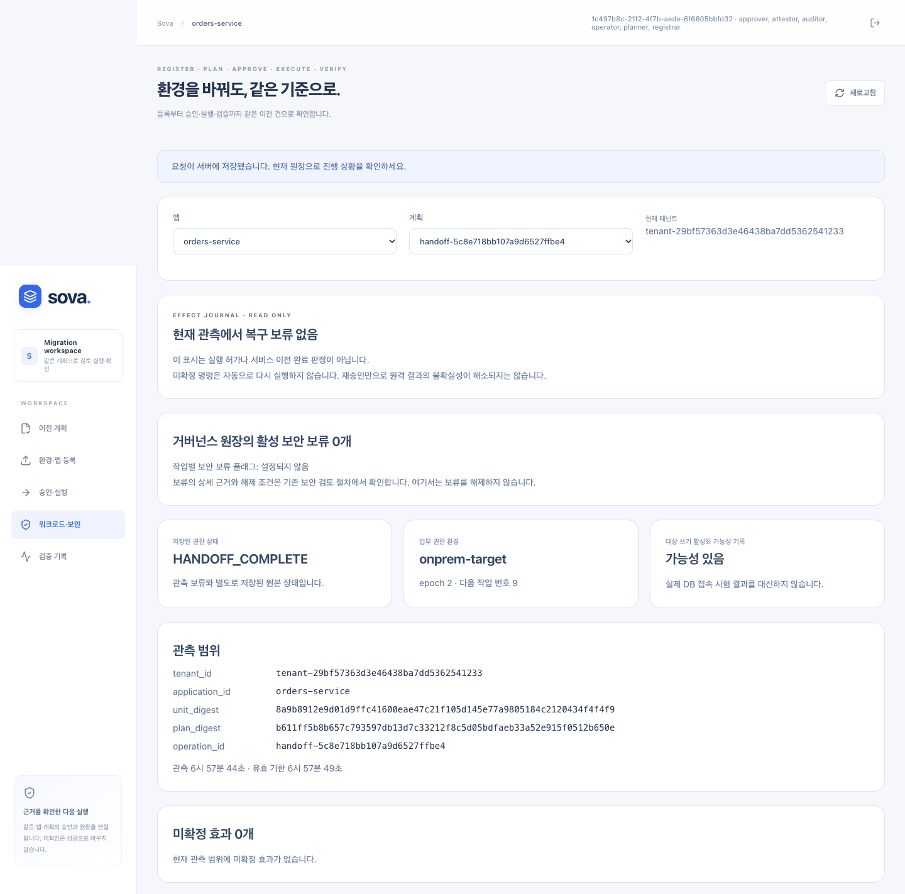

# 등록부터 검증까지 같은 계획으로 실행하기

네이티브 workspace는 `/workspace/`에서 기존 제어면 API를 사용한다. 예전 개인 대응 화면을 대체하거나, 그 화면의 고정 운영자 자격을 쓰기 권한으로 확장하지 않는다. 읽기·승인·실행 권한은 로그인한 사용자의 토큰을 서버가 검사해 결정한다.

## 사용자 흐름

1. 조직 IdP에서 본인 계정으로 로그인한다. 환경·앱 등록에서 서비스 계약, 의존성 조사, 양쪽 환경 프로필, 어댑터 능력, 방향별 자격을 등록한다.
2. 신뢰 등록된 검증자의 서명 봉투를 제출한다. 화면은 자격이나 PASS 서명을 생성하지 않는다.
3. 앱과 입력을 선택해 이전 계획을 생성한다. 같은 앱·계획 선택을 유지한 채 digest, 작업 순서, 검증 의무와 만료 시각을 확인한다.
4. 다른 승인자가 같은 동결 계획을 검토하고 승인한다. 작성자가 승인 역할까지 가지고 있어도 본인 계획의 승인은 서버에서 거부한다.
5. 운영자가 저장된 승인을 선택해 실행을 접수한다. 확인 창은 앱·계획·digest를 고정한다. 서버가 현재 입력, 승인과 보안 보류를 다시 확인한다.
6. 기존 워커가 접수된 원장의 작업을 소비한다. 워크로드·보안 메뉴는 같은 계획의 권한 상태, 미확정 효과와 활성 보안 보류를 조회한다. 접수 응답이나 화면 표시를 실행 완료 판정으로 사용하지 않는다.
7. 대상 활성화 뒤 안정화가 끝나기 전에 복귀가 필요하면, 복귀 검토를 요청하고 역방향 자격으로 별도 계획을 만든다. 다시 독립 승인·접수한 뒤 대상에서 새로 생긴 데이터를 포함해 복귀한다. 완료된 원래 계획을 되살리거나 원래 승인을 복귀에 재사용하지 않는다.

등록·계획 목록은 한 번에 20건씩 읽으며 다음 페이지를 명시적으로 불러온다. 승인 조회는 최근 20건으로 제한되므로, 승인 이력이 더 많은 운영 사례는 추가 페이지 인수가 필요하다. 목록 조회와 실제 작업 권한 검사는 서로 다르다.

## 인증·배포 연결

기존 `sova-service serve-api` 설정에 다음을 명시하면 정적 workspace를 함께 제공한다.

| 설정 | 내용 |
|---|---|
| `SOVA_CONSOLE_ROOT` | 직접 빌드한 `console/dist`의 절대 경로 |
| `SOVA_CONSOLE_ORIGIN` | 실제 고정 HTTPS origin. 로컬 시험만 리터럴 `http://127.0.0.1:포트` 허용 |
| `SOVA_CONSOLE_CLIENT_ID` | IdP에 등록한 public SPA client |
| `SOVA_CONSOLE_TENANT` | 이 workspace의 테넌트 ID |
| 기존 `SOVA_OIDC_*` | issuer, JWKS, audience와 서버에서 검사할 tenant·role claim |

IdP는 Authorization Code, PKCE S256, 정확한 `/workspace/callback` URI와 origin만 허용한다. implicit flow와 SPA의 password grant를 사용하지 않는다. client secret은 브라우저에 넣지 않는다. 외부 issuer와 JWKS는 HTTPS가 필요하며, 로컬 issuer를 쓴다는 이유로 다른 네트워크 호스트의 평문 JWKS를 허용하지 않는다.

공식 `oidc-client-ts` 3.5.0을 사용한다. access/ID token은 메모리에만 보관하고 OAuth state·PKCE 처리 중 상태만 sessionStorage에 둔다. callback의 code·state는 처리 뒤 주소에서 제거한다. 로그아웃은 이 앱의 메모리 세션을 종료한다. IdP 전체 세션 회수나 즉시 권한 회수까지 보장하는 전역 로그아웃은 아니다. 새 로그인에는 `prompt=login`을 사용한다.

정적 자산은 정확한 Host, CSP, no-store 정책을 적용한다. 자산을 읽는 것만으로 API 권한을 얻지 않는다. API는 JSON 파싱 전 스트리밍 본문에도 1 MiB/15초 상한을 적용한다. 토큰·본문·callback query를 access log에 남기지 않는다. JWT 키는 알려진 kid도 60초 캐시 기한 뒤 재조회한다. JWT 만료·역할 회수·MFA 정책은 실제 조직 IdP 설정과 별도로 인수해야 한다.

## 2026-11-19 실제 검증

기준 코드: `836f1caf7a1eaea9fb428bb6a9230cd9fc12c318`.

| 사례 | 실제로 검증한 범위 |
|---|---|
| 정상 이전 | 브라우저 두 계정의 실제 PKCE 로그인, 화면 등록·계획·승인·접수, 폴링 워커 프로세스, 실제 PostgreSQL 복사·신규 쓰기·HTTP 대조, 같은 계획의 완료 표시 |
| 워커 사망·보류 | 복사 커밋 뒤 실제 SIGKILL, 실제 원장의 보안 보류 1건, 후속 프로세스의 재실행 차단, source 쓰기 거부와 화면의 미확정 표시 |
| 별도 승인 복귀 | 안정화 전 의도한 시험 결함, 브라우저의 복귀 검토·역방향 계획·새 승인·접수, 별도 워커 프로세스, 목적지 신규 데이터와 복귀 후 신규 쓰기 보존 |

세 사례 모두 로그인 토큰 주입이나 localStorage 토큰 보관 없이 실행했다. 자기 승인 요청은 실제 발급 토큰으로 서버에서도 403을 확인했다. 데스크톱·모바일 화면, JUnit 결과와 원본 해시는 [검증 요약](evidence/workspace-user-journey-20261119.json)에 연결한다.

**위 화면은 로컬 통합 검증이다.** Keycloak·API·DB·HTTP 요청과 워커 프로세스는 실제로 실행했다. 등록된 출발지·목적지 인벤토리, 자격·신뢰 부트스트랩, change-feed와 공유 파일 경로는 시험 fixture다. `aws-source`·`onprem-target`라는 프로필 이름은 이 시험에서 물리적 AWS·VM 배포를 뜻하지 않는다. 실제 AWS→VM 경로, 운영 verifier·수집기와 조직 SSO 인수는 별도다.

쓰기 정지 중 503과 재요청을 관측했으므로 `service_continuity=NOT_QUALIFIED`를 유지한다. 독립 사용자 승인 검증을 독립 운영 검증기 배포나 금융 운영 인증으로 확대하지 않는다. 앞선 시험의 연결 타임아웃·리스 상실은 실패 증거로 보존했으며, 현재 연속 실행 통과를 근거로 그 원인이 해결됐다고 표현하지 않는다.

실행 방법과 최신 남은 항목은 [개발 기록](development/user-journey-six-themes-2026-11-19.md)에 이어 기록한다.
