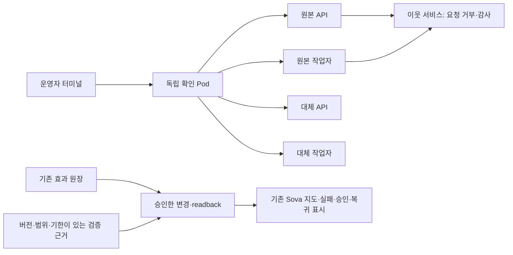

# 실제 워크로드 대응: 지원 범위와 운영 인수

**2026-11-08의 `demo/onprem_response` 무상태 시험 경로**에 대한 기록이다. 이후 `demo/local_response`의 9개 대응 유형과 개인 EKS→로컬 RKE2 경로는 [최신 실행 안내](workload-response-runtime.md)에 별도로 기록한다. 아래의 두 격리 유형·승인·미검증 범위를 이후 실행기 전체에 적용하거나 양쪽 실적을 합산하지 않는다.

이 문서는 전용 시험의 성공과 운영 인수의 차이를 명시한다. 전체 플랫폼의 공격 방어·무중단 이전 완료 보고서가 아니다.

아래는 기존 수동 승인 경로다. 위반 전에 범위를 승인하는 별도 opt-in 경로는 [사전 승인 자동 격리](automatic-containment.md)에 있다. 이 경로도 전용 fixture만 지원하며, 재검증·복귀 승인을 생략하지 않는다.

## 현재 지원하는 전용 시험

같은 온프렘 클러스터에 새로 만든 소유 namespace 세 개에서 다음 자원만 사용한다.

- 원본: 무상태 API·무상태 작업자·독립 이웃 서비스.
- 대체: 동일하게 등록한 이미지·불변 ConfigMap의 API·작업자. 처음에는 실행 수가 0이다.
- 관측: 독립 HTTP 확인 Pod와 고정 시험 요청 경로. Kubernetes 인증 API의 Service proxy를 사용하며 새 공개 주소나 포트포워드는 만들지 않는다.

격리 범위는 `API` 또는 `API + 작업자`다. 현재 실제 요청 주체가 API이므로 이를 제외한 범위는 받지 않는다. DB·큐·파일 저장소·공유 서비스·고객 앱은 이 시험에 포함하지 않는다. 실제 API→작업자 호출을 관측하지 않았으므로 지도에 그 관계를 추정해 그리지 않는다.

선은 등록한 시험 경로다. 애니메이션은 자원·경로 상태의 표시이며 실제 패킷 흐름이나 클라우드 간 물리 이동을 나타내지 않는다.

## 실행과 승인

1. 등록한 이미지·설정·자원 UID를 고정하고 정상 HTTP·발신 연결·기존 스트림의 기준선을 수집한다.
2. 터미널에서 고정 `/protected` 요청을 발생시킨다. 실제 403과 이웃의 독립 감사 기록을 actor Pod UID/IP·소유 Deployment·nonce로 대조한다.
3. 선택한 구성 요소, 이미지 해시, 작업 목록, 기한을 보여 준다. 운영자가 **첫 대응 계획**을 승인한다.
4. 선택한 구성 요소만 수신·발신 차단한다. 동일 이웃 Pod IP로의 발신 TCP 연결 두 번과 독립 Pod에서의 새 수신 연결 거부를 확인한다. 이웃은 별도로 정상 응답해야 한다.
5. 원본 Deployment 실행 수를 UID·resourceVersion 조건으로 0으로 바꾼다. 선택한 원본 Pod 부재와 기존 클라이언트 소켓 닫기·읽기 루프 종료를 확인한다. NetworkPolicy만으로 기존 연결이 종료됐다고 주장하지 않는다.
6. 대체 실행본을 기동한다. 고정 시험 기능으로 실제 검증 실패를 주입한다. 경로는 원본에 유지하며 실패·보류를 표시한다.
7. 별도의 **재검증 계획**을 승인한다. 실패 상태를 해소하고 현재 Pod의 HTTP·이미지·설정을 확인한 뒤 대체 경로로 전환한다.
8. 별도의 **복귀 계획**을 승인한다. 원본을 새 Pod로 기동해 이전 사고 Pod와 UID가 다름을 확인한다. 등록 이미지·불변 설정·실행 imageID·실제 응답을 대조한 후에만 격리 정책을 해제하고 경로를 되돌린다.
9. 사건 보류는 유지한다. 보류 해제는 별도의 보안 승인·재검증 계약이 담당한다. 시험 종료 때 소유 namespace UID 조건으로 정리하고 실제 부재를 확인한다.

세 승인은 서로 다른 계획 해시에 결속한다. 계획이 바뀌면 화면의 동의 체크를 해제한다. 요청 접수·Pod Ready·과거 성공 영수증만으로 현재 검증 성공을 표시하지 않는다.

## 원장과 검증의 경계

변경에는 기존 `EffectExecutor`·`SQLiteEffectJournal`을 사용한다. `IN_FLIGHT`·`UNKNOWN`인 변경은 자동 재실행하지 않는다. 결과 유실·불확실한 변경 뒤에는 다음 변경을 중지하고 기존 복구 절차가 필요하다.

읽기 전용 HTTP 검증은 기존 `EvidenceRecord` 형식의 PASS·FAIL·UNKNOWN 근거로 기록한다. 실패한 검증을 불확실한 외부 변경으로 위장하거나, 원장의 잠금을 지워 재검증을 진행하지 않는다. 실패 원문을 유지하고 새 계획·별도 승인으로 재검증한다. 전환 직전에는 해당 계획의 필수 검증이 모두 PASS이고 유효 기간 안인지 확인한다.

현재 SQLite·개인 세션·HMAC은 소유자 한 명의 전용 시험 경계다. 다중 호스트 운영 승인·기업 인증·금융 규제 준수의 근거로 확대하지 않는다. 운영에서는 기존 T10·PostgreSQL 원장과 신원·잠금·회수 경로를 연결해야 한다.

## 제품 운영 경로로의 인수 기준

본 PR의 자격 시험은 개인 전용 fixture에 한정한다. 실제 고객 앱, 일반 런타임 탐지, 제품 운영 승인과 클라우드 간 이전은 별도의 운영 인수로 확인한다. 이 문서는 특정 운영 환경의 현재 설치·권한·보안 설정을 공개하지 않는다.

| 경로 | 별도로 확인할 조건 |
|---|---|
| 일반 런타임 탐지 | 기존 Falco/Kyverno와 T33 수집기를 재사용한다. 인증된 이벤트, 중복·만료·수집 중단, 정확한 자원 UID/revision을 확인한다. 고정403을 일반 공격 탐지로 사용하지 않는다. |
| 고객 앱 대응 | 실제 앱의 무상태·세션·백그라운드 쓰기 조건과 자원·이미지·경로를 담당자가 등록한다. 기존 T31/T12 실행·복구 경로를 사용한다. |
| 제품 계획·승인 | 기존 T7/T9·T10·T19의 계획·최소 권한·승인·잠금을 사용한다. 개인 시험 승인을 운영 승인으로 대체하지 않는다. |
| 서비스 TLS | 등록된 이름·CA·인증서·기한을 검증한다. hostname 검증을 끄거나 동료 신원을 사용하지 않는다. |

기존 탐지·실행 도구를 재사용하고, 공유 자원에 대한 변경은 담당자와 인수 범위를 합의한다. 실제 환경별 관측 결과·자원 참조·권한 상태는 보호된 인수 기록에서 관리한다.

## 운영 인수 요청에 필요한 항목

- **T33·노드 담당:** 설치할 기존 탐지기의 버전·이미지 digest·아키텍처, 대상 노드, 수집기 SA UID와 webhook Secret 참조, 허용 통신, 보존·회수 방법. 비밀값은 문서나 채팅으로 전달하지 않는다.
- **T10 담당:** 현재 계획의 보호된 참조·프로필, 본인 또는 기존 담당자가 수행할 조회·승인 범위, 서버 간 호출 신원과 폐기 방법.
- **T31/T12·앱 담당:** 현재 앱·이미지·자원 revision, 선택 가능한 격리 집합, 서비스 영향·연결 종료 조건, 실행 가능한 시간과 복구 책임자.
- **함께 확인할 시험:** 실제 이벤트의 중복·만료·다른 앱 UID 거부, 승인 회수 후 변경 0회, 수집 중단 표시, 일부 변경 결과 유실 시 자동 재실행 차단, 관측·감사·실제 자원 readback 일치.

운영 담당자의 합의 전에는 해당 변경을 보류한다. 전용 시험 코드는 독립적으로 검증·공유할 수 있다.

## 실행 위치

- fixture: `demo/onprem_response/expanded_fixture.py`
- 고정 계획·실행 어댑터: `demo/onprem_response/incident.py`
- 현재 상태·과거 영수증을 구분하는 지도: `demo/onprem_response/incident_projection.py`
- 정확한 계획의 개인 승인: `demo/onprem_response/incident_supervisor.py`
- 기존 플랫폼 시험 호스트와의 조합: `demo/onprem_response/incident_host.py`
- 화면: `demo/onprem_response/incident_client.js`
- 터미널: `python -m onprem_response.incident_cli --state <보호된 세션 디렉터리> attempt`

호스트가 등록한 경로·이미지·코드 SHA만 사용한다. 접속 설정은 기존 목적지 직접 API 도구에서 받으며, 키·토큰을 새로 복사해 넣지 않는다. 기본 범위는 API+작업자이며, `--components api` 또는 호스트의 `SOVA_OWNED_TRIAL_COMPONENTS=api`로 단독 격리를 자격 시험할 수 있다. 브라우저 요청으로 대상을 임의 지정하지 않는다.

## 근거

- [Kubernetes NetworkPolicy: 기존 연결에 대한 구현체 차이](https://kubernetes.io/docs/concepts/services-networking/network-policies/)
- [Falco 컨테이너 실행과 호스트 관측 권한](https://falco.org/docs/setup/container/)
- [실제 실행 기록과 완료 체크](development/workload-response-expansion-2026-11-08.md)
