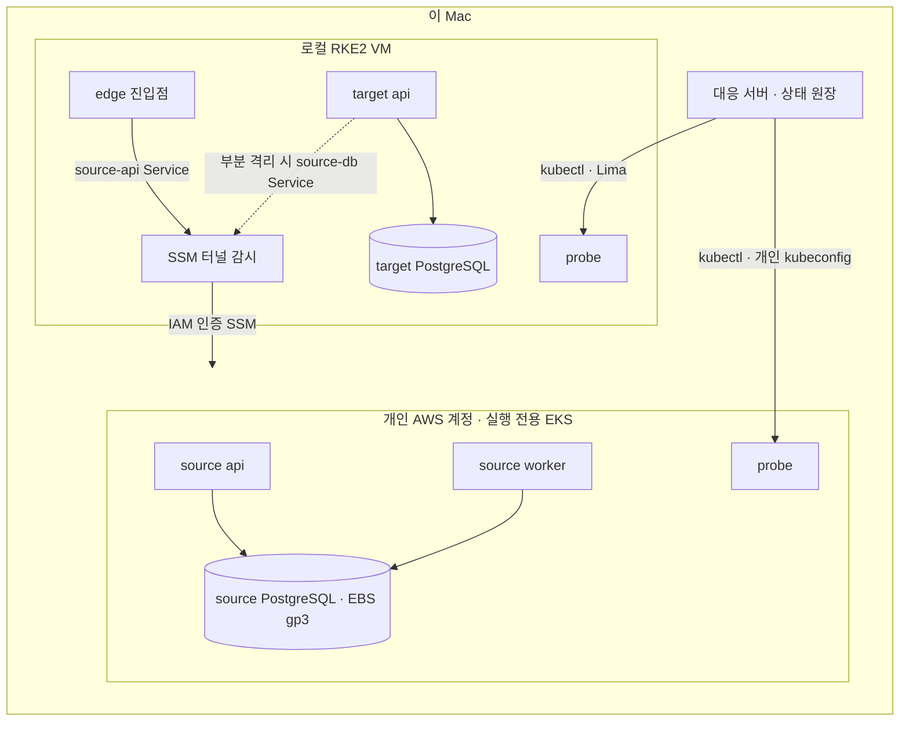

# 워크로드 대응 실제 실행기

워크로드 대응 화면(`demo/response_scenarios`)의 9개 대응 유형을 실제 클러스터에서 실행하는 실행기다. 화면은 단계마다 서버에 정확한 명령을 보내고, 서버는 실행 결과를 실제 Kubernetes·HTTP·PostgreSQL 관측으로 확인한 뒤에만 다음 단계로 넘긴다. 확인하지 못한 효과는 보류(`held`)하고 자동으로 다시 실행하지 않는다.

이 문서의 ‘명세’ ID는 [외부 통합 초안 추적표](spec-traceability.md)의 기준을 뜻한다. 저장소 자체 목표 명세 v2와 절 번호를 혼용하지 않는다. 아래 실측 수치는 과거 실행 요약이며 이번 문서 점검에서 클러스터를 재시험한 결과가 아니다.

## 두 가지 배치

한 프로세스는 상태 폴더의 `settings.private.json`에 적힌 배치 하나만 쓴다.

| 배치 | 출발지 | 목적지 · 진입점 · probe | 용도 |
|---|---|---|---|
| `local` | 이 Mac의 RKE2 (`sova-response-source`) | 같은 RKE2 (`sova-response-target`, `sova-response-control`) | 빠른 로컬 기준선 |
| `hybrid-aws` | 실행 전용 EKS (`sova-hybrid-source`, 같은 클러스터의 probe) | 이 Mac의 RKE2 (`sova-hybrid-target`, `sova-hybrid-control`) | AWS 출발지 → 온프렘 목적지 |

두 배치는 소유자 라벨(`sova.io/owner`), 네임스페이스, StorageClass, PV 이름이 모두 다르다. 같은 로컬 클러스터에 함께 있어도 서로의 자원을 바꾸지 않는다.



## 하이브리드 경로의 경계

- **클러스터를 오가는 경로는 SSM 터널 하나다.** 로컬 Pod는 `source-api`, `source-db` Service로 나간다. 이 Service의 EndpointSlice는 Lima가 Mac 루프백으로 넘기는 `192.168.5.2`를 가리킨다. Mac에서는 `session-manager-plugin`이 SSM 세션을 열고, EKS 노드가 출발지 Service ClusterIP로 전달한다. 출발지에는 공개 LoadBalancer나 공개 DB 포트가 없다.
- **EKS 쪽에서 이 Mac으로 오는 경로는 없다.** `host()`는 출발지에서 목적지로 가는 주소를 만들지 않는다.
- **격리는 규칙만 바꾸고 선택자는 바꾸지 않는다.** 격리할 수 있는 출발지 역할(api, worker)은 공용 `namespace-boundary` 허용에서 처음부터 빠지고, 각자 자기 허용 정책(`allow-api`, `allow-worker`)만 적용받는다. 격리·발신 제한·복구는 이 정책의 규칙만 바꾼다. EKS VPC CNI 1.22의 정책 에이전트는 Pod가 어떤 정책의 선택자에서 빠질 때 그 정책의 허용 항목을 eBPF 맵에 남겼다. 그래서 차단 정책을 적용한 뒤에도 작업자가 새 연결을 받았고, 실행기가 이를 확인하지 못해 보류했다. 선택자를 옮기는 방식은 쓰지 않는다. 예전 방식의 `isolate-*` 정책은 첫 초기화 때 지우고, 초기화가 api·worker를 새 ReplicaSet으로 다시 띄워 남은 맵을 버린다.
- **터널 허용 범위를 좁힌다.** 브리지 트래픽은 노드 주소에서 들어온다. 노드 IP(/32)만 허용한다. api 포트 허용은 `allow-api`의 정상 규칙 안에 있어서 격리하면 함께 빠지고, db 포트 허용은 고정된 `bridge-ingress`에 있다. VPC CNI에서는 Pod도 노드와 같은 서브넷 IP를 받으므로, 서브넷 범위로 허용하면 클러스터 안의 모든 Pod가 허용된다.
- **터널 감시는 허용된 노드로만 연결한다.** 노드가 교체되면 연결할 노드가 없어 터널이 끊기고, 관측이 실패해 보류된다. `python3 -m local_response.hybrid --state "$SOVA_RESPONSE_STATE_ROOT/runtime" --refresh-bridge`로 현재 노드를 다시 허용한다.
- **NetworkPolicy는 실제로 집행된다.** EKS에서는 VPC CNI의 network policy agent가, 로컬에서는 Calico가 집행한다. VPC CNI는 정책을 비동기로 적용하므로 수 초에서 1분 넘게 걸린다. 그래서 격리 뒤에는 실행 중인 Pod가 새 연결을 거부하는 것을 최대 45초까지 다시 확인한다. 복귀 뒤에는 진입점에서 터널을 거쳐 출발지에 닿는지를 최대 150초까지 다시 확인하고 나서 진행한다. 새 api Pod에 노드 주소 허용이 반영되기까지 45초를 넘긴 사례가 있었다. 정책을 쓴 것만으로는 집행으로 보지 않는다.
- **충돌과 실패를 구분한다.** Deployment 변경은 `resourceVersion` test가 들어간 JSON Patch로 한다. 상태 갱신으로 test가 실패하면 아무것도 적용되지 않으므로, 다시 읽어 최대 3번 시도한다. exec로 만드는 효과는 자동으로 다시 실행하지 않는다. 보류 기록에는 kubectl 실패 종류(rejected, unauthorized, timeout, connection 등)만 남고 stderr는 남기지 않는다.
- **판정은 각 클러스터 안에서 한다.** 출발지 HTTP·SQL 확인은 EKS 안의 probe가, 목적지·진입점 확인은 로컬 probe가 한다. 데이터 전환은 제어 호스트가 출발지 DB를 읽고 목적지 DB에 쓰는 제한된 stop-and-copy다(2,000행 상한). CDC나 무중단 복제를 주장하지 않는다.
- **이미지는 digest로 고정한다.** EKS는 실행 전용 ECR(태그 변경 불가, 푸시 시 검사)의 digest를 쓰고, 로컬은 containerd에 들여온 digest를 쓴다. 같은 소스(`workload.py` 해시 기록)에서 만든 ARM64 이미지다.
- **자격 증명은 개인 상태에만 둔다.** DB·관리 토큰, kubeconfig, EKS 토큰 캐시는 상태 폴더(0700)의 0600 파일이다. kubeconfig는 정적 토큰 없이 `eks_token`으로 15분짜리 토큰을 받는다.

## 실행 순서

### 기존 검증 환경과 준비 조건

아래는 자원·이미지·DB·네트워크를 변경하는 **기존 전용 환경의 실행 절차**다. 문서 점검 명령이나 새 PC의 무인 설치 안내가 아니다. 다른 사람이 사용하는 클러스터에 그대로 실행하지 않는다.

- 로컬 어댑터(`demo/local_response/kube.py`)는 Lima VM `sova-rke2-target`과 검증한 클러스터 UID `9de35591-57a3-4759-bd73-6340e2de0b61`에 고정돼 있다. 신규 장치는 같은 이름을 만들거나 UID 검사를 바꾸는 방식으로 대체하지 않는다. 별도 등록·환경 준비·재자격이 필요하다.
- 소유 namespace UID, 두 클러스터의 신원, 등록 이미지, 상태 폴더, 승인자 키를 먼저 준비한다. `--local-state`는 이미 초기화한 로컬 배치의 상태다. 저장소 checkout만으로 이 자료가 생기지는 않는다.
- 하이브리드는 승인된 개인 계정·역할·SSM 플러그인·Docker·Terraform·Lima·kubectl이 필요하다. 팀 공용 환경의 접속 설정을 재사용하지 않는다.
- 아래 상태 경로는 모두 **절대 경로**다. Terraform의 backend 상태와 `TF_DATA_DIR`는 서로 다른 위치이며, 현재 작업 디렉터리를 바꿔도 같은 실행 상태를 가리켜야 한다.

### 승인된 환경에서 실행

실행기는 Ed25519와 팀 `sova-security` 계약(고정 소비 버전 0.11.1)을 쓴다. 저장소 루트 README의 설치 절차로 검토한 security source를 먼저 설치한다. 기록된 검증 환경의 cryptography 버전은 50.0.2이며, 임의 환경에 같은 버전만 설치한다고 실행 자격이 이어지지는 않는다. 아래 `python3`는 준비한 전용 가상환경의 인터프리터다. API 서버·터널 감시는 각각 별도 터미널에서 실행하고, 검증 명령을 같은 상태에 동시에 보내지 않는다.

```bash
# 저장소 루트에서, 실제 준비한 절대 경로로 값을 바꾼다.
SOVA_REPO_ROOT="$(pwd -P)"
SOVA_RESPONSE_STATE_ROOT="/absolute/path/to/private/hybrid-response"
SOVA_LOCAL_RESPONSE_STATE="/absolute/path/to/private/local-response/runtime"
export PYTHONPATH="$SOVA_REPO_ROOT/demo${PYTHONPATH:+:$PYTHONPATH}"

# 1. AWS 출발지 (승인된 개인 계정, 실행 전용)
(
  cd "$SOVA_REPO_ROOT/infra/aws-response-source"
  TF_DATA_DIR="$SOVA_RESPONSE_STATE_ROOT/terraform/.terraform" terraform init \
    -backend-config="path=$SOVA_RESPONSE_STATE_ROOT/terraform/terraform.tfstate" || exit 1
  TF_DATA_DIR="$SOVA_RESPONSE_STATE_ROOT/terraform/.terraform" terraform apply \
    -var-file="$SOVA_RESPONSE_STATE_ROOT/terraform/run.auto.tfvars.json"
)
# 2. 이미지 푸시 · 두 클러스터 배포 · DB 초기화
python3 -m local_response.hybrid --state "$SOVA_RESPONSE_STATE_ROOT/runtime" \
  --terraform-state "$SOVA_RESPONSE_STATE_ROOT/terraform/terraform.tfstate" \
  --local-state "$SOVA_LOCAL_RESPONSE_STATE"
# 3. SSM 터널 감시 (별도 터미널, 위 변수·가상환경·PYTHONPATH 동일)
SOVA_SSM_PLUGIN_DIR="/absolute/path/to/session-manager-plugin-directory" \
  python3 -m local_response.bridge --state "$SOVA_RESPONSE_STATE_ROOT/runtime" --hours 8
# 4. 9개 유형 순차 검증 (서버를 띄우기 전, 같은 잠금 사용)
python3 -m local_response.qualify --state "$SOVA_RESPONSE_STATE_ROOT/runtime" \
  --security-drill-keys "/absolute/path/to/approver-directory"
# 5. 화면 서버 (별도 터미널)
python3 -m local_response.server --state "$SOVA_RESPONSE_STATE_ROOT/runtime" --hours 8
# 6. 화면 경로 검증 (서버 실행 중, 사람이 보내는 명령과 동시 실행하지 않음)
python3 -m local_response.http_qualify --state "$SOVA_RESPONSE_STATE_ROOT/runtime" --until "<ISO 시각>"
```

`run.auto.tfvars.json`에는 `account_id`, `operator_arn`, `operator_cidr`(EKS API 공개 접근을 허용할 운영자 /32), `run_id`, `expires_at`을 둔다. 커밋하지 않는다.

`http_qualify`는 브라우저와 같은 경로로 실행한다. 즉 일회용 접속 토큰 교환, 세션 쿠키, CSRF 헤더를 거쳐 `/api/scenario`·`/api/command`·`/api/state`를 호출한다. 일회용 토큰을 쓰므로, 끝나면 사람이 쓸 수 있도록 서버를 다시 띄운다.

## 콘솔과 서버 동작

- 콘솔은 서버의 명령 원장을 그대로 따른다. 모든 명령은 `request_id`(멱등 키)와 현재 `revision`(낙관적 동시성)을 함께 보낸다. 같은 요청을 다시 보내면 한 번만 실행되고, 오래된 revision은 거부된다(명세 §24.1의 Idempotency-Key, If-Match에 해당).
- 콘솔은 명령을 보내기 직전에 상태를 다시 읽는다. 이전 명령의 실행과 다시 읽기가 끝나지 않았으면 최대 15초 기다렸다가 한 번만 보낸다. 자동 재시도는 하지 않는다.
- `security hold`, `security release`, `exit drill`은 실제 실행기 연결에서만 받는다. 정적 시연 화면은 거부한다.
- 서버는 SIGTERM이나 SIGINT를 받으면 새 명령을 거부한다(`runner_shutting_down`). 실행 중인 명령은 최대 120초 기다려 끝낸 뒤 종료한다. 강제 종료로 끊긴 명령은 다음 시작 때 `held`(효과 불명)로 남고 자동 재실행하지 않는다.
- `demo/response_scenarios/live-browser-check.mjs`는 격리한 headless Chrome으로 실제 실행기에 접속해 다음을 확인한다.
  - 실시간 상태 표시, 일회용 토큰 제거
  - 터미널에서 건 보안 보류의 표시, 보류 중 초기화 거부
  - 별도 승인자 서명으로 해제, 페이지 예외 없음

## 증거

상태 폴더에 남는다. 값이 아닌 판정만 기록한다.

최신 실행기의 `qualification-*.json`, `http-qualification-*.json`, `support-record-*.json`과 WORM 업로드 원본은 비공개 상태에 보관하며 이 저장소에는 포함하지 않았다. 공개 문서로는 코드와 실측 요약을 확인할 수 있으나 원본 서명·전체 실행을 독립 재검증할 수는 없다. 공개된 `docs/evidence/*20261108.json`은 이전 무상태 시험의 요약이며 최신 9개 실행기의 원본을 대신하지 않는다. 외부 인수에는 비밀을 제외한 서명 봉투·공개 신뢰 anchor·producer·관측 시간·범위·검증 결과를 별도로 준비해야 한다.

- `qualification-*.json`: 실행 커밋, 실행기 파일 해시, 두 클러스터 UID, 유형별 검사 결과
- `http-qualification-*.json`: 화면 경로 반복 실행 결과(주기·유형·소요 시간·검사)
- `bridge-status.json`: 터널별 노드·재시작 횟수·수신 여부
- `latest-evidence.json`: 마지막 실행 직후의 상태와 관측
- `evidence/*.json`: 단계별 서명 증거 봉투. `evidence-trust.json`은 검증용 공개키와 유효기간이다. 개인키 `evidence-signing.private.json`은 공유하지 않는다.
- `support-record-*.json`: 서명된 자격 기록
- `security-hold.json`, `releases/*.json`: 활성 보류의 승인 대상 revisions와 별도 승인자가 서명한 해제 승인. `security-approvers.json`은 등록된 승인자 공개키다.

## 자격 회수의 실효

자격 회전은 새 로그인 거부만으로 회수 완료로 보지 않는다. PostgreSQL은 비밀번호를 바꿔도 이미 인증한 세션을 끊지 않는다. 회전 전에, 회전 때 재시작하지 않는 이웃 Pod(`objects`)에서 현재 자격으로 앱 세션을 열고 계속 쿼리하게 둔다. 회전은 비밀번호 변경과 함께 앱 계정의 기존 세션을 모두 종료한다.

다음 세 가지를 따로 검사한다(명세 S.4).

- 그 세션이 서버 쪽에서 실제로 끊겼는지(`pre_rotation_session_terminated`)
- 이전 자격의 새 로그인이 거부되는지(`previous_credential_rejected`)
- 새 자격이 동작하는지

앱 수준 토큰이나 외부 API 세션의 회수는 이 시험 범위가 아니다.

## 서명된 증거와 완료 게이트

검증할 때마다 결과를 팀 `sova-security`의 증거 봉투(`EvidenceRecord`, Ed25519)로 서명한다. 결속하는 값은 다음과 같다.

- 승인된 계획 digest(`configuration`)
- 관측된 환경(`environment`): 두 클러스터 UID, 소유 namespace UID, 실행 중인 Pod UID와 imageID
- 실행기 코드(`source`)
- 유형별 검증 계약(`policy`)
- run, 단계, 5분 유효기간

FAIL도 서명해 남긴다.

`response finalize`는 최종 효과 직전에 다시 읽어 새 봉투를 만든다. verify 때의 봉투와 이번 봉투가 모두 아래 조건을 충족할 때만 진행한다.

1. 서명이 검증된다.
2. 만료되지 않았다.
3. 같은 계획에 결속돼 있다.
4. 결속된 환경이 지금 관측한 환경과 같다.
5. 실행기 코드가 같다.

하나라도 어긋나면 `signed_evidence_rejected`로 보류한다. 위조, 다른 run의 영수증, 만료, 드리프트, 코드 변경, FAIL 결과를 거부하는지는 단위 시험으로 고정했다. 실행기 코드 digest는 실행 중인 프로세스가 불러온 코드 기준이다.

서명 키는 이 Mac의 실행기 상태 폴더(0600)에 있고 실행기 자신이 서명한다. 관측의 출처와 이후 변조는 확인할 수 있지만, 독립 검증기 신원이나 KMS에 보관한 키는 아니다.

## 보안 보류(SECURITY_HOLD)

실행기의 `held`(효과 불명 보류, SAFE_HOLD)와 별개다. 콘솔 운영자가 `security hold <사유>`로 건다. 보류 중에는 초기화를 포함한 모든 효과 명령과 유형 선택을 거부한다. 초기화는 writer를 다시 열기 때문이다. 보류는 상태 원장에 있어 실행기를 다시 시작해도 유지된다.

해제는 팀 `sova-security`의 `HoldRelease` 계약을 따른다.

- 등록된 별도 승인자가 자기 Ed25519 키로 서명한다(`security_approver approve`). 개인키는 실행기 상태 밖에 둔다.
- 승인자는 보류를 건 운영자와도, 해제 요청자와도 달라야 한다. 콘솔 운영자는 승인자로 등록할 수 없다.
- 승인은 보류 ID, 범위, 현재 revisions(실행기 코드, 계획, 보류 문서, 관측 환경)에 결속되고 15분 안에 써야 한다. 그 사이 환경이 바뀌면 무효다.
- 해제 뒤에는 이전 승인과 서명 증거를 재사용하지 않는다. 승인 전 계획은 다시 계획하고, 승인된 대응은 다시 검증한다.

```bash
# 승인자(운영자가 아닌 사람)의 키. 실행기 상태 밖에 둔다.
python3 -m local_response.security_approver init --key-dir "/absolute/path/to/approver-directory" --approver recovery-approver
python3 -m local_response.security_approver register --state "$SOVA_RESPONSE_STATE_ROOT/runtime" --approver recovery-approver --public-key "<init가 출력한 공개키 hex>"
# 콘솔: security hold suspected-compromise
python3 -m local_response.security_approver approve --state "$SOVA_RESPONSE_STATE_ROOT/runtime" --key-dir "/absolute/path/to/approver-directory" --approver recovery-approver --reason contained-and-rotated
# 콘솔: security release <승인ID>
```

`qualify --security-drill-keys <승인자 폴더>`는 9개 유형 뒤에 같은 절차를 실제 실행기에서 확인한다. 순서는 보류, 효과 명령 3개 거부 확인, 별도 승인자 서명, 해제다.

키는 신원을 결속할 뿐 사람의 존재나 로그인을 증명하지 않는다. 승인자 등록은 소유자 작업이고, 별도 관리 승인 절차는 아직 없다.

## 패치 후 재스캔

배포가 성공했다고 취약점이 해소된 것은 아니다(명세 P-G5, P-AT-04). 패치 유형은 배포 전에 지금 실행 중인 출발지 api 이미지 digest의 레지스트리 스캔 결과를 기록한다. 배포 뒤에는 새 digest의 스캔 결과를 다시 읽어 각 항목을 해소, 잔존, 신규로 나눈다.

- 하이브리드(ECR 푸시 시 스캔):
  - 배포된 digest의 스캔이 완료되지 않았으면 `deployed_image_rescanned`가 실패한다.
  - 패치가 새 항목을 만들면 `no_findings_introduced_by_patch`가 실패한다.
  - 잔존 항목은 해소로 표시하지 않고 `NOT_RESOLVED` 잔여 위험으로 남긴다.
- 로컬 배치에는 레지스트리 스캔이 없다. `NOT_RUN`으로 남기고 PASS로 바꾸지 않는다.

이번 실행 전용 ECR에서 v1과 v2는 같은 기반 이미지를 써서 같은 81개 항목이 나왔다(CRITICAL 8, HIGH 32 등). 그래서 패치 유형의 결과는 다음과 같다.

- 통제된 앱 결함(`legacy_feature`): RESOLVED
- 이미지 취약점: 0개 해소, 81개 잔존(NOT_RESOLVED)

기반 이미지 교체는 이 패치의 범위가 아니다.

## 출발지 독립 시험

데이터 전환을 마친 뒤 `exit drill`(콘솔 명령, 한 번)은 목적지가 출발지 없이 운영되는지 확인한다(명세 §20, AT-35). 순서는 다음과 같다.

1. 하이브리드에서는 목적지와 진입점의 유일한 출발지 경로(`bridge-egress`)를 거둔다. 그리고 목적지 Pod에서 출발지 DB 터널이 실제로 막혔는지 확인한다.
2. 목적지 api를 새 인스턴스로 다시 띄운다.
3. 새 인스턴스가 업무 쓰기를 닫은 상태로 시작하는지 진입점의 쓰기 거부로 확인한다(§15.6, AT-32).
4. 단일 writer를 다시 확인한다. 목적지 앱 로그인은 열려 있고 출발지 앱 로그인은 닫혀 있어야 한다. 확인한 뒤에만 쓰기를 연다.
5. 진입점으로 새 쓰기를 넣고 목적지 DB에서 읽어 확인한다.
6. 거둔 경로를 복원한다.

하이브리드 결과는 `COMPUTE_INDEPENDENT`, `DATA_IDENTITY_INDEPENDENT`, `RESTART_VERIFIED`로 기록한다. 로컬 배치는 출발지 경로가 따로 없어 `RESTART_VERIFIED`만 기록한다. 백업, 복원, 신규 배포까지 포함한 `OPERATIONS_VERIFIED`, 사업자 탈출(`PROVIDER_EXIT_VERIFIED`)은 범위가 아니다.

## 자격 기록과 지원 선언

9개 유형을 모두 통과한 실행에서만 자격 기록(`support-record-*.json`, 명세 §28.4)을 만든다. 기록에 들어가는 항목은 다음과 같다.

- **방향과 실행기:** 출발지와 목적지 프로필, 방향, 실행기 커밋과 코드 digest
  - 출발지와 목적지 프로필: Kubernetes, CNI와 정책 엔진 이미지, 노드 아키텍처·인스턴스·OS, 저장소
- **결과:** 유형별 검사 이름과 서명 증거 지문
- **범위:** 시험한 한계, 제외 범위, 만료(7일), 무효화 조건

기록도 실행기 키로 서명한다. 문서 커밋이나 후속 merge가 검증 producer를 대체하지 않는다. 기존 기록의 유효성은 현재 코드·프로필·만료를 실제로 다시 대조해야 한다.

지원 선언(`SUPPORTED`)은 이 기록으로만 한다. 다음 경우에는 `NEEDS_EVIDENCE` 또는 `UNSUPPORTED`로 이유와 함께 표시한다(명세 AT-02, AT-03).

- 방향이 정확히 같지 않다. 역방향과 failback은 자격이 없다.
- 지금 관측한 프로필이 다르다. CNI나 Kubernetes를 업그레이드하면 재검증해야 한다.
- 만료됐다.
- 실행기 코드가 바뀌었다.

```bash
python3 -m local_response.support --state "$SOVA_RESPONSE_STATE_ROOT/runtime" --report "$SOVA_RESPONSE_STATE_ROOT/runtime/qualification-<id>.json"
```

## 감사 보존(WORM)

실행기의 원장(SQLite)과 증거 파일은 이 Mac에 있어 같은 권한이면 지울 수 있다. 감사 보존은 실행기와 분리한 두 가지로 한다(명세 §23.4, SEC-07, AT-37).

- `infra/aws-response-audit`: Object Lock(GOVERNANCE, 기본 1일) 버킷과 `audit-writer` 역할.
  - 버킷은 버전 관리, 암호화, 공개 차단을 쓰고 TLS 연결만 받는다.
  - 쓰기 역할은 올리기, 읽기, 버전 삭제 시도만 할 수 있다. 보존 단축, 잠금 우회, 버킷 잠금·버전 관리·정책 변경은 명시적으로 거부한다.
  - IAM 역할과 버킷을 새로 만들므로 소유자 승인 뒤에만 적용한다. 2026-11-12 소유자 승인 뒤 적용했다.
  - 2026-11-12 적용 결과: 하이브리드 증거 194개, 로컬 증거 217개를 올렸다. 개인키, 토큰, 설정처럼 보이는 키는 0개였다.
  - 쓰기 역할로 WORM 검사(`worm`)를 실행했다. 잠긴 버전 삭제와 보존 단축은 AccessDenied로 거부됐고, 버전 없는 삭제는 삭제 표식만 만들었으며, 원본 버전은 SHA-256까지 그대로였다. 검사가 만든 삭제 표식은 소유자가 지웠다.
- `demo/audit_shipper`
  - `ship`은 허용 목록의 증거만 쓰기 역할로 올린다. 대상은 서명 봉투, 자격 기록, 검증 보고서, 해제 승인, 원장 JSONL(읽기 전용 추출)이다.
  - 개인키, kubeconfig, 토큰, 설정, 회전 자료, 콘솔 접속 링크, SQLite 파일은 패턴에 맞아도 거부한다.
  - 올린 뒤 SHA-256 체크섬과 잠금 보존을 확인하고 버전 영수증을 남긴다.
  - `worm`은 쓰기 역할로 다음을 실제로 시도한다. AWS가 AccessDenied로 거부할 때만 통과로 본다.
    - 잠긴 버전 삭제
    - 보존 단축
    - 버전 없는 삭제. 삭제 표식만 생기는지 본다.
    - 원본 버전 다시 읽기

```bash
# 위 실행 절의 가상환경·PYTHONPATH·절대 상태 경로를 그대로 사용한다.
(
  cd "$SOVA_REPO_ROOT/infra/aws-response-audit"   # 승인 뒤
  TF_DATA_DIR="$SOVA_RESPONSE_STATE_ROOT/audit/.terraform" terraform init \
    -backend-config="path=$SOVA_RESPONSE_STATE_ROOT/audit/terraform.tfstate" || exit 1
  TF_DATA_DIR="$SOVA_RESPONSE_STATE_ROOT/audit/.terraform" terraform apply \
    -var-file="/absolute/path/to/approved-audit-vars.json"
)
python3 -m audit_shipper.ship --state "$SOVA_RESPONSE_STATE_ROOT/runtime" --bucket "<audit_bucket>" --writer-role-arn "<audit_writer_role_arn>" --prefix hybrid-aws/runtime
python3 -m audit_shipper.worm --state "$SOVA_RESPONSE_STATE_ROOT/runtime" --bucket "<audit_bucket>" --writer-role-arn "<audit_writer_role_arn>"
```

기본 보존 1일은 시험 당시의 조건이다. 과거 거부 시험은 현재 버전의 잔여 보존 기간·장기 보존·COMPLIANCE 모드 인수를 증명하지 않는다.

## 비용과 정리

하이브리드 출발지는 시간당 약 0.20달러다. 2026-11-12 AWS Price List API의 서울 리전 온디맨드 단가 기준이다.

| 항목 | 단가 | 시간당 |
|---|---|---|
| EKS 클러스터 | 0.10달러/시간 | 0.100 |
| t4g.medium 2대 | 0.0416달러/시간 | 0.083 |
| 노드 공개 IPv4 2개 | 0.005달러/시간 | 0.010 |
| EBS gp3 41GB(노드 20GB 2개, DB 1GB) | 0.0912달러/GB-월 | 0.005 |

제어 평면 로그(3일 보관), ECR 저장, 데이터 전송은 이번 실행에서 미미했으나 측정값은 아니다. 실제 청구는 Cost Explorer로 하루 뒤 확인한다. NAT 게이트웨이는 쓰지 않는다. 노드는 공개 서브넷에 있지만, 들어오는 트래픽은 EKS가 관리하는 클러스터 보안 그룹만 허용한다. 모든 자원에 `component=sova-response-hybrid-source`, `RunId`, `ExpiresAt` 태그가 붙는다. EBS CSI가 동적으로 만드는 DB 볼륨은 Terraform 기본 태그가 닿지 않으므로, EBS CSI 애드온의 `extraVolumeTags`로 같은 태그를 붙인다.

정리 순서:

1. 서버와 터널 감시를 멈춘다.
2. `terraform destroy`를 실행한다. ECR 저장소는 `force_delete`로 함께 지워진다. EBS 볼륨은 StorageClass `Delete`라서 PVC와 함께 지워진다. 다만 PVC보다 클러스터가 먼저 지워지면 볼륨이 남을 수 있다. 그래서 destroy 전에 소유 namespace의 UID와 등록 자원을 대조해 정리한다. 이후 잔존 볼륨은 읽기 전용으로 찾고 AWS 계정·Terraform 상태·실행 등록의 자원 ID·소유권을 함께 확인한 뒤 별도 정리한다. `RunId` 태그나 이름 접두사만으로 삭제하지 않는다.
3. 로컬의 `sova-hybrid-*` 네임스페이스와 PV는 데이터 보존을 위해 자동으로 지우지 않는다.

## 범위 밖

운영 환경, 팀 공용 AWS 계정, 모의해킹 검증은 이 실행기의 범위가 아니다. EKS 관리형 노드 그룹이나 IAM 연동 같은 관리형 기능도 클러스터 생성 이상으로는 검증하지 않는다. 통과 기록은 위 배치와 경로에 대한 것이다.
